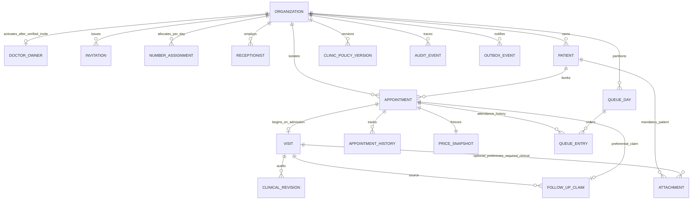
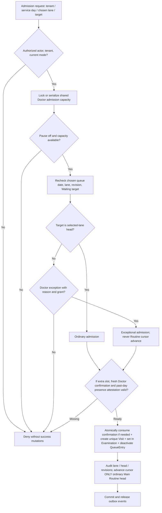

# CarePulse — Domain Model & State Machines

**Document ID:** CP-DOM-001  
**Version / status:** 1.2 — APPROVED DESIGN BASELINE (Product Owner, 19 October 2026)  
**Product baseline:** `CarePulse_PRD_v1_APPROVED.md`, Product Owner approved 19 October 2026  
**Prepared:** 19 October 2026  
**Approved:** Product Owner, 19 October 2026 (explicit confirmation in project conversation)  
**Correction basis:** Previously addressed findings F-01–F-14 and Patient Archive/Booking race; targeted re-review findings R-01–R-05. Changes are limited to this Domain specification; approved PRD unchanged.  
**Purpose:** Phase 1 of the post-PRD handoff. This document specifies a technology-neutral conceptual domain, state transitions, invariants, transaction boundaries and test obligations. It does **not** authorize implementation or alter the approved PRD. **v1.2 was approved by the Product Owner on 19 October 2026.** This approval records acceptance of the conceptual design baseline; it does not claim an independent technical review or executable test evidence.

> **Authority key:** **[B]** binding rule taken from the approved PRD; **[D]** proposed *technical design* for a later architecture/implementation review (not a new product requirement); **[G]** residual specification gap or explicit future release gate. Every domain behavior below must yield to the approved PRD if a shorthand interpretation differs.

## 1. Scope, source and separation of responsibilities

This design covers patient identity, one-Doctor/one-branch clinic identity, limited platform provisioning, appointment and Visit lifecycle, independent Emergency/main waiting lanes, Doctor admission capacity and Pause, follow-up entitlement, immutable service-value snapshots, work schedules and booking slots, files/audit/outbox, operational reconciliation and bulk rescheduling. It does **not** implement future SaaS plans, patient payments, patient portal, bulk cancellation, e-prescription authoring, additional Doctors/branches or multi-currency/timezone operation. [B: PRD §§1–4, §§5–7, §11]

**Execution environment note (2026-10-21; non-domain):** The Product Owner's workstation has no Docker and cannot install it. Required database, concurrency, and container integration proofs must therefore run in a Docker-capable CI environment, without reducing the invariants or acceptance tests defined here. No local Compose execution may be assumed or required.

| Level | Owns | Does NOT own |
|---|---|---|
| Approved product PRD | Actors, allowed flows, service policies, business rules, acceptance outcomes | SQL tables, queue mechanism, APIs, deployment topology |
| This approved domain baseline | Entity boundaries, invariants, state machines, command pre/postconditions, race-handling approach | Product scope change, final DB/technology decision, legal retention values |
| Upcoming Security / Data Governance | Explicit field access lists, MIME/size limits, encryption/key design, retention, session numerics | Additional clinic features without approval |
| Upcoming Architecture + API contracts | Storage, transactional isolation, events, wire errors, scaling, deployment | Silent alteration of PRD rules |

**Global context [B]:** all clinical tenant data are scoped by immutable `organization_id`; one Doctor=Owner per **activated** Organization (provisioning tenant may await invitation acceptance), one physical branch, default EGP and `Africa/Cairo` fixed in MVP. Platform provisioning operators may access limited nonclinical tenant metadata, never patient, Visit or clinical attachments. Patients do not log in. [FR-001/002/065/072/094/100–102; BR-044/045]

## 2. Bounded contexts and aggregate ownership

| Context | Aggregate root(s) | Responsibilities | Cross-context rule |
|---|---|---|---|
| Tenant Provisioning | Organization; Invitation | Restricted operator bootstrap; initial owner invitation/activation; suspend/reactivate tenant; expiry/reissue/revoke invitation | Non-active tenants deny clinical use; operator has metadata-only access [FR-100–102; AC-39/40] |
| Identity & Access | StaffAccount; Session | Doctor/Owner and Receptionist, roles/flags, recovery, revocation | Admission and mutations verify **live** grants, not stale UI [FR-003/071/075] |
| Patient Registry | Patient | Stable ID, age/reference date or DOB, family phone lookup, archive/unarchive | No phone/name unique identity and no merge [FR-006/090; BR-029/037/038] |
| Clinic Configuration | ClinicPolicy / PolicyVersion | Pricing, working periods/breaks, exact-time config, queue policy, capacity/Pause, cutoff | Existing frozen prices/confirmed entitlements remain immutable [BR-024/025/032–034] |
| Booking | Appointment | Service date/number, status, type/tier, frozen monetary snapshot, history, individual/bulk reschedule | Counted patient/day uniqueness and atomic replacements [FR-061; BR-003–006] |
| Queue & Admission | QueueDay / QueueEntry; AdmissionConfirmation | Service-day lane ranks, routine missed-turn cursor, Doctor shared capacity and Pause | Two independent lane heads; admission serializes shared capacity [BR-011c/047/048] |
| Clinical Encounter | Visit | Doctor-authored content and corrections; preliminary uploads; completion | Created exactly once **on admission**, retained after exceptional cancel [BR-001/005/007] |
| Preferential Follow-up | FollowUpClaim / PolicyEvidence | Eligible source exam; one active and one completed claim; frozen authorization | Enforced transactionally across appointments [BR-002a/b/c] |
| Clinical Files & Export | Attachment; ExportRecord | Tenant-private scans/reports, permission-aware download, one-patient export | Storage key is never sufficient authorization [BR-039–041] |
| Audit, Notifications & Reporting | AuditEvent; OutboxEvent; MetricDefinition | Immutable evidence, post-commit event publishing, value vs activity metrics | No outbound patient messages or billing assumptions [BR-023/030/042] |

**[D] Aggregate boundaries are conceptual.** They may become tables in one transactional store or modules, but do not imply microservices. Commit-critical booking, claims, queue, Visit and outbox mutations require a consistent transactional boundary.

## 3. Conceptual entity catalogue

**Cardinality notation:** `1 → N` means a single left-side parent may own many right-side records; optional relations are specified explicitly. All clinical child entities carry or inherit `organization_id` and must be checked under its parent. Suggested property names are **[D]**, not approved database names.

| Entity / relation | Conceptual data (design fields, not schema approval) | Required invariant / source |
|---|---|---|
| Organization `0..1 active Doctor/Owner until activated; exactly 1 when ACTIVE` | `id`, `PROVISIONING/ACTIVE/SUSPENDED` (conceptual administrative lifecycle), one branch, Cairo timezone, EGP currency, operator evidence | First-owner invitation can precede activation; only activated tenant has verified working Doctor/Owner [FR-001/002/100–102; AC-39/40] |
| Provisioning Invitation `N→1` Organization | opaque single-use token digest, invited email, expiry, purpose, `ISSUED/ACCEPTED/REVOKED` + derived EXPIRED, creator/acceptance evidence | Verified acceptance creates/activates **the** first owner once; stale/replayed/revoked links deny; controlled replacement is audited [AC-39/40] |
| StaffAccount `N→1` Organization | identity, active role `DOCTOR_OWNER` or `RECEPTIONIST`, `bulk_reschedule` grant, revoked/version | One Doctor Owner; Receptionist no clinical authoring; permission check at every request [FR-003/071] |
| Patient `N→1` Organization | stable ID, names, DOB **or** declared age plus reference date, `raw_phone`, `normalized_phone`, archived flag | Same phone/name may match several patients, no merge/delete; archive blocks new booking [BR-029/037/038] |
| Appointment `N→1` Patient | ID, tenant, Doctor, `service_date`, status, `service_type`, tier/lane, booked sequence, optional exact interval, snapshots, revision | No Visit merely from booking; counted patient/day unique; preliminary number comes from tenant/day allocation ledger shared by both lanes [BR-001/003/010; FR-020/061] |
| AppointmentHistory `N→1` Appointment | actor/reason/time, from/to, former/new day/sequence, replacement link, before/after references | Immutable-in-history; terminal originals preserved [FR-012; BR-005/006] |
| PriceSnapshot `1→1` Appointment | EGP base, discount type/value/reason, net, free flag, pricing provenance/version, rounding rule | Freeze on confirmation; Urgent net/base > standard base at creation [BR-024/024a/025] |
| QueueDay `N→1` Organization | `service_date`, `lane=MAIN/EMERGENCY`, revision, effective policy version, Routine cursor | Ordering isolated by date and lane; Emergency never advances Routine cursor [BR-011/048] |
| QueueEntry `0..1 active→1` Appointment | arrival sequence, check-in/presence timestamps, lane/date, active/closed disposition, manual rank evidence | Only Waiting has an active position; new-day reschedule closes old entry [BR-009/010] |
| Visit `0..1→1` Appointment | Doctor, admitted-at, clinical content, completion/cancellation association, revision | Exactly one created on successful admission; retained after Doctor exception [BR-001/005/007] |
| ClinicalRevision `N→1` Visit | change kind, actor, before/after, timestamp, reason when required | Immutable before/after for post-terminal Doctor corrections [FR-033a/074] |
| FollowUpClaim `0..1→1` preferential Appointment | original Completed New Exam/Visit, approved deadline, policy version, Doctor decision, appointment link | One active claim per source; max one Completed ever; terminal cancellation/no-show releases [BR-002a–c] |
| ClinicPolicyVersion `N→1` Organization | working periods, holidays/breaks, booking style, queue policy/depth, prices/capacity, effective date | Schedule conflicts previewed; Routine queue policy next day [BR-033/034/062] |
| DoctorAdmissionConfirmation `N→1` target Appointment | `organization_id`, issuer Doctor, Doctor identity, target Patient/Appointment, chosen lane + original service day, issued/expires-at, captured queue/appointment/capacity-policy revisions, `ISSUED/CONSUMED/REVOKED` plus derived expired, consumption ID/time | One-use scoped approval **per additional admission above one**; live recheck before consumption; no blanket capacity grant [FR-023; BR-013/014; AC-26] |
| DayReview `N→1` Organization/date | optional staff close/reconcile intent, actor/time, audit and no-Waiting check | Does not change Appointment status; in-exam may continue [FR-092; BR-049] |
| Attachment `N→1` Patient AND optionally Visit depending on classification | tenant, mandatory Patient ID, nullable Visit ID for **preliminary** class only; **clinical/handwritten prescription** class requires Visit ID and Patient = Visit.Patient; uploader, classification, blob/scan/access proof | Same tenant and patient/Visit FK invariants, field-grant validation and malware safe-read; no unlinked prescription scan [BR-039/041; AC-29] |
| AuditEvent / OutboxEvent | tenant, actor/role/action/time; event ID/commit state/recipient scope | Append-only audit; publish notifications only **after commit** [BR-030; AC-12] |
| MetricDefinition | metric ID, subject entity, numerator/denominator, count unit, service/event date basis, status/policy filters, replacement and as-of rule | Formula catalogue in §9.5; Completed value = frozen EGP NET only, not cash [FR-048/098; BR-023/042; AC-37] |

**[D] Number assignment:** `PreliminaryNumberLedger` (or equivalent transaction-safe tenant+service-date counter and append-only assignment history) is conceptual infrastructure, not a new product feature. Each newly assigned number is unique for the entire Organization/day across MAIN and EMERGENCY, including cancelled/replaced history; never reuse a previously assigned number on the same day. Cross-day reschedule assigns a fresh destination-day number and retains original history.

**[D] Identity pattern:** all clinical foreign keys should be tenant-qualified (`organization_id`, `entity_id`), and authorization must check actual relation, not merely ID validity. A `Branch` can be a 1:1 value object at MVP rather than an independent multi-branch domain. A separate operator identity must not be equated with a clinic role.

### 3.1 Relationship overview (conceptual)



An `Appointment` may have multiple *historical* queue entries after reschedules but no more than one **active** queue entry. `Visit` is optional until admission, then exactly one for the appointment; no independent Visit reuse across appointments. A Completed New Examination can source at most one Completed preferential claim over time; multiple sequential cancelled/no-show claims may have existed historically.

## 4. Domain invariants and recommended enforcement

| ID | Binding invariant [B] | [D] Enforcement recommendation | Trace |
|---|---|---|---|
| INV-01 | Cross-Organization reads, writes, downloads, exports denied | tenant-qualified FK + authorization + storage/object policy + negative tests | FR-072, AC-01/36 |
| INV-02 | At most one **counted** Appointment per patient/date; counted = Booked, Waiting, In Examination, Completed | transaction-safe conditional/partial unique index or equivalent DB invariant | FR-061, AC-14/16 |
| INV-03 | Terminal Completed/Cancelled/No-show never reopen or reschedule | status transitions guarded in same transaction; no generic arbitrary setter | BR-003/004 |
| INV-04 | Waiting implies exactly one active lane/date QueueEntry and physical attendance | transactional check-in/out; unique active entry per Appointment | FR-018; BR-008/009 |
| INV-05 | No Visit before admission, and at most one Visit per Appointment | unique tenant+appointment on Visit, create with Waiting→In Examination transaction | BR-001, AC-04/17 |
| INV-06 | Emergency and main lane precedence remain independent | lane/date-scoped ranking; head validation inside admission transaction | BR-011c/047 |
| INV-07 | Pause/capacity shared across both lanes | serialized/conditional Doctor admission lock or equivalent invariant check | BR-013–015, AC-17 |
| INV-08 | Only ordinary MAIN/Routine-head admission progresses missed-turn cursor | record admission type/lane/head and advance conditionally | BR-011b/011c |
| INV-09 | Confirmed price snapshot EGP and immutable; Urgent never free; Urgent base/net > standard | server decimal, snapshot atomic with booking; deny invalid settings/bookings | FR-013–015a, BR-024a/025 |
| INV-10 | Qualifying original Completed New Exam → at most one active preferential claim and one Completed consumption | unique active reservation + consumed flag/ledger under lock | BR-002a–c, AC-06 |
| INV-11 | No-show only Booked unarrived; no midnight default | cutoff opt-in + state CAS with check-in; manual verified reason | FR-035/107, BR-027 |
| INV-12 | Waiting cross-day reschedule detaches old queue, becomes Booked with new sequence and requires fresh check-in | one transaction: old entry inactive + Appointment update + new day number | FR-011, BR-006 |
| INV-13 | Cancel Routine Booked/Waiting + create Paid Urgent is one all-or-none operation | single locking transaction and confirmation event | BR-016a, AC-16 |
| INV-14 | Bulk reschedule all selected eligible or none; Bulk CANCEL absent | eligibility preview token/revision, full revalidation in commit | FR-041a, BR-019a/046 |
| INV-15 | Clinical corrections after Completed / exceptional cancel preserve before and after | append-only clinical revisions, field-level Doctor checks | FR-033/033a/074 |
| INV-16 | No pending event delivered on rollback | transactional outbox, asynchronous post-commit delivery | AC-12, §10.3 |
| INV-17 | Overdue lane retains original service_date after Cairo midnight | date-qualified QueueDay, explicit day filter, no auto carry-over | BR-048, AC-42 |
| INV-18 | Archive prevents **new Appointment creation** until unarchive, not processing of a previously confirmed Appointment; export one patient Owner-only | distinguish new-ID creation from valid pre-existing Appointment check-in/admission/reschedule; serialize archive vs booking; scope-limited export | BR-038/040 |
| INV-19 | Operator cannot access clinical tenant data | disjoint operator routes/roles/claims, deny clinical resources by default | FR-100–102, AC-39/40 |
| INV-20 | Authentication and tenant suspension checked live | centralized authz + immediate invalidation for disabled users/tenants | FR-075/101, AC-22/40 |
| INV-21 | Doctor/Owner may book and check-in; Doctor-authorized Emergency intake differs from Receptionist-only Paid Urgent intake | operation-level checks against PRD §3, separate commands; no shared Emergency/Urgent role shortcut | FR-003/021a/021c; BR-016/016a |
| INV-22 | Each extra admission above one requires a fresh Doctor-issued, scoped one-use confirmation | expiry, target/lane/day and live revision checks inside `AdmitPatient` transaction; consume with Visit creation | FR-023/024; BR-013/014; AC-26 |
| INV-23 | All preferential claim releases, including Doctor exceptional In Examination cancellation, commit with terminal cancellation | atomically change claim from active to released with history; preserve original-source consumption invariant | BR-002b/005; AC-06 |
| INV-24 | Exact-Time booking/reschedule respects configurable holiday/non-working-day booking toggle, valid date-specific operating period, breaks, and overlap/capacity at commit; manual slots do not bypass interval guards | tenant/day policy revision and intersecting-interval checks; never treat `holiday_booking_enabled` as an unrestricted 24-hour schedule | FR-053/055/060; BR-032; AC-23 |
| INV-25 | Paid Urgent intake/replacement is onsite and strictly inside a valid enabled work interval, outside break/holiday | single reusable server predicate evaluated under schedule/pricing state lock | FR-059a; BR-016a/024a |
| INV-26 | Pricing/schedule/queue policy updates cannot race into inconsistent commands | versioned atomic policy mutations; revalidate affected bookings on schedule activate; queue settings next operating day | BR-024a/033/034; FR-097 |
| INV-27 | Receptionist manual Routine placement may not skip/modify Urgent or Emergency lane, and serializes with admission | Routine-only reorder command; lane revision, eligibility, actor+reason audit all in one transaction | BR-011b/c; FR-021b |
| INV-28 | Only ACTIVE tenant with verified unique Doctor/Owner may perform clinical operations; suspend/reactivate/invite lifecycle is audited | operator-only tenant lifecycle; live tenant gate; acceptance and reactivation lock version | FR-100–103; BR-045; AC-39/40 |
| INV-29 | Clinical prescription/report attachment always links Patient+Visit in same tenant; preliminary material may link Patient without Visit | classification-specific relational constraints + role/scan checks at finalize and read | BR-039/041; AC-29 |
| INV-30 | Past-day Waiting attendance is explicitly reconfirmed before admission within original dated lane | actor/time-presence proof and admission on same transactional version; cannot silently roll queue forward | BR-048; AC-42 |
| INV-31 | Server-issued preliminary numbers are unique for each Organization/date across all types/lanes and historically allocated values | atomic monotonic tenant/day ledger + immutable number assignment history | FR-020; BR-010 |
| INV-32 | Metric formulas disclose units, service/event date, statuses, and replacement treatment | versioned Metric Dictionary + boundary tests for replacement, cancellation and midnight | FR-098; BR-023/042; AC-37 |
| INV-33 | Archive and **new Appointment creation** serialize: no new booking/atomic replacement after archive; previously confirmed Appointment is **not cancelled or blocked solely by archive** | common Patient lifecycle version/lock for archive, creation, check-in and rescheduling; existing Appointment ID remains usable under independent guards | BR-038; FR-061 |
| INV-34 | Ordinary Open/Exact-Time bookings may use an explicitly enabled holiday/non-working-day setting; Paid Urgent still rejects holidays unconditionally | two distinct predicates and transactional policy version checks for ordinary vs Paid Urgent | FR-055/059a/060; BR-032 |
| INV-35 | Only Doctor/Owner may explicitly revoke an unused Doctor admission confirmation | deny every Receptionist/platform-operator/security-administrator revoke attempt; expiry and policy invalidation do not confer human revoke power | FR-003/023/024; BR-013/014 |
| INV-36 | Routine walk-in toggle (OFF by default) gates **unbooked on-site Routine quick intake**; confirmed Booked check-in stays valid | explicit routine-intake operation/intent distinct from ordinary `CreateRoutineBooking` and `CheckIn`; no hidden toggle bypass through fused workflow | FR-018/059/059a; AC-14 |
| INV-37 | Paid Urgent is same-day on-site and its premium lane/price cannot transfer to another service day by `Reschedule` | forbid cross-day Urgent reschedule under same ID; separate authorized cancellation and ordinary new booking only, never automatic conversion/repricing | FR-011/021c; BR-006/016a |
| INV-38 | Patient archive never deletes or auto-cancels confirmed appointments and does not by itself disqualify previously booked check-in/ordinary reschedule | guard pre-existing ID and independent status/tenant/queue/date validation; booking creation stays blocked while archived | BR-038; FR-011/018 |

**[D] Race and idempotency:** booking, admission, cancel-and-replace, reschedule, claim, uploaded attachment finalize, and bulk commands should carry idempotency keys and entity revision preconditions. An idempotent retry must return the original committed result, not create a duplicate. This is a recommended technical mechanism, not a new PRD feature.

## 5. State machine — Appointment (normative six states)

```mermaid
stateDiagram-v2
  [*] --> Booked: valid ordinary booking
  [*] --> Waiting: atomic Emergency or Urgent on-site intake
  Booked --> Waiting: confirmed physical check-in
  Waiting --> In_Examination: authorized admission + Visit creation
  In_Examination --> Completed: Doctor completes
  In_Examination --> Cancelled: Doctor exceptional cancel + reason; Visit retained
  Booked --> Cancelled: authorized cancellation + reason
  Waiting --> Cancelled: authorized cancellation + reason
  Booked --> No_show: enabled cutoff OR verified overdue absence
  Waiting --> Booked: valid cross-day reschedule; detach old queue
  Booked --> Booked: valid reschedule; new-day sequence if day changed
  Completed --> [*]
  Cancelled --> [*]
  No_show --> [*]
```

**Canonical labels** remain `Booked`, `Waiting`, `In Examination`, `Completed`, `Cancelled`, `No-show`; `In_Examination` and `No_show` above are just diagram-safe aliases. `requires_review`, queue entry flags and DayReview do **not** create a seventh Appointment state. [BR-003; FR-106]

| Transition / command | Actor / guards | Atomic side effects | Forbidden |
|---|---|---|---|
| New Routine / preferential booking → Booked | Authorized staff; **not-archived Patient** for NEW record; valid date/holiday toggle, Exact-Time interval if relevant, claim and patient/day uniqueness | new Appointment, number, immutable EGP snapshot, optional claim, history/outbox | no Visit or Waiting position from ordinary booking; no instant unbooked Routine walk-in when toggle OFF |
| Immediate Medical Emergency → Waiting | Authorized Doctor/Owner **or** Receptionist per PRD §3; physical same-day presence, active tenant/Patient and uniqueness | Emergency Appointment + separate-lane QueueEntry, standard-base EGP or authorized non-Urgent discount/free, audit/outbox | do not enforce Paid Urgent Receptionist-only pricing/work predicate on Emergency |
| Immediate Paid Urgent → Waiting | **Receptionist-authorized intake only**, verified presence and active valid premium/work predicate | Main-lane Urgent Appointment + queue entry + premium snapshot in one transaction | Doctor Urgent creation, remote intake, break/holiday/out-of-hours or wrong price |
| Booked → Waiting | Authorized **Doctor/Owner or Receptionist** per PRD §3; physical presence, correct tenant and previously valid Booked Appointment, **even if Patient subsequently archived** | queue entry + arrival sequence/revision, Doctor alert | checking in terminal/in-exam or duplicate attendance; using check-in as an unbooked Routine quick-intake bypass |
| Waiting → In Examination | permitted actor/lane, lane head or Doctor exception, live revisions, Pause off, shared capacity and case approval if necessary | close entry, create **one Visit**, state update, admission audit, event | client-defined rank; receptionist skip within lane |
| In Examination → Completed | Doctor only; current state; valid own tenant | terminal completion, retain Visit; claim consumption if preferential; KPI source | receptionist completion; cancelled→completed |
| In Examination → Cancelled | Doctor only, exceptional reason; lock preferential claim when relevant | terminal cancellation, **retain Visit**, **release active FollowUpClaim in same commit**, audit/outbox; zero Completed value | partial cancellation with an active claim stranded, reschedule/reopen |
| Booked / Waiting → Cancelled | permitted staff + reason | terminal history, deactivate queue if present; release active preferential claim | any deletion of terminal record |
| Booked → No-show | enabled cutoff or overdue absent confirmation, current Booked | terminal, audit, release preferential claim | Waiting/In Examination/terminal → No-show |
| Waiting → Booked on another service day | permitted individual/bulk Routine move, new day valid and uniqueness/claim checked | deactivate old QueueEntry, reset attendance requirement, new booking number, preserve history and **price** | preserving active Waiting in future day |
| Booked → Booked on valid reschedule | permitted staff; existing Appointment ID, valid destination date/holiday and slot policy, patient/day uniqueness and entitlement; archive alone does not bar amendment to same existing ID | new schedule/order history, snapshot unchanged | repricing; moving terminal or In Examination; carrying Paid Urgent premium to a different service day |

**[D] Within-day Waiting reordering/rescheduling requires care:** the PRD specifies cross-day Waiting → Booked and prohibits urgency carryover. No generic Waiting→Booked transition should be used to reset check-in silently on the same day. Handle permitted same-day changes with explicit validated command semantics, not a free-form status patch.

## 6. State machine — Queue membership and admission

**[B] Queue partition key**: `(organization, Doctor, Cairo service_date, lane)` where lane is `EMERGENCY` or `MAIN`. Emergency FIFO uses server arrival sequence; MAIN prioritizes Urgent FIFO before Routine. Routine rank uses booked number by default among checked-in, or actual FIFO when selected, with a genuine missed-turn cursor, configured late depth and reasoned manual Routine placement. Earlier-date Waiting remains in its **original** partition and needs explicit presence reconfirmation for lawful admission after midnight. [BR-009–011c/047/048]

| QueueEntry conceptual phase [D] | How it arises | How it ends / derived behavior |
|---|---|---|
| No active entry | Appointment Booked; not physically checked in | check-in or on-site quick-intake creates active Waiting membership |
| Active Waiting | Appointment status `Waiting`; only one active membership | admission, cancellation or permitted cross-day reschedule closes entry |
| History only | Entry deactivated, immutable initial arrival evidence | can be read/audited, but never ranked in active queue |

### 6.1 Doctor additional-admission confirmation [B outcomes; D lifecycle]

1. `IssueAdmissionConfirmation`: active tenant, **Doctor/Owner only**, target still Waiting in explicitly chosen service-day/lane, shared capacity configured above one, and admission would create an additional concurrent examination. Server writes one time-bounded, target-specific `ISSUED` approval with actor/time and current Appointment, QueueDay and capacity-policy revisions; a Doctor may issue approval without being the actor permitted to execute `AdmitPatient` under Receptionist-only mode. No Patient/Visit is admitted here.
2. `RevokeAdmissionConfirmation`: **only the Doctor/Owner** may explicitly revoke an unused approval, with audit. Receptionists and platform/security administrators may not revoke clinical admission approval. Expiry and invalidation by changed capacity/queue/tenant conditions are system-enforced ineligibility, **not** separate actor-granted revocation powers. No new Appointment state is created.
3. `AdmitPatient`: after locking Doctor shared capacity and selected lane, recompute eligibility/head (or Doctor exception), Doctor Pause, capacity and current revisions. If concurrent In Examination count >= 1, require matching `ISSUED` unexpired approval for this exact Patient+Appointment+lane+original service date; invalidate stale scope/revisions or revoked/consumed approval. **Consume exactly once in the same transaction as** the new Visit, Waiting→In Examination, queue close and audit. If head/order or authorization changes, reject and request a fresh approval; retry must never double-consume or double-create Visit.
4. [D] A policy change that changes capacity, a patient reclassification, a changed service day/lane, tenant suspension, or revoked Doctor authorization renders an unconsumed case approval unusable. Verification must not depend on a client-provided `approved=true` flag. Test approve/admit races against capacity changes, competing admissions, expiration, revocation and selected-lane head changes. [FR-023/024/026; BR-013/014; AC-26]

### 6.2 Manual Routine placement [B outcomes; D command]

`ManualRoutinePlacement` is restricted to a Receptionist authorized for queue positioning, with required reason and tenant/day. It can change order only among current **MAIN/Routine/Waiting** entries; it cannot move anyone ahead of MAIN/Urgent or affect Emergency, terminal, In Examination or unarrived entries. Within the same serialized lane/day revision, recompute current positions (including late-depth effect), verify expected revision and grant, record old/new rank and actor/reason, and increase QueueDay revision with append-only audit. `AdmitPatient` serializes against the same QueueDay revision, so a stale ordinary admission cannot use the pre-reorder head. Never advance the missed-turn cursor solely for a manual move. [FR-021b; BR-011b/c]

### 6.3 Previous-day Waiting reconfirmation [B outcomes; D evidence]

For selected original-day lane admission after Cairo midnight, `AdmitPatient` requires an explicit new physical-presence attestation by permitted staff, persisted with actor and timestamp under the same Appointment/QueueDay transaction as admission. A stale separate reconfirmation or client flag alone is insufficient; the original `service_date` and QueueDay remain unchanged. No cross-day automatic promotion. [BR-048; AC-42]

**Ordering/head lookup:** Emergency selects oldest active arrival of its service day. Main sorts first eligible Urgent by server-arrival sequence, then Routine by current day-policy ordering, late depth and approved manual positioning. Two simultaneous transactions must not independently admit distinct heads if shared capacity is one. Doctor exceptional non-head admission is allowed *inside the chosen lane*, with reason, audit, live permission and common capacity checks. Selecting the alternate lane itself is never an exception. [BR-011c/047; AC-15/17/38]



**[D] Suggested shared critical section:** lock Doctor admission control row **before** lane-head read, then lane/day row, Appointment row and any confirmation in consistent order; commit Visit, status, queue closure and outbox together. A single combined doctor/capacity lock handles Emergency vs main simultaneous admission while lane-specific serial order protects arrival/head calculation. Alternative serializable isolation/optimistic version checks are acceptable if their behavior is proven. Never implement priority checks only in the UI.

**Routine turn cursor:** [B] advances only on an *ordinary* MAIN/Routine-head admission. [D] Store its last genuinely passed booked-order sequence (or equivalent durable event ledger) **per original service day**. Emergency, Urgent, Doctor exceptional admission, pause/resume and simple cancellation do not advance it. A just-arrived lower booked number can move ahead of still Waiting higher numbers if its actual Routine turn has not been passed. If late, insert after first `min(lateDepth, routineWaitingCount)` Routine entries, never before Urgent and never in Emergency lane. [FR-021b/062; BR-011b]

## 7. Clinical Visit lifecycle (derived; NOT a new product status enum)

| Moment | Visit existence | Allowed writes / outcome |
|---|---|---|
| Appointment Booked or Waiting | **Absent** | Receptionist may enter permitted preliminary Patient intake; cannot create Doctor authored Visit through booking |
| Successful admission | **Created once** | Doctor can document examination/diagnosis/treatment; authorized Receptionist may attach scanned prescription/report with limited privileges |
| Appointment Completed | **Retained** | Doctor may correct clinical contents; record before/after immutable audit |
| Appointment exceptionally Cancelled from In Examination | **Retained** | Doctor later correction allowed with immutable audit; no Completed value, no follow-up source |
| Appointment cancelled from Booked/Waiting or No-show | **Absent** unless this rule is violated | no clinical Visit fabricated for an unattended patient |

**[D] Do not conflate Appointment terminal status with clinical record immutability.** Terminal Appointment never reopens; Doctor correction creates a new clinical revision on the existing Visit. `[B]` authorizations are field-level and tenant-scoped. [FR-032/033/033a/069/080; BR-005/007/030]

## 8. Preferential Follow-up reservation/consumption

**[B] Source:** only an original `Completed` `New Examination` (Routine, Medical Emergency or Paid Urgent), same Organization, Patient and Doctor. Date of completion is day 0; qualifying default service date through end of day 7 Africa/Cairo inclusive, unless valid Doctor-specific decision. Source Visit records the eligibility decision, and confirmed preferential Appointment freezes approved deadline/Doctor authorization/policy provenance/EGP net. No recursive follow-up source, no standalone standard Follow-up without entitlement. [FR-009–009c/067; BR-002a–c]

| Derived entitlement availability [D] | Cause | Allowed resulting action |
|---|---|---|
| Not eligible | No Completed source / Doctor opt-out / out of effective window / already consumed | new standard New Examination only (or Doctor-audited prospective exception where permitted) |
| Eligible-unclaimed | Qualifying source, no current active claim and not consumed | confirm one preferential Follow-up inside window |
| Active claim reserved | Follow-up in Booked/Waiting/In Examination | block second active preferential claim on same source |
| Released (available if still eligible) | Claim is Cancelled or No-show | new distinct booking under CURRENT applicable entitlement and price |
| Consumed | Follow-up reaches Completed | never grant second completed preferential use from that source |

**Exceptional cancellation rule [B]:** `DoctorExceptionalCancel` for a preferential Follow-up already `In Examination` transitions its Appointment to `Cancelled` and **releases its active FollowUpClaim in the same transaction**, while retaining the Visit and full medical audit. Release permits a *new* eligible reservation if current permitted entitlement window still applies; it never reopens the cancelled Appointment, retroactively extends a deadline, or allows two Completed claims. Normal Booked/Waiting cancellation and permitted No-show also release any active claim. A failed cancel must roll back the claim release. [BR-002b/005; AC-06]

**[D] Enforce under source Visit/entitlement lock:** one active reservation per original and durable consumed marker after completion. A doctor extension is appended audit evidence covering proposed service day **before** rescheduling a confirmed claim outside its frozen deadline. Cancellation does not “resurrect” outdated policy; distinct rebooking applies current policy. [BR-002b/c; AC-06/27/28]

## 9. Pricing/scheduling policy and version boundaries

### 9.1 Immutable EGP snapshot [B]

Every confirmed Appointment carries `service_type`, standard/premium source, EGP base, any permitted fixed/percentage discount+reason, free flag (NEVER Urgent), policy provenance and final rounded net. Use decimal-safe arithmetic; negative and above-base discounts are rejected. Urgent requires enabled valid fixed base and **both base AND rounded net strictly exceed the current standard New Examination base at creation**. Editing prices never reprices existing appointments. Owner changes to standard base that invalidate active Urgent price are rejected until Urgent is updated or disabled. [BR-024/024a/025]

### 9.2 Exact time and day scheduling [B]

- Default Open mode stores a **service date**, never an artificial time/duration or daily capacity limit.
- Optional Exact-Time schedules use explicit manual slots, duration-generated slots or both; manual slots take precedence over overlapping generated slots; half-open intervals `[start,end)` mean touching intervals do not overlap.
- **Ordinary calendar-day booking** (Routine or eligible ordinary Follow-up) is allowed on a holiday/non-working day **only when `holiday_booking_enabled` is ON**. When it is OFF, reject such new bookings and target-date reschedules. This is a date-eligibility setting, not a Paid Urgent override. Open day-only booking remains untimed and requires no fictitious work interval.
- **Exact-Time on holiday/non-working day:** when ordinary holiday booking is ON, a manual or generated timed booking may be accepted **only inside a valid explicitly configured operating period applicable to that specific date**, respecting breaks, positive duration, and interval overlap/capacity; the toggle itself does not generate a 24-hour period. Without a valid period, reject Exact-Time while allowing separately eligible Open date-only bookings. If date-specific periods/overrides are used, their configuration and precedence must be specified later in Architecture; this design does **not** invent automatic holiday opening hours.
- **Exact-Time on ordinary operating day:** all manual and generated timed intervals must be inside a valid configured work period, outside breaks, with positive duration. Manual-slot precedence over generated candidates does not exempt a manual slot from interval guards. Actual confirmed interval overlaps default to forbidden; when expressly enabled, maximum simultaneously overlapping confirmed bookings must stay within configured same-time booking capacity. A transaction-safe Doctor/date schedule revision and full interval-overlap sweep must apply at commit to intersecting appointments and reschedules. Already confirmed bookings must be previewed and explicitly resolved before activation of conflicting schedule changes. [FR-053–060; BR-032/033]
- Routine queue policy version is effective **next clinic-local operating day** after change, not mid-day. Previously confirmed price and follow-up eligibility snapshots stay pinned. [FR-053–058/062/097/099; BR-032–034]

### 9.2.1 Routine walk-in vs prebooked Check-in [B policy; D operation split]

- `RoutineWalkInEnabled` is **OFF by default**. `CreateRoutineOnSite` means direct on-site **unbooked Routine quick intake** (a new Appointment plus immediate Waiting placement without an existing confirmed Booked ID); it is denied when OFF. When ON, it requires authenticated permitted staff, a physically present active Patient, tenant/day uniqueness and the ordinary date/slot eligibility policy; any new Appointment/QueueEntry created together must commit atomically. [FR-018/059; AC-14]
- `CreateRoutineBooking` is the ordinary independent booking flow: it creates **Booked only**, not an instant Waiting position, and applies normal booking/date guards. `CheckIn` is an independent attendance event for a **real pre-existing Booked Appointment**, regardless of whether that appointment was confirmed earlier today, and does not require the walk-in toggle. The system must not expose a fused `CreateRoutineBooking` → immediate `CheckIn` convenience command to bypass a disabled walk-in setting. **No arbitrary minimum advance-booking duration is introduced.**
- Distinguish operation intent in API authorization and audit; merely comparing creation and check-in timestamps cannot reliably determine whether a legitimate booking was a walk-in. Medical Emergency and Paid Urgent retain their independent intake policies and are unaffected by Routine walk-in enablement.

### 9.2.2 Archived patient and pre-existing appointment [B boundary; D lifecycle]

- `ArchivePatient` prohibits all commands that create a **NEW Appointment ID** for that Patient until authorized unarchive: standard, preferential, Medical Emergency, Paid Urgent, and cancel-and-replace creation. Archive does **not** change the status of an already confirmed Appointment, erase its QueueEntry or Visit, or automatically cancel it. A Booked pre-existing record may still be checked in; a current Waiting record may still be admitted; authorized amendments to the **same existing Appointment ID** remain subject to normal status/date/queue/entitlement rules. [BR-038; FR-011/018]
- Serialize archive against both new booking and operations on existing Appointments via Patient lifecycle version and Appointment status locks; **do not reapply the new-booking `Patient.active` guard** to valid `CheckIn`/same-ID `Reschedule`. Any automatic cancel/new-ID workflow is new booking and must be rejected while archived. Archived does not waive Doctor/Receptionist access boundaries, clinical restrictions or live tenant checks.
- Because the PRD specifies prohibition of **new** appointments, not cancellation of existing ones, this continuation model is the narrow [D] interpretation. If Product Owner later wants archive to block already confirmed appointments, that would require an explicit PRD change.

### 9.3 Paid Urgent eligibility predicate and transactional policy updates

**[B] `IsPaidUrgentIntakeEligible(now, targetDate, policy)`** is TRUE only when the requester is an authorized Receptionist; patient is physically present for same Cairo local day; active Patient and tenant; Urgent is enabled, its standard/premium prices and post-discount net remain strictly valid; a valid configured work interval covers **the current instant**, and it is neither a clinic holiday, break nor outside operating hours. Missing schedule or invalid time yields rejection. `CreateUrgentOnSite` and `AtomicRoutineToUrgent` MUST invoke the **same server predicate again in their commit-critical section** (along with patient/day uniqueness, old Appointment status and schedule/pricing versions); failure of replacement leaves the original untouched. This predicate does **not** govern Medical Emergency intake. [FR-059a; BR-016a/024a]

**[D] `UpdatePricingPolicy`:** Owner only; acquire a policy revision/serialization point shared with Urgent booking/replace; validate that any active Urgent configuration satisfies `Urgent BASE > Standard BASE` and that allowed Urgent NET remains strictly above Standard BASE; otherwise reject the **policy update** unless Urgent is expressly disabled or fixed. Commit updated version/audit atomically; existing PriceSnapshots remain immutable. Interleaving must result in a complete before-or-after valid snapshot, never a mixed-price commit. [BR-024a/025]

**[D] `ActivateSchedulePolicy`:** Owner-authorized; produce revision-bound preview of **all affected confirmed bookings** under proposed work periods, breaks and holidays (timed intervals plus any date-only booking invalidated by newly closed service dates). If a new booking/reschedule appears before activation, re-evaluate all conflicts and reject stale preview or demand resolution; no unilateral invalidation. Atomic activation writes new effective schedule version and audit; the same concurrency boundary applies to timed booking/urgent creation. Pausing the Doctor or changing admission capacity is a separate **immediate** control, not a future effective schedule version. [BR-033/034; FR-053–059a]

**[D] `ChangeQueuePolicy`:** Owner only; preserve today's active `QueueDay` ranking and cursor; validate chosen configuration and commit a future effective policy version for next clinic-local operating day with audit. Future policy provisioning serializes with creation of its QueueDay, never silently reorders existing Waiting. `ManualRoutinePlacement` is a different immediate audited command. [FR-097; BR-011b/034]

**[D] `SetDoctorPause` / `UpdateAdmissionCapacity`:** independently validated immediately effective commands (Owner policy controls, Doctor Pause authority as allowed by PRD). Pause cannot cancel Waiting or an In Examination Visit; capacity reductions must not silently evict or terminate existing In Examination and cannot authorize fresh admission exceeding current effective limit. Changes invalidate or force rechecking unused confirmations. Publish only post-commit. [BR-013–015]

### 9.3.1 Slot overlap audit [D]

Represent a slot interval in Cairo time and compare canonical instants under the fixed timezone. When automatic slots overlap manual slots, suppress *every conflicting generated candidate*, not merely one identical start label, to meet BR-032. An actual conflict check must be performed again when committing timed bookings; client-side time calendars are advisory.

### 9.4 No default closing and dated reconciliation [B]

- `Africa/Cairo` midnight changes today's display context, not Appointment status or QueueEntry date.
- Past Booked remains Booked and is **derived** `requires_review` until verified and addressed; authorized staff may mark verified absence No-show with reason (transaction-safe against check-in). No cut-off is configured by default.
- Prior-day Waiting stays in dated lane, never added to today's list; if truly still present, staff reconfirms physical presence before admission from old-day lane. Otherwise authorized reasoned cancel/reschedule; no auto No-show for Waiting.
- An ongoing In Examination may continue and complete after midnight and contributes completed service value to the **original** service day.
- Optional guided close of date `D` cannot finish with unresolved Waiting `D`, but may record review despite still-In-Examination Visits and still-Booked awaiting separate absence handling. Marking a day reviewed does not change a booking automatically. [FR-035/092/106/107; BR-027/048/049; AC-41/42]

**[D] Daily reconciliation is a separate administrative record, not a new Appointment status.** For example, `DayReview` can retain review actor/time and closure revision; reversible administrative corrections must be audited without reopening any terminal Appointment.

### 9.5 Metric Dictionary — executable definitions [B basis; D exact formulas]

**Common rules:** Clinic-local service day is `Appointment.service_date` in Africa/Cairo, not the UTC day a change was entered. Each `Appointment` has one stable ID and a terminal history; individual cancel-and-replace creates **two** distinct IDs. Event/activity measures attribute audit actions to their actual Cairo-local event date; never silently use event date for service counters. An as-of filter and treatment of status snapshots must be explicit. These are **[D] concrete metric formulas** proposed to fulfill FR-098; details can be adjusted at the Acceptance Matrix gate without changing PRD business meaning.

| Metric ID | Unit / population | Date and formula (proposed [D]) | Replacement / exclusion and proof |
|---|---|---|---|
| `TODAY_BOOKINGS_TOTAL` | Gross count of existing Appointments currently assigned to selected day | selected service date; distinct Appointment IDs across all six statuses; **includes** cancelled original of cancel-and-replace if its retained service date is selected; excludes an Appointment rescheduled to a different current day | Defined as **gross bookings for day**, not current outstanding workload; historical former-day allocations separately tracked below |
| `TODAY_BOOKED_CURRENT` | Number of current nonterminal scheduled Appointments | selected service date; count distinct `Appointment.id` where current status `Booked` | Historical Cancelled original excluded; replacement included if current Booked; explicitly labeled **current Booked**, not all bookings |
| `TODAY_WAITING` | Number of Waiting Appointments | selected service date; count distinct current `Appointment.id` with `Waiting` (both lanes; each date separate) | Original-day carry-over not counted for next day |
| `TODAY_IN_EXAMINATION` | Number of active In Examination Appointments | selected service date; count distinct current In Examination IDs | Concurrency capacity counts ALL active In Examination across dates, unlike this date-filtered display |
| `TODAY_COMPLETED` | Number of Completed Appointments | selected service date; distinct Completed IDs | Cancelled clinical Visit does not count |
| `TODAY_CANCELLED_SERVICE` | Number of cancelled Appointment records | selected service date; count distinct IDs currently `Cancelled` including the original of cancel-and-replace | Explicitly includes cancelled originals; separate net/current bookings KPI avoids conflating with appointment events |
| `TODAY_NO_SHOW` | Number of No-show Appointments | selected service date; distinct No-show IDs | Does not include unreviewed past Booked or Waiting |
| `GROSS_SCHEDULED_APPOINTMENTS` | Number of distinct Appointments ever assigned to service date | count distinct Appointment IDs with original or audited assignment to selected service date; historical snapshot | A reschedule can contribute historical activity for its **former** date; label as historical gross, not current occupancy; proposed metric, not mandatory UI KPI |
| `CANCELLATION_EVENTS` | Number of cancellation actions | Cairo event date from append-only audit, count distinct cancellation events | Replacement cancellation counted on the **event** date and separate from cancelled-service count |
| `COMPLETED_EXAMINATION_VALUE_EGP` | EGP sum (not payments) | selected service date; sum immutable `PriceSnapshot.net_EGP` once per Completed New Examination or qualifying Completed service per BR-023 | No in-progress, cancelled/no-show, or platform subscriptions; zero-valued authorized non-Urgent services count as 0 |
| `PATIENT_FLOW` | Number of qualifying examination/admission events, not unique people | selected date and defined bucket; count unique Visit admission IDs for flow by admission-time bucket, separately from Completed throughput | A late completion after midnight does not change original service-date completed KPI; temporal activity charts clearly say admission event-time |
| `UNIQUE_PATIENTS_SERVED` | Unique Patients among Completed services | selected service date; count distinct Patient IDs linked to Completed qualifying Appointments | Same Patient with several historical bookings counted once in this **optional distinct** measure |
| `WEEKLY_MONTHLY_TRENDS` | Series of precisely named daily/weekly/monthly aggregates | group an identified metric above by Cairo service-day buckets for operational trends, or by actual event day for activity trends | No mixed time basis; tooltip names numerator/unit/date basis |

**[D] Acceptance calculations:** one Routine appointment cancelled and replaced with Urgent yields two stable records, one cancelled original and one current Waiting/Completed Urgent; `TODAY_CANCELLED_SERVICE` includes the original, `CANCELLATION_EVENTS` counts the action on its event date, `COMPLETED_EXAMINATION_VALUE_EGP` counts the new one only if Completed. If rescheduled from D to D+1, active status belongs only to D+1, while immutable number and history for D remain observable. If an In Examination from D completes at 00:05 on D+1, its completion value belongs to D. [FR-048/050/098; BR-023/042; AC-10/37]

## 10. Critical commands and transaction contracts

| Command | Atomic reads / locks / writes (conceptual) | Commit / error contract |
|---|---|---|
| `CreateRoutineBooking` | live tenant+authorized Doctor/Receptionist; lock Patient **not archived** + counted day uniqueness; verify date via ordinary `holiday_booking_enabled`, and optional valid Exact-Time interval/work/break/capacity at commit; allocate global tenant/day number | **Booked only** (not instant Waiting) + frozen snapshot + optional FollowUpClaim/history/outbox in one commit; reject archived/new-booking or invalid holiday revision |
| `CreateRoutineOnSite` | only if Routine walk-in enabled; authorized staff and physically present **not-archived Patient**, ordinary date/Exact-Time guards, counted uniqueness, queue and number serialization | if supported, new Routine Appointment + Waiting QueueEntry + arrival/snapshot/history in one atomic commit; when OFF reject without mutation; not an Urgent or Emergency shortcut |
| `CheckIn` | authorized **Doctor/Owner or Receptionist**; physical presence; valid **pre-existing Booked Appointment** (even if Patient later archived); matching tenant/day/lane, Appointment+QueueDay revision and Patient lifecycle serialization | Waiting + one active QueueEntry and server arrival + audit; deny duplicate/terminal/in-exam or synthetic unbooked quick intake |
| `CreateEmergencyOnSite` | authorized **Doctor/Owner or Receptionist**; present Patient, active tenant, counted uniqueness, same-day unique number/arrival, Emergency FIFO; Standard EGP base with authorized reasoned non-Urgent discount/free | new Waiting Emergency Appointment + separate-lane entry + frozen NET and audit atomically; **no Paid Urgent work-period/premium guards and no Visit** |
| `CreateUrgentOnSite` | **Receptionist only**, verified present same Cairo day, active Patient, `IsPaidUrgentIntakeEligible` including no break/holiday/missing schedule, current valid price/discount, counted uniqueness + unique number, same schedule/pricing lock at commit | Waiting MAIN/Urgent + frozen valid NET+arrival+history+outbox atomically; **no Visit**, no partial write |
| `AtomicRoutineToUrgent` | Receptionist only, lock counted old Routine Booked/Waiting, Patient, price/schedule/queue policy; typed confirmation+reason; recheck same `IsPaidUrgentIntakeEligible` and new number/uniqueness before commit | old Cancelled + queue detached + preferential claim released if applicable + new Urgent Waiting/snapshot **one commit**; on failure **old remains unchanged** |
| `AdmitPatient` | live role/mode/tenant, shared capacity+Pause, selected lane/day revision and head/Doctor exception, **atomic prior-day presence reconfirmation** if needed; for each admission above one match unexpired, unused, unchanged per-case Doctor confirmation | atomically **consume case confirmation**, create one Visit, In Examination, close entry, audit+cursor (only ordinary Routine head), post-commit outbox; reject stale head, replay, expiry/revoke |
| `CompleteVisit` | current In Examination, Doctor authority, claim lock if Follow-up | Completed + consumed Follow-up source flag where relevant + audit/event |
| `DoctorExceptionalCancel` | current In Examination, Doctor authority + reason, existing Visit and **lock active FollowUpClaim if this is a preferential Follow-up** | terminal Cancelled + retained Visit + **claim RELEASE in same transaction** + audit/outbox; no completed value or new entitlement source; rollback leaves claim active |
| `CancelBookedOrWaiting` | current state, actor permission, reason, claim & active queue | Cancelled terminal; claim release; queue closure; immutable history |
| `Reschedule` | authorized eligible **existing Appointment ID**, Patient + Appointment revision, destination patient/day uniqueness, ordinary holiday toggle and Exact-Time work/break/overlap/capacity guards at commit; existing archived Patient does not by itself bar same-ID changes; preferential claim deadline/Doctor extension locked; **deny a Paid Urgent move to another service_date** | atomically update same Appointment and history; cross-day eligible Routine Waiting→Booked closes old entry and requires new attendance; original EGP snapshot remains frozen, no repricing or implicit Urgent→Routine conversion |
| `BulkRescheduleSameDay` | selected same-day eligible Routine set, preview/revision, permission+typed confirmation; lock Patient/Appointment versions, destination days/policies; apply ordinary holiday toggle, Exact-Time conflicts, entitlement and current status; archive alone does not invalidate valid same-ID moves | **all** selected eligible Routine moves or none; preserve frozen snapshots and previous sequence/history; never bulk cancel or move Paid Urgent |
| `ManualNoShow` | overdue and still Booked, actor verifies absence + reason, row/revision lock + active preferential claim if present | No-show terminal + **release active claim in same transaction**; simultaneous check-in cannot win too |
| `RunConfiguredCutoff` | opted-in cutoff/date, still Booked+unattended, compare-and-swap + active preferential claim if present | only matching Booked→No-show and **release active claim atomically**; no default scheduled cleanup |
| `FinalizeDayReview` | actor + selected date, validate no unresolved Waiting on that date | record administrative closure, no implicit status changes |
| `UploadClinicalAttachment` | classification and role/field allowlist: **preliminary** requires active tenant+Patient, Visit optional; **clinical/handwritten prescription** requires same-tenant Patient+Visit where Visit.patient_id matches; enforce scan/MIME/size | private object linkage only after verified upload/scan; reject missing Visit or mismatched Patient for prescription; pending/quarantine technical [G numeric limits] |
| `OwnerExportPatient` | Owner+tenant, one Patient, scope and confidentiality | private PDF/CSV + attachment manifest + audit; no bulk export |
| `SuspendTenant` / `ReactivateTenant` | authenticated metadata-only platform operator, tenant lifecycle lock, actor/reason/time + audit; reactivate only if verified first owner remains valid | ACTIVE→SUSPENDED blocks every protected clinical request immediately; authorized SUSPENDED→ACTIVE restores eligible login, never clinical data deletion |
| `CreateTenantAndInviteFirstOwner` / `ActivateFirstOwnerInvite` / `RevokeOrReissueOwnerInvite` | operator creates PROVISIONING tenant+one pending invite, verified single-use expiry-bound acceptance; token revoke/reissue and owner uniqueness all under tenant lock | only acceptance activates **exactly one** Doctor/Owner+tenant; expired/revoked/replayed acceptance denied; audit every transition, no SaaS billing |
| `IssueAdmissionConfirmation` / `RevokeAdmissionConfirmation` | **Doctor/Owner only** issues or explicitly revokes the scoped unused approval, checked against current case and live role; system expiry/staleness makes approval ineligible without delegating clinical revocation | issue/revoke cannot admit; deny Receptionist/platform-operator/security-actor revocation; later Admit consumes once with clinical transaction |
| `ManualRoutinePlacement` | permitted Receptionist, current MAIN/Routine/Waiting positions, required reason, queue revision lock | Routine-only reorder + revision increment + before/after audit; concurrent stale Admit must fail |
| `UpdatePricingPolicy` | Owner, current standard/premium version, serialize against Urgent intake/replace, validate current validity or express disabling | commit whole valid price-policy version or reject; already confirmed EGP snapshots unchanged |
| `ActivateSchedulePolicy` | Owner, proposed version, revision-bound affected booking preview, **fresh affected-set** validation under schedule-policy / service-day booking serialization lock (including Open date-only holiday effects) | activate only if all invalidated confirmed bookings resolved; new concurrently created booking forces fresh preview/reject |
| `ChangeQueuePolicy` | Owner, validate new Routine ordering/depth, record future next-operating-day version under QueueDay instantiation lock | active today's queue/ranks/cursor unaffected; no instant reordering |
| `SetDoctorPause` / `UpdateAdmissionCapacity` | Owner/Doctor only per actual permission matrix; live admission guard serialized with both lanes | immediate policy change with audit, no evictions, unused approvals stale if required; no bypass of live capacity |
| `ArchivePatient` / `UnarchivePatient` | authorized Owner, Patient lifecycle version lock shared with **NEW Appointment creation** and extant Appointment check-in/reschedule; record actor and audit | archive blocks future **new-ID** bookings and replacements; does **not** cancel/prevent previously confirmed check-in or same-ID permitted amendment; unarchive restores new booking eligibility |
| `AllocatePreliminaryBookingNumber` (internal) | tenant/service-day sequence row or equivalent serialized allocator across all lanes and booking paths, including reschedule | unique never-reused day assignment ledger; same-day numbers globally unique across Emergency and MAIN |
| `RequestOwnerPasswordReset` / `CompleteOwnerPasswordReset` / `DisableStaffOrRevokeGrant` | verified-email proof, single-use expiring rate-limited token, account/session version; authorization change serialized with live protected requests | reset atomically consumes token+changes credentials+revokes all prior sessions; disable/grant removal blocks protected requests immediately, audit without token disclosure |

**[D] Recommended error classes:** `AUTHORIZATION_DENIED`, `TENANT_MISMATCH`, `STALE_REVISION`, `INVALID_TRANSITION`, `APPOINTMENT_DAY_CONFLICT`, `QUEUE_HEAD_CHANGED`, `DOCTOR_PAUSED`, `CAPACITY_REACHED`, `DOCTOR_CONFIRMATION_REQUIRED`, `FOLLOWUP_INELIGIBLE`, `URGENT_PRICE_INVALID`, `INVALID_SCHEDULE`, `ATTACHMENT_REJECTED`. Names are proposals for the subsequent API contract, **not** approved product error codes.

### 10.1 Paid Urgent reschedule boundary [B outcome; D contract]

Paid Urgent is physical same-day on-site `Waiting` with immutable premium snapshot. `Reschedule` **must reject** any change of its `service_date` that attempts to retain Urgent service/tier on the next day. Neither `Waiting→Booked` cross-day nor a new day number can carry premium Urgent priority. When an Urgent encounter is not served and a future Routine booking is needed, authorized staff use separately audited **individual cancellation** of the existing eligible Urgent Appointment and a **new ordinary Routine booking** with a new ID and its own pricing/eligibility checks, after any needed unarchive; these are independent operations, not an automatic premium conversion or unapproved atomic replace pathway. In Examination and terminal appointments remain non-reschedulable; any allowed same-day adjustment must preserve onsite eligibility and frozen snapshot. [FR-011/021c; BR-003/006/016a; AC-16]

## 11. Concurrency assurance and negative acceptance matrix

| Test ID | Critical interleaving | Required result | PRD trace |
|---|---|---|---|
| CON-01 | Two concurrent bookings same Patient+service day | At most one counted record commits; no duplicate sequence claims | FR-061, AC-14 |
| CON-02 | Two admissions from Emergency and main when capacity=1 | At most one Waiting→In Examination and one Visit commit | BR-011c/047, AC-17/38 |
| CON-03 | New Urgent joins main while stale Routine admission requests old head | Recompute main lane head; stale ordinary admission denied/retried | BR-011c, AC-17 |
| CON-04 | New Emergency joins its lane while main admission requests a valid main head | Emergency arrival does **not** displace main head; shared capacity still enforced | BR-047, AC-38 |
| CON-05 | Two Receptionists check-in same Booked Appointment | one Waiting entry only; no double alerts or duplicate rank | BR-008/009 |
| CON-06 | Receptionist attempts within-lane skip / Doctor exception forged | deny; no Visit, cursor movement or success audit | FR-026/029, AC-15/17 |
| CON-07 | Doctor exceptional Routine non-head admission | allowed only if authorized reasoned live checks; Routine cursor does not move | BR-011b/c, AC-08 |
| CON-08 | Check-in races manual/cutoff No-show | only one terminal result: Waiting OR No-show | FR-035/107, AC-33/41 |
| CON-09 | Same Routine booked patient atomically replaced with Urgent while third request modifies old record | all-or-none replacement or rejection with original unchanged | BR-016a, AC-16 |
| CON-10 | Two parallel preferential Follow-up claims from one Completed source | no more than one active preferential claim | BR-002b, AC-06 |
| CON-11 | Follow-up completed while other process attempts another claim | consumption atomic; second completed preferential never possible | BR-002b, AC-06 |
| CON-12 | Bulk reschedule one selected element becomes In Examination after preview | entire eligible selected commit rejected; none partially moved | BR-019a, AC-09/43 |
| CON-13 | Old Waiting after midnight + new-day lane active | old remains dated and separate; reconfirm before admission; shared capacity enforced | BR-048, AC-42 |
| CON-14 | Doctor token revoked / tenant suspended after UI loads | next protected API denies even if UI stale | BR-035/045, AC-22/40 |
| CON-15 | Failed transaction with internal notification queued | no external publish; outbox only durable if booking/admission commits | AC-12 |
| CON-16 | Reschedule a preferential claim beyond preserved deadline | reject absent prior Doctor-audited extension; price never rewritten | BR-002c/006, AC-06/27 |
| CON-17 | Rollback or replay first-owner invitation | no duplicate privileged Doctor; consumed invite not reusable | AC-39 |
| CON-18 | Completed cancelled In Examination Visit or wrong-status task counted as value | only Completed Appointment snapshots enter value, retained Visit cancel contributes zero | BR-007/023, AC-07 |
| CON-19 | Doctor performs allowed CheckIn/Emergency intake; Doctor tries Paid Urgent create | Doctor check-in and Emergency allowed under active role; Paid Urgent create denied and no persisted booking | FR-003/021a/021c; BR-016a |
| CON-20 | Two competing admissions attempt to consume same additional-case Doctor approval | Only target-scoped, unexpired approval can be consumed once; at most one Visit, second denied/replayed idempotently | BR-013/014; AC-26 |
| CON-21 | Doctor approval issued for previous QueueDay head, then reorder/Cancel/expiry/revocation or capacity-policy change | Stale confirmation rejected; fresh Doctor approval required; no unauthorized extra Visit | BR-013/014; AC-26 |
| CON-22 | DoctorExceptionalCancel preferential Follow-up In Examination while a new claim competes | Cancelled + retained Visit + claim release one transaction; new claim only after release and still-eligible; never two active/Completed | BR-002b/005; AC-06 |
| CON-23 | Exact-Time manual slot on break/outside hours; generated collision; overlap-enabled capacity overflow | First two denied (or suppressed generated); capacity overflow denied at commit; endpoint-touching intervals allowed | BR-032; AC-23 |
| CON-24 | Two intersecting Exact-Time appointments commit in same Doctor/date slot, or timed reschedule races create | Default no overlap, or enabled overlap up to configured max; no oversubscription even when preview was available | FR-053/055; BR-032 |
| CON-25 | Paid Urgent create or Routine→Urgent replacement races break/holiday boundary or Owner schedule/price change | Same Urgent predicate and current versions govern commit; reject and rollback old replacement if invalid | FR-059a; BR-016a/024a |
| CON-26 | Owner pricing update races Urgent confirmed snapshot | Serial before/after prices; no mixed Invalid Urgent NET; policy change rejected if invalidating active premium | BR-024a/025 |
| CON-27 | Schedule preview races newly created booking, then Owner activates new holiday/break | New conflicting booking prevents stale activation until explicit resolution; no confirmed booking silently invalidated | BR-033 |
| CON-28 | Queue policy changed during live day or while next QueueDay instantiated | Active current queue untouched; one deterministic next-day version; no partial live re-ranking | FR-097; BR-011b |
| CON-29 | Receptionist manually reorders Routine R2 ahead of R1 while another request admits R1 on stale head | One serialized outcome; stale admission rejected or revalidated, cursor only advances on actual ordinary head | FR-021b; BR-011b/c |
| CON-30 | First owner invitation expires/revokes/reissues; operator suspend and reactivate race acceptance | At most one verified active Doctor/Owner; no clinical use before ACTIVE; suspended requests denied until audited reactivation | FR-100–103; AC-39/40 |
| CON-31 | Receptionist uploads paper prescription using Patient P1 + Visit of P2 or Visit from other tenant | Denied despite valid IDs; preliminary Patient-only attachment works only for permitted class and field | BR-039/041; AC-29 |
| CON-32 | Old-day Waiting is targeted for admission after Cairo midnight with stale presence token | Admission denied absent **fresh atomic** reconfirmation; original service date/lane preserved if accepted | BR-048; AC-42 |
| CON-33 | Main/Emergency simultaneously assign booking number to different patients same clinic day | Distinct globally unique prelim numbers, neither reused after cancellation/replacement; former reschedule assignments remain in history | FR-020; BR-010 |
| CON-34 | Dashboard computes replacement cancelled original, completion after midnight and cancellation audit event | Service-date and event-date metrics diverge correctly; Completed frozen net counted only in original service day once | BR-023/042; AC-37 |
| CON-35 | Owner archives Patient while another request attempts new Routine/Emergency/Urgent booking | At most one serial outcome; after archival commit any new booking fails, no orphan snapshots/queue/number assignment | BR-038; FR-061 |
| CON-36 | Owner credential reset/role removal races authorized booking API and prior token retry | Successful reset invalidates old sessions immediately for later requests; reused recovery token denied; audit preserves no secrets | FR-075/103; AC-22 |
| CON-37 | Holiday toggle OFF; staff attempts Open Routine/Follow-up booking or Exact-Time manual slot on holiday | Reject new ordinary booking and target-day reschedule without queue, price, number or outbox writes | FR-055/060; BR-032 |
| CON-38 | Holiday toggle ON with valid date-specific work period and valid manual Exact-Time slot; overlap capacity available | Allow ordinary timed booking at commit; reject if break/outside period/no valid period despite toggle ON; date-only Open booking need not invent hours | FR-053–060; BR-032 |
| CON-39 | Paid Urgent on holiday while ordinary holiday toggle ON, or holiday setting changes during attempt | Urgent still denied by its independent strict predicate; no Emergency priority/price behavior changed | FR-059a/060; BR-016a |
| CON-40 | Previously Booked Patient archived, then valid `CheckIn`/`AdmitPatient`/same-ID `Reschedule` attempted | Existing ID may continue under normal status/tenant/queue/destination guards; never auto-cancel or invent new ID; Patient archive alone is not denial | BR-038; FR-011/018 |
| CON-41 | `ArchivePatient` races `CheckIn` or same-ID reschedule and new-ID urgent/replacement | Serialized deterministic outcome; archive blocks only **new-ID** creation after commit, valid existing-ID operations stay possible; no lost queue/history/claim | BR-038; FR-061 |
| CON-42 | Receptionist/platform operator attempts `RevokeAdmissionConfirmation` with valid unused Doctor approval | Deny unauthorized revoke and preserve approval; Doctor/Owner revoke succeeds with audit; expired or revision-stale approval unusable without new actor right | BR-013/014; AC-26 |
| CON-43 | Routine walk-in setting OFF; staff attempts direct unbooked Routine Waiting intake or combined create-and-check-in | Reject on-site quick intake without writes; existing Booked Appointment `CheckIn` still allowed even if created today | FR-018/059; AC-14 |
| CON-44 | Routine walk-in enabled; authorized unbooked Routine arrives; two simultaneous create-intakes | At most one counted Appointment/day and one QueueEntry, valid policy and physical presence, no Urgent/Emergency misclassification | FR-059/061; BR-009 |
| CON-45 | Urgent Waiting reschedule to tomorrow vs allowed ordinary same-day operations | Cross-day Urgent reschedule denied with unchanged status/snapshot/queue; authorized separate cancellation and independently validated Routine new ID is not silent reclassification | FR-011/021c; BR-006/016a |


**[D] API tests should exercise both normal and denied paths at the database/transaction boundary, not just E2E UI.** For all denied commands assert **no** successful status, Visit, queue cursor, claim or outbox mutation.

## 12. Decisions intentionally deferred (do not implement by inference)

| Ref | Status / consequence | Owner / next document |
|---|---|---|
| OPEN-OPS-01 | Numeric database + attachment backup frequency, retention and evidence of tested restore block production with patient data | Product + Operations / Security Data Governance |
| OPEN-OPS-02 | Numeric RPO/RTO targets and demonstrated restoration block production with patient data | Product + Operations |
| OPEN-OPS-03 | Egypt-specific medical/privacy law, storage residency, retention and access authorization must be reviewed prior to production | Product + Legal / Security |
| OPEN-FILES-01 | MIME allowlist, max size/count/storage, malware scan failure/quarantine and download policy numerics remain release gates | Security / Data Governance |
| FUTURE-SAAS-COMMERCE | No subscription policy, self signup, checkout, billing, trials or full SaaS Admin UI in MVP; separate contract before paid launch | Future Product Owner decision |

### 12.1 Nonblocking technical design questions [D — not missing PRD decisions]

1. Which transactional database/locking strategy will enforce counted patient/day uniqueness and shared Doctor admission capacity? Validate an actual race-test implementation before schema approval.
2. How will policy revision identifiers and per-day `QueueDay` records be instantiated when the clinic has no working period configured? Do not infer a closing time.
3. What is the exact UI/API mechanism for manual slot collision warnings and resolving affected confirmed schedule changes? Preserve BR-032/033 results.
4. Which invitation/email infrastructure is approved for minimal operator-to-Doctor identity verification? The ban on patient WhatsApp/SMS does not eliminate first-owner verified-email invitations, which are included in FR-100.
5. How will browser push device consent/revocation work under the selected auth stack without exposing patient data? Full numeric session policies belong in security specification.
6. The proposed Metric Dictionary is provided in §9.5; the Acceptance/Traceability gate must confirm each exact formula, its unit and as-of semantics before Dashboard SQL/API work, including replacement and day rollover boundary tests.
7. Choose a deterministic DB rank/tie-break representation for `ManualRoutinePlacement` (§6.2) and prove version-serialized ordering/admission, without changing the PRD Routine/Doctor-exception semantics.
8. Which data classification for handwritten prescription scans and proposed audit content prevents overexposing Doctor-authored fields to reception? Define in Security/Data Governance.

### 12.2 Recommendation for downstream work

**Next gate (in order):** (1) prepare `Security & Data Governance Specification` with field-level matrix and production-gate placeholders; (2) write `Acceptance & Traceability Matrix` mapping every active FR/BR to at least positive/negative, and race tests for protected mutations; (3) choose Architecture/DB/API transaction contracts using this model; (4) construct dependency-aware Implementation Plan. No implementation or production approval is inferred from approval of this *design* document.

## 13. Traceability index

| Design area | Main PRD rules | Acceptance proof |
|---|---|---|
| Tenant and onboarding | FR-001–005/070–075/100–103; BR-035/044/045 | AC-01/02/21/22/39/40 |
| Patient identity/archive | FR-006–008/051/082/090; BR-029/037/038 | AC-03/30 |
| Booking, statuses, prices | FR-009–017/061/065–067; BR-001–007/024/025 | AC-04–07/14/16/18/27/28/32 |
| Independent queue and shared capacity | FR-018–031/062–064/108; BR-009–015/047/048 | AC-08/15–17/20/25/26/38/42 |
| Follow-up entitlement | FR-009a–c/067; BR-002a–c | AC-06/27/28 |
| Operations/time/bulk | FR-035/041a/053–060/092–099/106–107; BR-019a/027/032–034/046/049 | AC-09/19/23–25/33/34/41–43 |
| Clinical files/audit/export | FR-032–034/069–081/095–096/104; BR-030/039–041/043 | AC-02/04/05/11/12/29/31/35/36 |
| Reporting, localization, readiness | FR-048/050/084–089/098/105; BR-023/031/042 | AC-07/10/13/36/37 |

## 14. Targeted correction ledger and verification scope

| Finding | Updated sections | Status in approved v1.2 baseline |
|---|---|---|
| F-01 Doctor check-in / Emergency actor versus Urgent actor | §§4–5, 10, CON-19 | **Addressed**: allowed Doctor check-in/Emergency, Urgent Receptionist-only |
| F-02 Case-specific Doctor approval lifecycle | §§3, 4, 6.1, 10, CON-20/21 | **Addressed**: issue/revoke/expiry/scope/atomic one-use consume |
| F-03 Exceptional cancellation releases FollowUpClaim | §§5, 8, 10, CON-22 | **Addressed**: transactional release; retained Visit |
| F-04 Exact-Time full booking guards | §§4, 9.2, 10, CON-23/24 | **Addressed**: manual/generated, break/holiday, overlap, capacity at commit |
| F-05 Paid Urgent operational guard | §9.3, §10, CON-25 | **Addressed**: common guard for create and replace; not Emergency |
| F-06 Concurrent policy writes | §§4, 9.3, 10, CON-26–28 | **Addressed**: pricing, schedule, queue, separate immediate controls |
| F-07 Manual Queue Reordering command | §§4, 6.2, 10, CON-29 | **Addressed**: Routine-only rank and revision lock |
| F-08 Tenant/invitation lifecycle | §§2–4, 10, CON-30 | **Addressed**: pending first owner, activate/suspend/reactivate |
| F-09 Class-scoped Attachment ownership | §§3–4, 10, CON-31 | **Addressed**: required Visit link for handwritten prescription |
| F-10 Emergency discount/free | §10, INV-09/21 | **Addressed**: Standard EGP with authorized non-Urgent discount/free |
| F-11 Dated attendance reconfirm | §§4, 6.3, 10, CON-32 | **Addressed**: atomic admission guard |
| F-12 Password/session revocation commands | §10, CON-36 | **Addressed**: credential reset and grant revocation; numerics deferred to Security |
| F-13 Booking number serial uniqueness | §§3–4, 10, CON-33 | **Addressed**: global tenant/day allocator and immutable assignment history |
| F-14 Metric Dictionary | §§3–4, 9.5, CON-34 | **Addressed at conceptual level**: proposed formulas require Acceptance Matrix agreement |
| Additional ArchivePatient/CreateBooking race | §§4, 10, CON-35 | **Addressed**: serialized patient state for all booking routes |
| R-01 Holiday toggle versus Exact-Time blanket holiday denial | §§4, 9.2, 10, CON-37/38/39 | **Corrected**: ordinary bookings honor toggle; exact timed needs a real valid work window; Paid Urgent always denies holidays |
| R-02 Existing bookings after archive | §§4–5, 9.2.2, 10, CON-40/41 | **Corrected**: archive denies new Appointment IDs only; same-ID valid check-in and reschedule continue |
| R-03 Unauthorized revocation of Doctor admission approval | §§4, 6.1, 10, CON-42 | **Corrected**: explicit revocation Doctor/Owner only, no future admin actor assumption |
| R-04 Routine walk-in toggle not distinguished from booked check-in | §§4–5, 9.2.1, 10, CON-43/44 | **Corrected**: unbooked routine on-site quick intake requires enabled toggle; pre-existing Booked check-in unaffected |
| R-05 Cross-day Urgent reschedule ambiguity | §§4–5, 10.1, CON-45 | **Corrected**: no Urgent carryover across service dates; separate cancellation and ordinary booking, no silent repricing |

**Verification caveat:** This v1.2 is a **Product Owner-approved conceptual design baseline** incorporating targeted author-side corrections and a consistency check against the approved PRD. Approval is not evidence of an independent third-party review or executable tests. The statuses mean the omission was addressed in the design text; they do not claim DB/endpoint proof. Product policy, actor matrix, six states, independent lanes, deferred Bulk Cancellation and SaaS commercial exclusions were not amended. Further independent review remains recommended as a quality check, but is not represented as completed by the Product Owner approval.

**Review rule:** only a written Product Owner approval may change clinical/service policy, roles or MVP boundaries. Technical choices can be evaluated without presenting them as an amended Product Contract.
