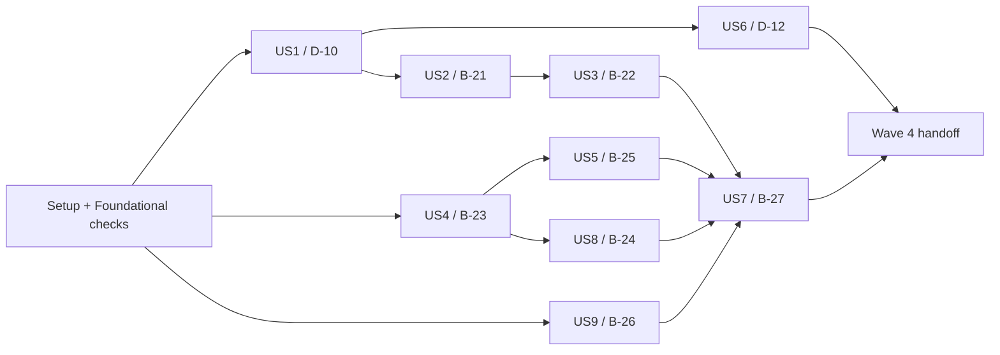

# Tasks: Wave 4 — Supporting Services & Integration Proof

**Input**: [spec.md](spec.md), [plan.md](plan.md), [research.md](research.md), [data-model.md](data-model.md), [HTTP contracts](contracts/http.md), [transaction/evidence contracts](contracts/transactions.md), [quickstart.md](quickstart.md) and the existing review checklists under `specs/006-wave-4-supporting-services/`.

**Generated**: 2026-11-28. **Source baseline**: `f52738dc0f4a33a1c8798df704134f690b9463c2`; migration head `0072_b20_worker`. Existing design artifacts are untracked and are preserved. All tasks below are unexecuted. The historical task-generation invocation authorized task generation and document verification only. Earlier specification/planning boundaries remain historical; the current five-finding remediation authorizes only targeted document changes and validation. This artifact grants no implementation, migration execution, CI dispatch, publication, commit/push/merge, Issue changes, production authority or automatic Spec Kit progression.

**Authority**: Approved PRD → Domain Model → System Design → [implementation plan](../../docs/implementation-plan.md) §§2/3/9/11–14; the [Constitution](../../.specify/memory/constitution.md) governs practice. Retain the nine Masters and their exact prerequisites. W4-M1/W4-M2 are delivery groupings, not new dependencies or execution permission. Final interfaces and representative U-12 E2E remain Wave 5-owned.

**Constraint citations**: `Entity.field` points to the named entity subsection and its exact field or grouped prose label in `data-model.md`; prose labels describe conceptual fields, not newly chosen SQL column names. The shared Background Work and Acceptance Evidence headings use those exact heading names as citation namespaces. Constraints remain canonical there; implementation tasks cite them rather than copying limits/enums. Shared `StagingAttempt` fencing also applies to export/download preparation. Prose-only labels (for example `PrivateObject.owner kind/ID`) remain design labels. Implement canonical constraints without copying altered defaults; preserve live authority, immutable audit/receipts and independent role projections. A descriptive migration filename does not allocate its revision: recheck head and assign actual forward revision/down_revision during implementation.

**Tests**: Explicitly required by the specification and approved Masters. Follow the authorized code-first sequence: production functionality → focused tests → relevant checks → confirmed defect correction → evidence review. No red-first/TDD prerequisite. D-12/B-27 supplement each owner’s focused proof. Use actual-login identities, real PostgreSQL/Compose and synthetic data for persistence, RLS and concurrency; no test trust bypass, Doctor impersonation or mocked race/isolation proof.

**Format**: `- [ ] Tnnn [P?] [USn?] Action with exact repository-relative file path`. All implementation paths are relative to `D:/care-pulse-3`; document-only references such as `data-model.md` resolve inside this feature. `[P]` permits work only after stated prerequisites, in separate files with no unfinished peer dependency. Shared migrations/lockfiles/router/configuration/CI/evidence records must be serialized. Proposed new source paths are work to create, not assertions that files exist. Migration revisions/down_revision must be allocated against the then-current single head, forward-only; never edit published revisions or infer permission for data repair.

## Common Per-Master Closure Procedure

Every owner closure task (T011/T023/T033/T043/T049/T055/T062/T068/T075) includes the following work for that Master, under its separately authorized execution scope:

1. Review actual production/test changes with clean-code-guard/test-guard and the consumed contracts. Run supported container-free checks and routine Fast Feedback when authorized. Diagnose failures from test/step/run/SHA plus logs, reproduction or observed lock state; use the smallest listed PostgreSQL diagnostic when applicable. After two speculative corrections require new cause evidence; never weaken assertions, retry/skip races or raise timeouts to mask failures.
2. Integrate its new mandatory selectors, independently collected locked case identities/counts, expected schema and supporting controller/receipt validation together in `.github/workflows/foundation.yml`, `ops/foundation_inventory.py`, `ops/foundation_acceptance.py` and `docs/postgresql-ci.md` as needed. Inspect the actual existing controller before editing. Assign by database/service/fixture/order dependencies and measured cost within `ordinary-db-core`, `ordinary-db-clinical`, `ordinary-stack`, `historical`, `compat`; real scanner/storage/BFF/SSE/process/mail/push service proofs use Stack where required. Preserve existing mandatory selectors, intentional repeats, security assertions and provenance.
3. Obtain required exact-executable-SHA Full Foundation evidence from an applicable available complete run or an authorized full dispatch. Require common + five lanes + final `Full Foundation acceptance`, zero mandatory failures/skips, five schema-3 post-cleanup receipts with strict ZIP digest/repository/workflow/SHA/run/attempt/schema/inventory/coverage/source validation and successful completed aggregate gate. Rerun all jobs in one attempt if required. No mixed receipts, cross-SHA result reuse, Fast Feedback/diagnostic substitution, isolated marker-line acceptance or unavailable-artifact PASS. Do not install or request Docker locally; container checks belong in Docker-capable CI.
4. Record per-suite elapsed, full/common/lane/gate elapsed, actual critical path and aggregate **unrounded** runner-minutes, candidate SHA/run/attempt, schema/inventory/pins/environment and changed-coverage caveats from the already required acceptance run in `quickstart.md`. Compare with the preceding applicable accepted baseline. No extra measurement-only dispatch, automatic repartition/additional lane, invented numerical gate or speculative production optimization. Follow all six [permanent scalability rules](../../docs/full-foundation-scalability.md#permanent-scalability-rules-for-wave-4-wave-5-and-future-masters).
5. Map actual positive/negative/race tests and outcomes to scenarios and source IDs; record limitations, independent reviewer/Issue status and actual authorization. Check a task only when its own scope/evidence is satisfied. IMPLEMENTED, TESTED and INTEGRATION VERIFIED are distinct; documentary completion supplies no runtime or production acceptance.

Integration results belong to their tested executable commit. If a later closure commit changes only documentation, record that distinction explicitly; if executable behavior changes, require acceptance for the new executable SHA.

## Shared execution procedures for refined tasks

The numbered substeps beneath each task are instructions within that task, not additional task IDs, acceptance claims, or permission to execute. Every task inherits the applicable exact Master prerequisites from the table below, T001–T004 entry verification for implementation, and the existing code-first/common closure procedure. Within-Master predecessors refer to completed prerequisite work and its necessary evidence; the [P] examples and Master table remain authoritative. A test task starts only after its actual production paths exist. A named planned path must be created by its owning task; a verified existing path is a reuse/inspection starting point, not a claim that Wave 4 behavior already exists. Recheck actual head and source before editing. For exact cross-story task gates, accepted D-10 means T011, B-21 means T023, B-22 means T033, B-23 means T043, B-25 means T049, D-12 means T055, B-24 means T062, B-26 means T068 and B-27 means T075; apply only the edges already in the Master table.

**Shared source and authorization procedure.** Use the authoritative PRD → Domain → System Design → implementation plan and the feature spec/data-model/HTTP/transactions clauses cited in each task. Read actual surrounding code and callers with CodeGraph first when indexed; use actual read/search if incomplete. All new protected staff calls reuse the existing `apps/web/auth/session.ts::currentActor`, `apps/api/carepulse/identity/boundary.py::ClosedServiceBoundary`, `identity/runtime_identity.py::bound_transaction` and `identity/authorization.py::protected_transaction` boundaries; use dedicated binary/SSE adapters where specified. Each private phase receives a new signed nonce/proof and PRIMARY transaction; never transfer a binding or treat a saved receipt/handle as authority. Apply transactions Identity and Effective Privileges, Multi-transaction F-01 Authorization Lifecycle and Lock and Receipt Rules and HTTP Shared Boundary: current actor/tenant/role/session/security revision, exact purpose/target/body/query, default deny, strict DTOs and configured limits, authority-first locks, sanitized errors, fresh recheck after lock wait, immutable receipt digest and independent status readback for unknown commit. No external I/O/client wait under domain locks. Missing/invalid required policy fails closed; synthetic policy values remain labeled. No new policy values, extra role, service, generic repository or production approval.

**Shared security proof.** Use actual active Doctor/Owner, delegated Receptionist Manager and ordinary Receptionist in tenant A, active staff in tenant B, revoked/disabled A staff, suspended A tenant and actual restricted API/Web/worker/gate/sender/operator DB logins as applicable. Obtain genuine sessions and signed requests using existing test fixtures (`tests/integration/runtime_identity_fixture.py::signed_test_transaction` for the real signed transaction path); no migration credential or spoofed GUC as application authorization. For each allowed operation assert exact target/actor/role/tenant, returned fields and committed effects. For denial assert contract-specific status/SQLSTATE and minimal sanitized response, no foreign/Doctor-only fields, raw tokens, locators, keys or PHI. Independently capture affected row IDs/values/revisions, history, success audit, receipt, outbox and the applicable resource/generation/grant/stream/provider effects before and after. Denial/rollback leaves these identical except explicitly contracted non-success security/failure evidence; do not mistake a registered transport nonce or permitted denial audit for a successful domain mutation. Test no-context and same-PID pool reuse after both success and failure where applicable. A Manager designation change must invalidate stale authority as prescribed, but must not remove an approved universal operation or Receptionist recipient eligibility from a freshly authorized still-active ordinary Receptionist; assert the distinction where applicable.

**Shared ordered race procedure.** Use two real PostgreSQL connections/credentials, independent signed proofs or exact worker capabilities, deterministic fixture and an independent permitted observer. Capture pre-state, hold the first transaction at the actual authority/resource lock or after tentative writes before commit, signal a checkpoint, start competitor, capture distinct PIDs and, for transactions that actually wait, observe the waiter blocked by the specific holder with `tests/integration/postgres_locks.py::wait_for_postgres_lock` / `pg_blocking_pids`. For a candidate-row `FOR UPDATE SKIP LOCKED` path, establish that the applicable authority barrier has been acquired or passed (or separately observe its actual blocker), in a distinct candidate-row witness hold the eligible candidate row at the real SQL checkpoint without a conflicting authority lock that would prevent the poll reaching SKIP LOCKED (use a permitted isolated database lock fixture if necessary; never bypass production authorization); with only that eligible candidate, prove the competing poll returns no work before the holder releases, with unchanged committed generation/claim/attempt/outcome and zero losing effects. If other eligible candidates exist, they may be selected independently; the skipped candidate must remain unchanged. Do not demand a waiter/blocker witness for a skipped row; retain the exact blocker witness for any actual authority/resource wait. Assert uncommitted writes are not externally visible; release/commit first, await competitor and compare exact winner effects plus zero losing changes (or the contractually permitted second result). Repeat with fresh fixture and reversed acquisition/commit order. Record actual barrier, PIDs and blocker relation for waits or held-candidate/no-work completion before release for skips, outcomes/SQLSTATE and independent durable state, including receipt/revision/generation/claim/number/queue/Visit/audit/outbox or artifact/stream effects as relevant. For a read snapshot, establish actual statement snapshot/commit ordering; a read need not block unless the authority barrier requires it. For failure after tentative writes, force a definite rollback and assert unchanged domain state; unknown commit requires matching authorized status/receipt readback before retry. For external effects hold at actual pre-send/publish/redeem checkpoint, reconcile ambiguous acknowledgment and never assert provider exactly-once or recall previously authorized bytes. No arbitrary sleep, mocked isolation, timeout increase or assertion relaxation. Apply only relevant variants to each task; use existing proven fixtures and checks rather than duplicating matching owner evidence.

**Shared completion boundary.** Production implementation tasks end with the defined code/contract outcome and focused proof obligations handed to their named test tasks; test tasks end with actual required checks/evidence, not just written assertions. Owner closures require the common procedure and permanent scalability rules. Any absent prerequisite, unsupported contract, failed proof or unresolved decision is explicitly BLOCKED/UNVERIFIED at the affected boundary. Do not invent a rule to bypass it, mark another task complete or advance to a different Spec Kit command.

## Phase 1: Setup (Execution Baseline)

**Purpose**: Prepare the existing repository for a separately authorized implementation; do not initialize a replacement project.

- [ ] T001 Verify the assigned Master, actual SHA/branch, dirty/untracked files, active feature and pinned toolchain; record consumed prerequisite evidence and protected-file hashes in `specs/006-wave-4-supporting-services/quickstart.md`, preserving the existing spec, checklists and historical records.
  1. Entry: explicit assignment for a named Master; no task predecessor. Read this file's exact Master table, `plan.md` Master Ownership and Dependencies, implementation-plan §§1–3/9, Constitution and both feature checklists. A checklist approval is requirements quality only.
  2. Capture `git rev-parse HEAD`, `git status --porcelain=v1 -uall`, current branch and `.specify/feature.json`; inspect actual consumed owner evidence in the predecessor quickstarts and compare executable SHA versus any documentation-only closure. Preserve all pre-existing edits. Record hashes of the feature inputs/checklists and authoritative documents before changing any authorized implementation file.
  3. Read repository pin files and `quickstart.md` Prerequisites and Scope; record actual Python, pip, Node, pnpm, Next and PostgreSQL pins, dependency lock hashes and workstation limitations. Label unavailable verification separately; do not install Docker, change pins or persist a different feature selection.
  4. Acceptance: a reviewer can identify the assigned scope, required predecessor proof, current executable baseline, every protected input hash and any missing dependency. No runtime acceptance is asserted; no implementation before the applicable entry gate.

- [ ] T002 Record the current schema head, mandatory selector/count/case-identity inventory, lane dependencies and preceding accepted timing baseline in `specs/006-wave-4-supporting-services/quickstart.md` using `ops/foundation_inventory.py` and `docs/postgresql-ci.md`; distinguish available evidence from reported historical results.
  1. Entry: T001 recorded; read `docs/postgresql-ci.md`, permanent scalability rules and `quickstart.md` Full Foundation Acceptance.
  2. Inspect `db/migrations/versions/` and Alembic revision/down_revision graph for the actual single head (baseline 0072); read `ops/check.ps1`, `.github/workflows/foundation.yml`, `ops/foundation_inventory.py` (`expected_evidence`, `_digest`) and `ops/foundation_acceptance.py` (`validate_request`, `aggregate`). Record exact lane-to-report/case counts and identity digests, intentional repeats, locked selectors, schema and source archive pins. Do not derive expected identities from a successful run.
  3. Find the preceding accepted Full run for the relevant executable scope and verify the recorded repository/workflow/SHA/run/attempt, common/five lanes/final gate, five receipts and measured durations where available. Distinguish historical four-lane receipts from the current five-lane contract. Record any unavailable artifact as UNVERIFIED; do not dispatch a measurement run.
  4. Acceptance: complete baseline comparison record, including actual critical path and unrounded summed runner-minutes where available, no changes to selectors or schema, no historical result treated as current acceptance.

**Checkpoint**: Record verified checks and blockers without expanding the current assignment.

---

## Phase 2: Foundational (Blocking Execution Checks)

**Purpose**: Complete these checks before changing a protected contract. They verify existing prerequisites; they do not transfer ownership or add Master dependency edges.

- [ ] T003 Verify effective F-01 registration/bind/activation/expiry/recovery and actual-login grants from `apps/api/carepulse/identity/boundary.py`, `apps/api/carepulse/identity/runtime_identity.py` and the current migration head; record the operation-to-phase/target/PRIMARY matrix in `specs/006-wave-4-supporting-services/quickstart.md`, using CodeGraph first and no implementation bypass. Use the complete method/path/purpose/target/phase inventory in contracts/http.md; confirm every entry with current API and effective PostgreSQL registration during implementation.
  1. Entry: T001–T002; read research review finding 1 and transactions Identity and Effective Privileges / Multi-transaction F-01 Authorization Lifecycle / Lock and Receipt Rules; PRD FR-072/075, INV-01/19/20, plan §2 and F-01 documentation.
  2. Trace existing `ClosedServiceBoundary` and `_read_body` in `identity/boundary.py`, `f01_register_proof` registration, `bound_transaction` in `identity/runtime_identity.py` (gate `f01_bind` with PID/xid, API `f01_activate()`), `protected_transaction` in `identity/authorization.py` and native `lock_native_session_authority`. Inspect 0041 and subsequent forward migrations for effective route-purpose parsing, stage matrix, context expiry and actual grants. CodeGraph first; if the index yields irrelevant or stale results, read the actual files.
  3. Record each existing login and proof/stage capability, route method/path/query/body/target binding, consumed nonce and expiry rules, and the exact proposed Wave 4 families/phase targets that need new registrations. A planned phase is a new fresh PRIMARY transaction, not an existing F-01 stage. Verify recovery status read-only and no reusable captured authority; document where fresh proof/rechecks are needed after external work or lock waits. Match the canonical HTTP inventory; no alternate phase routes or dotted purpose aliases.
  4. Acceptance: source-located matrix distinguishes verified existing from planned changes, no legacy GUC fallback, arbitrary continuation or role impersonation, and no prerequisite claimed passed without actual evidence. Block affected work if the live authority contract cannot be established.

- [ ] T004 Verify the existing configuration, authority-first privilege/session lock paths and private-volume/worker/sender boundaries against `contracts/transactions.md`; record affected-operation policy requirements and any concrete prerequisite blocker in `specs/006-wave-4-supporting-services/quickstart.md`. Load clean-code-guard/test-guard before subsequent code edits; missing policy fails closed and synthetic values stay labeled. Verify server-only CP_POLICY_FILE consumers in apps/web/config.ts and apps/api/carepulse/config.py; check compatible upload/SSE policy before BFF resource consumption.
  1. Entry: T001–T003; read `config.py` (`load_config`, `_load_policy`, `FilePolicy`, `SecurityPolicy`), `compose.yaml`, `apps/worker/main.py`, `notifications/evidence.py` and `notifications/email_sender.py` plus transactions Lock and Receipt Rules / Worker, Push and External Effects and HTTP Shared Boundary.
  2. Record actual configuration consumers and required explicit policy for each planned capability, including unavailable/invalid configuration behavior, secret-file mounts, private_files ownership (API/worker only), current sender credential and worker cutoff scope. Separate planned validation from existing settings; use no production values or raw secret output.
  3. Trace Organization barrier → live staff/session/security revision → downstream resource order; verify native session lock/invalidation and existing D-09 receipt/outbox ownership. Record affected paths including BFF `currentActor` and `forwardPrivate`; do not change them in this task. Load required quality skills before future code edits.
  4. Acceptance: every affected capability has a verified entry path, required policy, failure mode and lock/credential boundary or explicit blocker. No scanner/send/file activity, CI or runtime acceptance is implied by this read-only check.

**Checkpoint**: Record verified checks and blockers without expanding the current assignment.

---

## Phase 3: User Story 1 — Correct patient/Visit attachment and export persistence (P1, D-10)

**Goal**: Persist tenant-qualified file/export metadata without granting content access.

**Independent test**: With two tenants and two patients each, allow configured preliminary null-Visit records and valid same-patient clinical records; reject wrong-patient/foreign/missing-required Visit associations, unauthorized SQL and all non-clean reads with unchanged related state.

**Implementation, then focused proof**:

- [ ] T005 [US1] Add forward-only attachment schema, Visit triple uniqueness, class/association checks, indexes, immutable attribution and non-readable lifecycle transitions in a newly allocated successor under `db/migrations/versions/`; mirror definitions in `apps/api/carepulse/files/tables.py`. Canonical constraints in `data-model.md` Shared Rules and Attachment: `Visit.organization_id`, `Visit.patient_id`, `Visit.id`, `Attachment.id`, `Attachment.organization_id`, `Attachment.patient_id`, `Attachment.visit_id`, `Attachment.class`, `Attachment.uploader_id`, `Attachment.captured actual role`, `Attachment.creation/finalization time`, `Attachment.Original display filename`, `Attachment.declared/detected MIME`, `Attachment.extension`, `Attachment.byte length/digest`, `Attachment.state`, `Attachment.revision`, `Attachment.generation`, `Attachment.scan outcome/engine metadata`, `Attachment.private_object_id`, `Attachment.finalized_at`, `Attachment.minimal failure category`.
  1. Entry: D-10 authorized; D-03/D-07/D-09 accepted, T001–T004 baseline verified. FR-073/081/096, BR-039/041, INV-29, CON-31; data-model Attachment and transactions File Finalization and Cleanup.
  2. Inspect existing visits/tables.py and 0021_d07_visits.py (only tenant/id and tenant/appointment unique keys); allocate current-head successor, add tenant/patient/id Visit unique key and mandatory tenant-qualified Patient and uploader FKs, optional triple Visit FK with explicit class-dependent presence check. Ensure configured preliminary class may omit Visit, clinical report/prescription cannot; no hardcoded production policy names. Mirror new schema in planned files/tables.py, reconcile existing Visit metadata where required. Enforce the canonical `Attachment.class` semantic mapping in data-model.md for the immutable stored class and Visit constraint; expose that same mapping to B-21.
  3. Constrain immutable owner/actor/class attribution, revision/generation transitions, timestamps and state/object linkage: non-clean cannot serve, CLEAN requires definitive scan and protected committed object (T006 relationship); no implicit release or clinical status/authoring change. T009/T010 verify valid and invalid combinations and existing Visit preservation; completion is schema/metadata only, not content retrieval.

- [ ] T006 [US1] Extend the D-10 successor and `apps/api/carepulse/files/tables.py` with protected object/staging metadata, immutable ownership, generation/claim/lease fences, phase/input/result identity and chunk-progress constraints; raw keys/bearers and client locators are excluded. Canonical constraints in `data-model.md`: `PrivateObject.Object ID`, `PrivateObject.organization_id` (Shared Rules), `PrivateObject.tenant/patient`, `PrivateObject.owner kind/ID`, `PrivateObject.artifact kind`, `PrivateObject.Opaque server-generated relative locator`, `PrivateObject.ciphertext digest/length`, `PrivateObject.Algorithm/version`, `PrivateObject.key_version`, `PrivateObject.nonce`, `PrivateObject.authentication tag`, `PrivateObject.Immutable source digest`, `PrivateObject.generation`, `PrivateObject.claimant/lease`, `PrivateObject.created time`, `PrivateObject.state`. Canonical constraints in `data-model.md`: `StagingAttempt.attempt_id`, `StagingAttempt.actual actor/session/security revision`, `StagingAttempt.operation/key/target/typed digest`, `StagingAttempt.business phase`, `StagingAttempt.expected revision`, `StagingAttempt.generation/claim/lease`, `StagingAttempt.immutable snapshot/input/candidate digests`, `StagingAttempt.contiguous committed offset`, `StagingAttempt.per-chunk length/digest`, `StagingAttempt.BFF-observed whole-file length/digest`, `StagingAttempt.assembly verification outcome`. Explicit tenant identity: `StagingAttempt.organization_id`. Canonical chunk-key fields in `data-model.md`: `StagingAttempt.upload identity`, `StagingAttempt.chunk starting offset`.
  1. Entry: same D-10 predecessors D-03/D-07/D-09; T005 schema selected, serialize edits to its successor. FR-073/079/096, BR-039/040, INV-29; data-model PrivateObject/StagingAttempt; transactions Multi-transaction F-01 Authorization Lifecycle and Lock and Receipt Rules.
  2. Add tenant/patient-qualified discriminated attachment/export owner/artifact references, exact generation and immutable locator/source/ciphertext identity; AES-256-GCM metadata/version/nonce uniqueness per key, tag and bounded length/digest consistency. Persist immutable server-generated UUID `StagingAttempt.attempt_id` with unique tenant-qualified identity and matching tenant-qualified references to operation, owner, phase and generation; persist actor/session/security revision, normalized operation/key/target/digest, phase, expected revision, generation, claimant/lease and immutable input/result identity; these never confer authority.
  3. Constrain chunk-position uniqueness independently of attempt UUID by tenant/upload identity, generation and offset; length/digest are immutable content attributes, not unique keys. Persist each accepted position/length/digest and advance contiguous committed offset exactly once; accept identical bytes at distinct valid contiguous offsets, acknowledge an identical committed same-offset replay under fresh proof without appending, and reject conflicting same-offset content or gaps/overlap without changed progress. Require BFF whole-file measurement and independent assembly length/digest agreement before STAGED. Reconcile FK creation with T007 without another Master edge; no raw key/bearer/client path. Check invalid owner, stale generation, conflicting duplicate chunk position, invalid/mutable/cross-tenant or mismatched operation/owner/phase/generation attempt identity and non-clean publication fail without partial metadata; T009/T010 execute actual-login constraints, and T021/T022 verify distinct-offset identical-byte persistence, same-offset replay/conflict and assembled content.

- [ ] T007 [US1] Extend the D-10 successor and `apps/api/carepulse/files/tables.py` with export/artifact and discriminated grant relations, unique effects, grant consumption and minimal audit/receipt links. Canonical constraints in `data-model.md`: `PatientExport.Export ID`, `PatientExport.organization_id` (Shared Rules), `PatientExport.tenant`, `PatientExport.one Patient ID`, `PatientExport.creator actual ID/role`, `PatientExport.format`, `PatientExport.as_of`, `PatientExport.extraction/dictionary schema version`, `PatientExport.Specified purpose`, `PatientExport.intended recipient reference`, `PatientExport.authority/identity verification method/outcome`, `PatientExport.verifier/time`, `PatientExport.State/generation/owner`, `PatientExport.normalized request digest/idempotency identity`, `PatientExport.Success audit and immutable receipt linkage`. Canonical constraints in `data-model.md`: `ExportArtifact.Artifact ID`, `ExportArtifact.export FK`, `ExportArtifact.organization_id`, `ExportArtifact.export_id`, `ExportArtifact.kind`, `ExportArtifact.private object FK`, `ExportArtifact.content type/digest/length`. Canonical constraints in `data-model.md`: `DownloadGrant.grant ID`, `DownloadGrant.bearer digest`, `DownloadGrant.organization_id` (Shared Rules), `DownloadGrant.organization/patient`, `DownloadGrant.actual actor/session/security revision`, `DownloadGrant.resource kind/ID`, `DownloadGrant.artifact ID/kind`, `DownloadGrant.issued/expiry/consumed timestamps`, `DownloadGrant.minimal redemption audit linkage`, `DownloadGrant.state`, `DownloadGrant.positive actual-verifier/time/recipient handoff evidence`.
  1. Entry: D-03/D-07/D-09; T005–T006 schema available. FR-079/080/104, BR-030/039/040, INV-18/20; data-model PatientExport/ExportArtifact/DownloadGrant; transactions Export and Grant Transactions.
  2. Add one-patient tenant-qualified export with actual creator/verification/recipient/purpose/as_of/schema/generation and logical request identity, immutable minimal evidence linkage, unique artifact kind per export and exact tenant/patient/owner object linkage. Require READY exactly one RECORD and one MANIFEST, enforce atomically through constrained writer/commit guard rather than permitting partial READY.
  3. Add discriminated digest-only grant for exactly matching attachment or selected export artifact, bound actor/session/revision and positive same-recipient handoff for export; timestamps and consumed audit linkage, CAS-ready state. Reuse D-09 audit/receipt substrate (identity/receipts.py, notifications/evidence.py); no raw bearer, document copy or TTL default. T009/T010 prove mismatches, uniqueness, partial READY and immutable audit/receipt rejection; B-21/B-22 own serving.

- [ ] T008 [US1] Implement tenant FORCE RLS, fixed definer ownership/search paths, effective table/column/function/PUBLIC/inherited grants and narrow operation projections in the D-10 successor under `db/migrations/versions/` and `apps/api/carepulse/files/permissions.py`; separate upload metadata, original reads and export-only full history for actual API/Web/worker/gate/sender/operator identities.
  1. Entry: D-10 prerequisites D-03/D-07/D-09; T005–T007 relations complete. FR-069/073/075/079/080/104, BR-039/040, INV-01/20/29; transactions Identity and Effective Privileges, Lock and Receipt Rules.
  2. Inspect db/roles.sql, effective 0041–current F-01 chain and existing carepulse_identity_owner NOLOGIN. Apply FORCE RLS, tenant/operation/target/field policies and narrow definer functions with fixed pg_catalog,pg_temp search path; revoke PUBLIC/inherited/unneeded table/column/EXECUTE privileges. Separate Doctor original-read, both Receptionist variants' allowed metadata/preliminary read, and all-staff export-only full-history scope; deny raw object tables to web/operator/gate/sender and unrestricted worker/API, use exact worker capability only for approved work.
  3. Reuse protected_transaction and existing per-Organization authority lock before staff/session, Patient and applicable Appointment/Visit/owner/object/attempt/grant locks. Future route phases remain B-21/B-22 planned; no GUC/SET ROLE authority. T009/T010 prove effective privileges via actual credential logins and direct SQL denied/no rows, including forged context and cross-tenant. Completion is persistence permission foundation, no new serving capability.

- [ ] T009 [P] [US1] Add focused two-tenant real-login constraint/RLS/class/non-clean-read tests in `tests/integration/test_w4_file_persistence.py` after T005–T008, including null-Visit and same-tenant wrong-patient cases, operator/missing-context denial and zero partial successful metadata/audit/outbox effects.
  1. Entry: D-10 prerequisites D-03/D-07/D-09 and T005–T008 implemented. US1-AS1–3, FR-073/096, INV-01/29, CON-31; transactions Identity and Effective Privileges/File Finalization and Cleanup. Reuse signed_test_transaction from tests/integration/runtime_identity_fixture.py and existing tenant fixtures; actual carepulse_api/gate and staff sessions for legitimate scope; operator/web/worker/sender/runtime/auth logins for denied direct access; migration credential only arrange/observe.
  2. Two clinics with two Patients and matching Visits each: preliminary null Visit accepted, matched clinical/prescription accepted; missing Visit, same-tenant wrong Patient, foreign/missing IDs, cross-owner object/artifact and forged actor/role fail. Test invalid lifecycle/READY/grant constraints and immutable attribution; explicitly verify `data-model.md` `StagingAttempt.attempt_id` UUID generation, immutability, tenant-qualified uniqueness and references, operation/owner/phase/generation mismatch rejection and independent chunk-position uniqueness; pending/rejected/quarantined/failed states never reveal locator or content metadata outside authorized projection. Use actual permitted narrow writer or migration-only constraint probes explicitly distinguished from service authority. Use synthetic mapped categories plus an allowlisted unmapped name. Verify the latter denies persistence and enabling a class cannot relax either Visit-required category.
  3. Capture exact rows/counts/revisions/history/audit/outbox/receipt/grants/quota before failures and after rollback; compare no partial successful effects, no wrong-tenant data or direct SELECT bypass. Assert missing/forged context and reused pool without context denied. Record case identities and mapping, no simulated runtime file retrieval before B-21.

- [ ] T010 [P] [US1] Add empty/repeated/current-populated predecessor upgrade, clean redeploy, effective-grant and atomic incompatible-data rejection tests in `tests/integration/test_w4_file_migration.py` after T005–T008; preserve published revisions and retained identifiers/clinical/history/receipt links.
  1. Entry: D-10 prerequisites D-03/D-07/D-09, T005–T008 complete; US1-AS1–3, INV-01/29, CON-31; transactions Migration and Historical Evidence, plan and permanent scalability. Use actual current predecessor (head initially 0072_b20_worker) and newly allocated successor, not an invented revision or altered 0021.
  2. Fresh empty upgrade to head, repeat upgrade idempotently, clean redeploy and populated predecessor fixture with two tenants, patient/Visit/history/clinical/audit/receipt identifiers and values. Verify single head, Visit triple uniqueness/FKs, unchanged retained rows/relationships, actual role privileges and new relations/constraints, including `data-model.md` `StagingAttempt.attempt_id` tenant-qualified identity/references and independent chunk-position uniqueness. Deliberately incompatible synthetic data/constraint scenario must reject atomically with observed previous revision/data preserved; do not pretend incompatible legacy attachment data already exists.
  3. Verify rollback/no partial schema/data or widened permissions, migration hashes unchanged, scoped cleanup; capture actual source/candidate revisions and effective grants from PostgreSQL. Preserve immutable Historical/Compatibility selectors; no production repair/downgrade or #13 closure.

- [ ] T011 [US1] Complete D-10 owner verification and CI integration under the common per-Master closure procedure; record concrete test/report/case, schema, exact SHA/run/attempt, timings, limitations and relevant Issues in `specs/006-wave-4-supporting-services/quickstart.md`. Content retrieval remains B-21-owned.
  1. Entry: D-03/D-07/D-09 accepted; T005–T010 actual implementation and focused test evidence complete. Map FR-073/079/096/104, BR-039–041, INV-29, CON-31 and US1-AS1–3 to T009/T010 exact cases, including actual-login denial and wrong-patient/foreign/null Visit.
  2. Apply Common Per-Master Closure Procedure and transactions CI Allocation and Closure: independently collect exact mandatory reports, choose lane by dependencies, verify current single head and five same-attempt Full receipts at executable SHA; retain predecessor inventory and measure costs.
  3. Record pass/blocked status, evidence/limitations, open #26 and #18 where applicable; no content-serving approval, B-21 execution or production file activation implied.

**Checkpoint**: Complete this owner’s independently assessable scope and required evidence before claiming its status; dependent stories still enforce the Master table below.

---

## Phase 4: User Story 2 — Safe private upload and retrieval (P1, B-21)

**Goal**: Transport, validate, scan, encrypt, finalize and retrieve only currently authorized clean attachments.

**Independent test**: Use real signed BFF/API/PostgreSQL requests, ClamAV and protected storage; demonstrate policy/class boundaries, infected/spoofed/incomplete/outage denials, ciphertext at rest, independent upload/read permissions, fenced cleanup and at-most-one authorized redemption.

**Implementation, then focused proof**:

- [ ] T012 [P] [US2] Implement assembled-file extension/declared/detected type checks and definitive fail-closed ClamAV INSTREAM scanning in `apps/api/carepulse/files/scanner.py`; enforce configured class/type/size policy and sanitized outcomes, with no scanner bypass or implicit quarantine release. Treat `scanner_required=false` as invalid for enabled medical attachment processing; fail closed before upload processing and require definitive clean scan evidence before CLEAN publication, without changing unrelated baseline capabilities.
  1. Entry: B-21 authorized; D-10/B-01/B-05/B-16 accepted; T001–T004 verified. FR-073/096, BR-039/041, AC-29/36; HTTP Attachment Lifecycle/Dedicated Binary Adapter and transactions File Finalization and Cleanup. Planned scanner.py, reuse config FilePolicy/scan Endpoint and existing Compose ClamAV.
  2. Validate safe filename extension, declared MIME and independent detected assembled bytes against class policy and actual total size; reject disagreement, malformed/unsupported inputs. Send bounded assembled bytes via ClamAV INSTREAM (no user-selected paths); accept only definitive complete clean result, distinguish infected/rejected/quarantine per policy from timeout/unavailable/malformed/partial protocol response (503, unreadable). For enabled medical attachment processing, Web and API must reject `scanner_required=false` as invalid before upload body consumption/spooling, reservation or processing; return sanitized 503 UNAVAILABLE or fail required readiness/startup under F-03. Preserve unrelated baseline capabilities. Definitive complete clean scan evidence bound to the immutable source digest is mandatory before CLEAN publication.
  3. Return minimal typed scan outcome/engine evidence bound to immutable source digest; no payload/path diagnostics or locks across scan. T020/T022 exercise spoofing, exact limits, EICAR, outage/invalid response and no CLEAN on failure. No quarantine release or production numeric defaults.

- [ ] T013 [P] [US2] Implement authenticated per-object AES-256-GCM protection in `apps/api/carepulse/files/crypto.py`, parsing actual versioned key bytes and binding tenant/patient/object/owner/artifact metadata; authenticate all bytes before disclosure. Apply `data-model.md` constraints `PrivateObject.Algorithm/version`, `PrivateObject.key_version`, `PrivateObject.nonce`, `PrivateObject.authentication tag`.
  1. Entry: B-21 predecessors D-10/B-01/B-05/B-16; T001–T004 and T006 object contract. FR-073/079, BR-039/040, AC-36; data-model PrivateObject; transactions File Finalization and Cleanup/Export and Grant Transactions. Planned crypto.py, reuse locked cryptography and config ServiceConfig.file_encryption_key (currently text).
  2. Strictly decode protected versioned key material to actual 32 bytes; select exact stored key version, fresh unique nonce per key, AES-256-GCM with canonical unambiguous algorithm/version/tenant/patient/object/owner/artifact AAD. Produce ciphertext/tag/digest/length and immutable source identity, never expose key or plaintext. Validate entire ciphertext/tag/AAD and digest before release to protected temp result; wrong/missing key/version/tag/metadata or truncation fails closed with sanitized 503/no bytes.
  3. No database locks through crypto, no master key in DB/image/log, no key-rotation workflow beyond reading configured versions. T020/T022 prove roundtrip, tampered metadata/ciphertext/tag, key errors and at-rest inspection.

- [ ] T014 [P] [US2] Implement opaque root-bounded no-follow regular-file staging/candidate access in `apps/api/carepulse/files/storage.py`; use protected ephemeral files and immutable locators, no client filename paths or public links. Apply `data-model.md` constraints `PrivateObject.Opaque server-generated relative locator` and `PrivateObject.ciphertext digest/length`.
  1. Entry: B-21 dependencies D-10/B-01/B-05/B-16 and T006 object contract; FR-073/079, BR-039/040, AC-36; data-model PrivateObject; transactions File Finalization and Cleanup. Planned storage.py; use existing protected private_files mounts in compose.yaml (API/worker, not Web).
  2. Generate opaque immutable relative locator scoped to exact generation, tenant and owner; resolve within configured private root using no-follow and regular-file checks at actual open, reject absolute/traversal/symlink/nonregular/racy substitution. Create exclusive protected staged/candidate files; durable completed ciphertext before returning metadata, no overwrite/reuse; bounded IO, remove temporary plaintext only under appropriate ownership.
  3. Return private internal handle/digest/length, no client paths or public URLs; failure leaves non-readable scoped orphan for T019, no metadata success. T020/T022 test symlink/traversal/direct access, interrupted write, length/digest and permissions; Web spool stays ephemeral and separate.

- [ ] T015 [US2] Implement initiate/prepare/publish/status and proof-expiry-aware recovery in `apps/api/carepulse/files/lifecycle.py` and `apps/api/carepulse/config.py`; enforce policy/quota reservations and current actor/session/class/Patient/Visit/revision/generation/lease/digest at writes, publishing CLEAN/object/audit/safe receipt atomically after durable external scan/encryption. Follow `data-model.md` `Attachment.state`, `Attachment.revision`, `Attachment.generation`, `Attachment.private_object_id` and all `StagingAttempt` fields cited in T006. Validate compatible server-only CP_POLICY_FILE in `apps/web/config.ts` and `apps/api/carepulse/config.py` before upload resources are consumed; follow HTTP policy contract.
  1. Entry: B-21 approved predecessors D-10/B-01/B-05/B-16; T012–T014 completed for finalization, T005–T008 schema; FR-073/075/096, BR-039/041, INV-20/29; HTTP Attachment Lifecycle and transactions Multi-transaction F-01 Authorization Lifecycle, Lock and Receipt Rules, File Finalization and Cleanup. Planned lifecycle.py; extend existing config FilePolicy/SecurityPolicy/load_config with explicit class/type/count/quota/lease/retry/disposal validation, no missing-policy fallback; OPEN-FILES-01 stays disabled for production.
  2. Initiate strict patient/Visit/class/name/type/size body, actual actor/session, reserve quota under authority → staff/session → Patient → applicable Appointment/Visit → attachment/object → attempt/quota order; return safe attachment ID/state/current generation/revision/upload route, matching HTTP initiate success. Fresh signed prepare PRIMARY pins STAGED generation/digest/revision and commits lease; scan/encrypt outside locks. Fresh signed publish PRIMARY rechecks live context through write/completion, exact target/body/key/phase/lease/policy/assembly/candidate digest and current generation; atomically CLEAN/object/quota/audit/safe immutable receipt; no readable success on rejected/failed/dependency error. Initiate is the reservation phase; no separate attachment reserve route. Resolve class semantics from the D-10 mapping and separately enforce policy enablement. Deny unknown/unmapped classes, including allowlisted names.
  3. Use normalized_command_digest and safe receipt checks; repeated authorized same operation returns saved result, changed body/target 409 after visibility; wrong/foreign 404, unauthorized 403, stale/expired/conflicting phase fails closed. Fresh read-only status PRIMARY reconciles committed/in-progress/aborted result before any retry; unresolved remains unreadable, no reused PRIMARY/extended proof/lease. T021/T022 verify expiry, failure and exact effects.

- [ ] T016 [US2] Implement contiguous raw-chunk acceptance and independent final assembly measurement in `apps/api/carepulse/files/uploads.py` and dedicated `apps/web/auth/binary.ts`; retain existing 1 MiB request/proof and JSON/envelope bounds, independently hash actual raw bytes at API/DB, reconcile identical chunk acknowledgments and enforce cumulative policy/quota without wrapping maximum chunks. Follow `data-model.md` `StagingAttempt.attempt_id`, `StagingAttempt.contiguous committed offset`, `StagingAttempt.per-chunk length/digest`, `StagingAttempt.BFF-observed whole-file length/digest`, `StagingAttempt.assembly verification outcome`. Implement independently signed raw-chunk stage, publish and status phases from HTTP inventory; no reused PRIMARY. Verify signed `policy_digest` using the pre-spool status route and subsequent phases; no resource allocation on mismatch. Apply `data-model.md` fields `StagingAttempt.upload identity` and `StagingAttempt.chunk starting offset` independently of aggregate progress and attempt UUID.
  1. Entry: B-21 predecessors D-10/B-01/B-05/B-16; T014/T015 storage/lifecycle and T006 chunk schema. FR-073, BR-039, AC-29/36; HTTP Dedicated Binary Adapter and transactions Multi-transaction F-01 Authorization Lifecycle. Existing proxy.ts boundedBody/forwardPrivate is JSON-oriented; signRequest/currentActor/validMutation and ClosedServiceBoundary._read_body/f01_register_proof enforce actual body hash and 1,048,576-byte body/65,536-byte envelope.
  2. Planned binary.ts privately spool complete policy-bounded public upload, count/hash actual bytes, reject false declared length/truncation/excess. Forward contiguous raw chunks <=1 MiB with fresh currentActor and signed canonical operation/generation/offset/total/whole digest/expected revision query, actual body bytes; API and DB independently hash actual bytes. Strict unknown/duplicate query and cumulative quota/class/type bounds; no wrapping, unsigned digest shortcut or raised limit. Check compatible CP_POLICY_FILE policy before reading or spooling public bytes; fail closed on missing/invalid/mismatched policy, including resumed operations.
  3. Under shared lock order pin next offset/current generation; write immutable staged candidate outside critical transaction and fresh signed phase commits exact position/length/digest CAS. Identical committed chunk acknowledgment does not append again; gap/overlap/conflict/stale rejects. Independently measure assembled API file to exact BFF length/digest before STAGED. Unknown commit status reconciliation precedes further mutation. T021/T022 prove raw boundary, multi-chunk and exact zero losing progress; no content served. Follow exact HTTP chunk stage/publish/status contracts: publish must match the stage's independently verified raw-byte digest, generation, offset, length and attempt fence; read-only status resolves lost acknowledgments without granting write authority. Bind stage/publish/status to the immutable server-generated tenant-qualified attempt UUID and exact operation/owner/phase/generation. After BFF interruption require complete-file resubmission with explicit current selectors, repeat authorized pre-spool check and full measurement, verify pinned whole identity and each committed prefix chunk via fresh signed exact-identity status using the same deterministic partition; verify current generation/revision/offset and reconcile pending/unknown stage/publication before continuing only at the verified offset. Stale/conflicting selectors or identity deny, unexpected progress changes require explicit retry, and never skip unverified chunks or duplicate progress/quota; follow HTTP recovery exactly.

- [ ] T017 [US2] Implement live class-specific grant issue and distinct preflight/authenticate/redeem/status phases in `apps/api/carepulse/files/downloads.py`; atomic unused/unexpired exact-target consumption and audit precede bytes, with fresh authority per phase and no re-serving after lost acknowledgment. Apply all `DownloadGrant` canonical fields in `data-model.md` cited in T007; upload success never grants original read.
  1. Entry: B-21 dependencies D-10/B-01/B-05/B-16; T013–T015 and D-10 grant/object schema; FR-073/075/080/096, BR-039/041, INV-20, AC-11/29/36; HTTP Attachment Lifecycle/Dedicated Binary Adapter; transactions Export and Grant Transactions and Multi-transaction F-01 Authorization Lifecycle.
  2. Issue fresh random bearer only for current CLEAN/class-authorized reader with configured expiry, storing digest + actor/session/security revision/tenant/patient/target; no receipt raw token. Preflight fresh private POST PRIMARY binds exact unused/unexpired grant and immutable artifact/generation; no consumption. Authenticate/decrypt all bytes outside locks. Fresh redeem PRIMARY rechecks live authority, expiry, target/class, candidate/phase/digest and exact generation; lock authority/resource order then grant CAS and minimal audit commit before any response bytes. Apply the same D-10 original-read classification at issue and redemption, including after policy changes.
  3. Return safe binary only after committed consume; no replay or range/direct-object access. Lost grant response needs new issue; unknown redeem commit fresh read-only status resolves consumed or aborted without re-serving committed bytes; disabled/revoked/suspended/expired/foreign/other actor denies. T021/T022 prove concurrent at-most-one and zero losing audit/bytes, no new authorization from upload.

- [ ] T018 [US2] Wire attachment logical routes and narrowly registered private prepare/publish/preflight/redeem/status purposes through `apps/api/carepulse/files/routes.py`, `apps/api/carepulse/main.py`, `apps/api/carepulse/identity/boundary.py`, `apps/web/app/api/attachments/` and a forward successor under `db/migrations/versions/`; explicitly bind query/body/generation/target across BFF/API/F-01. Translate download GET/header bearer into fresh signed private POST bodies; preserve safe headers, no-store, nosniff and existing error/idempotency contracts. Register every attachment entry in the HTTP F-01 inventory, including independently signed chunk stage/publish/status and download status.
  1. Entry: B-21 predecessors D-10/B-01/B-05/B-16; coordinate T015–T017 phase contracts and T008 grants, serialize current-head successor with routes. FR-069/073/075/096, BR-039/041, INV-01/20; HTTP Attachment Lifecycle/Dedicated Binary Adapter and transactions Identity and Effective Privileges/Multi-transaction F-01 Authorization Lifecycle.
  2. Wire planned routes.py and actual main.py; implement logical initiate/upload/finalize/metadata/grant/download and exact private prepare/publish/status/chunk/preflight/redeem purposes consistently in BFF route handlers, ClosedServiceBoundary and F-01 route_purpose/registration target parsing. Enumerate method/path/purpose, canonical query/typed or raw body, target, operation/key/generation/phase, PRIMARY and projection for every private phase; fresh proofs each, no expanded recovery stage. Validate UUID/body/query, Origin/CSRF, no caller identity headers. Public GET bearer header becomes private signed POST JSON; never URL/log bearer. Treat the HTTP inventory as normative; verify every route and wrong-purpose/target/phase denial.
  3. Enforce safe status/errors, no-store/nosniff/safe disposition, only authorized metadata/verified binary. T021/T022 negative matrix wrong method/purpose/phase/target/query/body, forged/expired/replayed proof, direct private route and malformed headers; no effects. Existing JSON/proof caps and prior registered routes unchanged.

- [ ] T019 [US2] Implement fenced abandoned/quarantine cleanup in `apps/api/carepulse/files/cleanup.py`; reconcile unknown commit, require valid disposal policy and no live owner/committed reference, claim exact generation under authority-first ordering, dispose only its immutable locator outside locks and complete/release quota by matching generation. Apply `data-model.md` `Attachment.state`, `Attachment.generation`, `PrivateObject.generation`, `PrivateObject.claimant/lease`, `PrivateObject.state` and `StagingAttempt.generation/claim/lease`. Own the reusable attachment and export candidate cleanup mechanism; use exact tenant/owner/artifact/generation fences, protecting all committed CLEAN and READY references.
  1. Entry: B-21 predecessors D-10/B-01/B-05/B-16; T014–T016 generation/quota lifecycle and T008 narrow privilege foundation. FR-073, BR-039, INV-29, AC-36, US2-AS6; transactions File Finalization and Cleanup and Lock and Receipt Rules. Planned cleanup.py handler; B-25 owns scheduling only. B-22 consumes the same cleanup mechanism and owns failed export and READY-versus-cleanup proof; B-25 only invokes it when available.
  2. Require configured disposal policy and actual scoped carepulse_worker capability (reuse 0072 actual-login capability pattern, not staff impersonation). Reconcile unknown commit; only non-clean definitively abandoned/failed or expired lease with no live owner/committed reference qualifies. Authority/resource order then exact generation/lease/state CAS claim CLEANUP_CLAIMED; stale publication loses. Dispose only claimed immutable locator outside locks; fresh matching-generation completion marks DISPOSED/releases quota exactly once; failed disposal retains fenced recoverable state.
  3. Missing/invalid policy, uncertain commit/ownership, active owner or live lease, CLEAN/committed reference or wrong generation denies cleanup: zero physical object deletion and zero quota release, including stale completion. Verify unchanged candidate/reference and quota reservation state. T021 proves both finalize/claim orders, stale owner/replacement and interruption; preserve clinical/audit evidence, no retention default/quarantine release. Apply the same guards to export candidates; a referenced READY artifact is never disposable.

- [ ] T020 [P] [US2] Add focused scanner/type/configuration/crypto/tag/path validation tests in `tests/unit/test_w4_files.py` after implementation, including each missing/invalid required policy and failed key parsing; synthetic policy never enables production uploads while OPEN-FILES-01 is open. Cover both server configuration parsers and compatibility checks for upload policies. Explicitly verify configuration denial for `scanner_required=false` when medical attachment processing is enabled.
  1. Entry: B-21 predecessors D-10/B-01/B-05/B-16; T012–T019 implementation as applicable, no red-first requirement. FR-073/075, BR-039/041, AC-29/36; US2-AS1/2/5; HTTP Shared Boundary and Results and Dedicated Binary Adapter; data-model PrivateObject; config.py FilePolicy/SecurityPolicy/load_config.
  2. Planned unit suite exercises actual validation helpers: class/extension/MIME magic agreement, size exact/over, definitive clean vs malformed/partial/timeout/error scanner response, actual 32-byte/version key parsing, nonce/AAD/tag/ciphertext tamper, path normalization/no-follow/nonregular, missing or invalid policy/key/scanner/root/grant/lease/quota/disposal values. Explicitly verify both Web and API reject `scanner_required=false` for enabled medical attachment processing, including matching false policies and mismatched true/false policies, before body consumption/spooling, reservation or processing; assert sanitized 503 UNAVAILABLE or required readiness/startup failure, zero upload processing and no CLEAN publication without definitive clean scan evidence. Preserve unrelated baseline capabilities. Use synthetic fixtures and protocol test doubles only for pure adapter branches; real scanner/volume tests T022.
  3. Assert no clean/unsafe output, sanitized contract errors and production fail-closed even synthetic policy present; no new numeric defaults, public links or key rotation. Record cases, no claim of real PostgreSQL/ClamAV integration here.

- [ ] T021 [P] [US2] Add real-PostgreSQL lifecycle, quota, duplicate finalization/chunk, proof expiry/recovery, cleanup-versus-finalize and two-redemptions tests in `tests/integration/test_w4_file_races.py`; prove both authority/disable/revoke/suspension orders with checkpoints and exact PostgreSQL blockers, stale generation denial and zero losing effects. Prove stage/publish/status lost acknowledgments and fresh-proof recovery, `data-model.md` `StagingAttempt.attempt_id` tenant-qualified immutable identity and mismatched attempt/phase/offset/digest/generation denials, public resubmission recovery and zero losing progress.
  1. Entry: B-21 predecessors D-10/B-01/B-05/B-16 and T012–T019 production complete. US2-AS1–6, FR-073/075/096, BR-039/041, INV-20/29, AC-29/36; transactions Multi-transaction F-01 Authorization Lifecycle, Lock and Receipt Rules, File Finalization and Cleanup/Export and Grant Transactions.
  2. Reuse actual signed_test_transaction (JSON; registered_test_request for exact raw bytes) and _ordered_race in tests/integration/test_w3_checkin_races.py where applicable; real carepulse_api/gate with Doctor/Manager/ordinary Receptionist, two tenants, actual Owner disable/revoke, actual session invalidation/suspension authority, scoped worker cleanup. Adapt the existing API-only race helper for actual other-login paths. Checkpoint first tx after authority lock/tentative writes, observe independent committed state and pg_blocking_pids showing the exact first transaction blocking the second, then commit/rollback; reverse order independently. Cover reserve/quota competition, identical bytes at distinct valid offsets and identical/conflicting same-offset chunks, duplicate finalize, finalize vs cleanup, phase publish vs disable/grant/session revoke/suspension, redemption vs each and two redeemers; include lock-wait proof expiry. Manager grant removal alone must preserve universal staff rights if still eligible.
  3. Simulate definite rollback/unknown commit before and after publish/consume, expired lease, stale cleanup completion/reprepare, fresh status proof vs old nonce/PRIMARY, no partial or repeated success. For interrupted public upload, prove exact committed prefix/whole-file identity and offset/revision/generation status checks, unknown-commit hold before further mutation, stale selectors and cross-tenant or wrong-operation/owner/phase/generation attempt denial, and unchanged chunk-position uniqueness/progress/quota on replay or conflict. Snapshot owner/object/chunk/quota/grant/history/audit/receipt/outbox and private candidate identities: winner exactly expected effects, loser zero except permitted technical failure evidence, no protected bytes before committed consume; committed-first evidence retained but later reads deny. Record exact cases/blockers and source evidence; no timing sleeps/mock races.
  4. For explicit ordered outcomes: reserve A first consumes only its reservation and B cannot overrun remaining quota; reverse assigns the successful reservation to B. At the same upload identity/generation/offset, first chunk commits one position; identical fresh-proof replay acknowledges it without appending, whereas conflicting content loses (reverse chooses the other digest). At distinct valid contiguous offsets, identical bytes must commit as distinct positions: independently verify persisted position/length/digest rows, cumulative offset/quota and assembled exact bytes/whole length/digest including both copies; same-offset replay and conflict leave those effects unchanged. First finalize publishes CLEAN once and cleanup cannot claim/delete it or release its quota; cleanup first fences that generation, leaving finalize denied and no CLEAN reference. First redeemer consumes once and only that request may receive bytes; reverse swaps the winner. Publication/redemption before authority withdrawal retains only its already-committed evidence; withdrawal first prevents success/bytes, with no quota release or receipt forged by the losing operation.

- [ ] T022 [P] [US2] Add actual-login BFF/API/scanner/private-volume tests in `tests/integration/test_w4_files_bff.py`: exact/over-limit chunk and >1 MiB multi-chunk assembly, streamed false/absent length, gap/overlap/conflict/truncation/digest tamper, EICAR/outages, upload/read separation, traversal/direct/range/replay denials and protected binary response/consumed disconnect behavior. Verify missing/invalid/mismatched Web/API CP_POLICY_FILE before public body consumption or private upload, including spooling cleanup and no unauthorized chunk publication. Prove public complete-file resubmission after interruption and `data-model.md` `StagingAttempt.attempt_id` binding.
  1. Entry: B-21 predecessors D-10/B-01/B-05/B-16; T012–T019 and route registration complete. US2-AS1–6, FR-073/075/080/096, BR-039/041, AC-11/29/36; HTTP Attachment Lifecycle/Dedicated Binary Adapter, transactions File Finalization and Cleanup. Actual BFF sessions Doctor/Manager/ordinary Receptionist plus foreign staff/operator, actual API/gate credentials, Compose ClamAV and private volume; no direct test impersonation.
  2. Assert the actual initiate 201 response contains the attachment ID, technical state, current generation, revision and upload route, with generation/revision matching persisted state and usable as signed selectors for pre-spool status/upload. Test exact 1 MiB chunk, +1 rejected at private boundary, policy-permitted >1 MiB public assembly with identical full chunks at distinct valid offsets, fresh-proof same-offset identical replay acknowledged without append, conflicting same-offset content rejected, absent/false Content-Length/truncation, gaps/overlap/conflicts/changed whole digest and raw signed body tampering; missing/invalid phase or target proof, scanner clean/EICAR/spoof/outage, storage/key/tag failure, incomplete no-read. Independently verify persisted upload identity/generation/offset/length/digest rows, contiguous progress and quota exactly once per accepted position, no changes on replay/conflict, assembled exact bytes including both identical chunks and matching BFF/API whole length/digest before STAGED/scan; verify encrypted durable bytes differ from plaintext and independent decode, no Web retained mount, no logs/URL/path/bearer. Interrupt actual BFF after committed prefix and separately after lost stage/publication response; resubmit the complete file with explicitly current selectors, assert fresh pre-spool and exact-identity status checks verify whole digest/length, every committed prefix chunk and current generation/revision/offset before continuing; assert matching attempt UUID references, exact once-only progress/quota and full assembly. Stale selectors (including changes during recovery), altered complete file/prefix, wrong attempt identity or unresolved unknown outcome deny further progress; no silent selector replacement, skipping or repeated append. Exercise allowed preliminary vs clinical uploads, both Receptionist variants' metadata-only prescription and permitted preliminary reads; Doctor clean read; wrong Visit/foreign/operator/direct/range/replay/expired/leaked grant zero content. Using synthetic classes, verify both Receptionist variants can upload approved matching-Visit clinical and prescription scans but cannot retrieve their originals after allowlist changes. An allowlisted unmapped name must deny without successful effects.
  3. Actual response headers/status/envelope and digest/length, no plaintext before full GCM/commit; disconnect/lost acknowledgment retains consumed grant and no bytes on retry, fresh authorized grant only. Verify exact row/audit/receipt/quota effects and no clinical edits; retain sanitized QA, mandatory Stack selector, no production file approval.

- [ ] T023 [US2] Complete B-21 owner verification, reviewed CI inventory integration and common per-Master closure in `specs/006-wave-4-supporting-services/quickstart.md`, including encrypted-at-rest observations and US2-AS1–6; keep production medical uploads disabled under missing approvals.
  1. Entry: D-10/B-01/B-05/B-16 accepted; T012–T022 complete. Map US2-AS1–6, FR-073/081/096, BR-039/041, INV-29, AC-11/29/36 to exact scanner, crypto, signed binary, class, phase and race case evidence and encrypted-at-rest observation.
  2. Apply Common Per-Master Closure Procedure; actual service/scanner/volume BFF tests Stack, DB-only cases assigned by dependencies and measured cost; preserve prior inventory/provenance, exact executable SHA five receipts/zero skips and timing record.
  3. Record remaining #18/#26 and limitations; SECURITY-POLICY-NUMERICS/OPEN-FILES-01/backup and production key/scanner governance remain open. No upload activation, new retention policy or final Wave 5 interface.

**Checkpoint**: Complete this owner’s independently assessable scope and required evidence before claiming its status; dependent stories still enforce the Master table below.

---

## Phase 5: User Story 3 — Full one-patient export and verified handoff (P1, B-22)

**Goal**: Give all three authorized staff variants the approved full-record export while retaining ordinary clinical/original-file restrictions.

**Independent test**: For Doctor, Manager and ordinary Receptionist, export active/archived patients to readable mixed Arabic/English PDF and structured CSV plus separate manifest; verify full history, formula defense, purpose/handoff audit and independent one-use artifacts, with zero foreign/operator/bulk/unverified/revoked disclosure.

**Implementation, then focused proof**:

- [ ] T024 [US3] Validate and pin compatible ReportLab/Arabic shaping/bidi dependencies in `requirements.in` and `requirements.lock`, bundle a licensed Arabic font with its license under `apps/api/carepulse/files/fonts/`, and verify reproducible API image/install behavior in `apps/api/Dockerfile`; preserve all existing runtime pins. Renderer readability remains an acceptance gate.
  1. Entry: B-22 authorized; B-05/B-16/B-21/D-09 accepted, T001–T004 verified. FR-079/104, BR-040, AC-11/31; research §5, plan Technical Context, HTTP Full One-patient Export. Existing requirements.in/requirements.lock and apps/api/Dockerfile (--require-hashes --only-binary=:all:) verified; no existing renderer.
  2. Review compatible exact ReportLab release and Arabic shaping/bidi dependencies against locked Python and current security/licensing; select licensed Arabic font with license/provenance in planned files/fonts; preserve all existing pins, reproducible hashed binary wheels and image font availability. No new runtime/browser renderer/network dependency.
  3. Validate imports/font packaging/build in authorized container-free/CI checks and synthetic mixed-script sample; T027/T032 must independently demonstrate readable output. Pin/version choice remains implementation validation, no invented compliance or release approval.

- [ ] T025 [US3] Implement export-only one-statement full-record/manifest snapshot extraction in `apps/api/carepulse/files/export_snapshot.py` with a narrow forward-migrated F-01 scope under `db/migrations/versions/`; retain archived history, stable IDs/corrections/completion evidence and source snapshot binding. Apply `data-model.md` constraints `PatientExport.one Patient ID`, `PatientExport.as_of`, `PatientExport.extraction/dictionary schema version` and `ExportArtifact.kind`; never substitute ordinary Receptionist DTOs.
  1. Entry: B-22 predecessors B-05/B-16/B-21/D-09; D-10 export schema consumed, T028 contract coordinated without added Master edge. FR-079/080/104, BR-038–040, INV-18, AC-31; HTTP Full One-patient Export and transactions Export and Grant Transactions. Planned export_snapshot.py and forward migration; inspect existing `apps/api/carepulse/patients/tables.py`, `appointments/tables.py` (`appointments`, `appointment_history`, `appointment_price_snapshots`), `visits/tables.py` (`visits`, `clinical_revisions`, `completion_attestations`) and `notifications/tables.py` D-09 evidence relations.
  2. Fresh signed export-only extract PRIMARY bound to one patient/operation/generation/digest; use existing authority barrier and narrow definer projection (no generic full SELECT). One composed SQL statement snapshot with stable IDs/order, as_of and extraction/dictionary version: demographics/intake, appointment/status/service history, Doctor narrative, retained correction/completion evidence and same-patient manifest references/class/Visit/date/scan availability/independent access. Active and archived supported, no raw attachments/other patients/unneeded audit copies or redacted UI DTO.
  3. Bind immutable snapshot/source digest to same reserved generation and return only private renderer input; no render under locks. T030/T031 verify all-staff completeness, foreign/operator/no-context/export-purpose mismatch denied, snapshot coherence under concurrent change and no ordinary narrative privilege. No clinical mutation.

- [ ] T026 [P] [US3] Implement versioned full-record UTF-8 CSV serialization in `apps/api/carepulse/files/export_csv.py`, preserving clinical meaning/typed exact values and correct quoting while neutralizing untrusted formula cells, including control/whitespace prefixes; follow `contracts/http.md` export content contract.
  1. Entry: B-22 predecessors B-05/B-16/B-21/D-09 and T025 snapshot schema available. FR-079/104, BR-040, AC-11/31; HTTP Full One-patient Export; research §5. Planned export_csv.py; reuse standard library csv and fixed versioned schema.
  2. Serialize every approved record/history field from one captured snapshot with stable IDs/dates and typed exact decimal strings; UTF-8 and correct quoting/newline escaping. Distinguish trusted typed server values from untrusted text; neutralize formula interpretation after detecting dangerous leading characters even behind whitespace/control prefixes, preserving original clinical meaning in the documented readable representation. Manifest separate, no raw attachments or paths.
  3. Return private bytes/content type/digest inputs, no audit of document content; reject unsupported/schema-invalid data safely without partial READY. T032 decodes every row including quotes, commas, CR/LF, Unicode, empty and formula-like fields, validates no formula execution and exact typed values. No spreadsheet service or new format.

- [ ] T027 [P] [US3] Implement full-record paginated mixed Arabic/English PDF rendering in `apps/api/carepulse/files/export_pdf.py` using the reviewed bundled font, escaped text and no untrusted resource fetching; preserve complete long narrative, dates and mixed digits.
  1. Entry: B-22 predecessors B-05/B-16/B-21/D-09 and T024 validated font/dependencies, T025 snapshot schema. FR-079/104, BR-040, AC-11/31; HTTP Full One-patient Export, research §5. Planned export_pdf.py.
  2. Render server-owned paginated layout from full captured record, preserve source IDs/dates, long narrative and mixed Arabic/English/digits with actual bundled font/shaping/bidi; escape untrusted text and prevent markup/resource fetching. No raw attachments in PDF or clinical editing. Return private PDF bytes/content type or sanitized non-ready failure; no render under DB locks.
  3. T032 inspect every relevant synthetic page visually and validate content coverage/page breaks/no truncation or reversed digits; successful import/render alone insufficient. Do not claim production document/legal format or implement Wave 5 UI.

- [ ] T028 [US3] Implement reserve/extract/render/publish/status orchestration in `apps/api/carepulse/files/exports.py` with fresh per-phase proof and generation fences; atomically commit exactly RECORD+MANIFEST, READY, minimal audit and safe immutable receipt, reusing B-21 crypto/storage. Apply all `PatientExport` and `ExportArtifact` constraints in `data-model.md` cited in T007, including preparatory verifier/time and normalized request identity; unknown commit cannot duplicate success. Reuse B-21 cleanup for failed or abandoned RECORD/MANIFEST candidates; bind each to exact export owner, artifact and generation, with no READY reference until atomic publication.
  1. Entry: B-22 predecessors B-05/B-16/B-21/D-09; T025–T027 extraction/renderers and B-21 crypto/storage/lifecycle contracts. FR-079/080/104, BR-030/040, INV-18/20, AC-31; HTTP Full One-patient Export; transactions Multi-transaction F-01 Authorization Lifecycle, Lock and Receipt Rules, Export and Grant Transactions. Planned exports.py.
  2. Reserve one logical export from strict one-patient format/purpose/recipient/positive preparatory verification, actual actor/session/server verifier/time, normalized key/target/typed digest under shared authority → Patient → relevant upstream → export/object → attempt order. Fresh extract PRIMARY captures one snapshot/digest; render/encrypt RECORD and MANIFEST outside locks, durable immutable separate candidates. Fresh publish PRIMARY checks live authority through completion, patient/purpose/verification, same source identity, phase/revision/generation/lease/both artifact digests. Atomically exactly two artifacts, READY, one minimal success audit and immutable safe receipt; no raw bearer/locator/document in projection.
  3. Fresh status PRIMARY reconciles unknown commit, wait if in-progress, return matching committed result, resume only valid aborted phase; identical same-key/target/typed-body replay returns the original authorized immutable result without new effects; changed body or target under that same key conflicts after live authority/visibility checks. A fresh key is a separate new authorized export, subject to all normal checks and its own snapshot, artifacts, audit and receipt; it cannot be used as recovery of an unresolved prior key. Expiry/stale/revocation/failed render or one artifact failure leaves no partial READY or successful receipt. T030/T031 prove effects and recovery. Creation verification is preparatory only; no grant or new ordinary privileges. Failed/abandoned candidates enter the shared fenced cleanup path; unresolved commit is not disposal authority.

- [ ] T029 [US3] Wire creation, positive same-recipient actual handoff confirmation, independent artifact grant issue and fresh redemption through `apps/api/carepulse/files/export_routes.py`, `apps/api/carepulse/files/downloads.py`, `apps/web/app/api/patients/[id]/exports/`, `apps/web/app/api/exports/` and synchronized F-01 registration under `db/migrations/versions/`; apply `data-model.md` `DownloadGrant.positive actual-verifier/time/recipient handoff evidence`, `DownloadGrant.actual actor/session/security revision`, `DownloadGrant.artifact ID/kind` and `PatientExport.Specified purpose`. Creation verification alone cannot authorize disclosure; audit server disclosure without asserting onward recipient receipt. Use the canonical HTTP reserve/extract/publish/status/grant/preflight/redeem/download-status inventory; coordinate migration ownership with T025, extending an unpublished successor when safe or allocating a necessary forward successor.
  1. Entry: B-22 predecessors B-05/B-16/B-21/D-09; T025/T028 and B-21 downloads.py; FR-079/080/104, BR-030/039/040, INV-18/20, AC-11/31, Issue #25; HTTP Full One-patient Export/Dedicated Binary Adapter and transactions Identity and Effective Privileges/Multi-transaction F-01 Authorization Lifecycle/Export and Grant Transactions.
  2. Wire planned export_routes.py plus existing main registration and Web patients/[id]/exports and exports handlers; synchronize F-01 forward registration for exact reserve/extract/publish/status/grant/preflight/redeem/download-status method/path/purpose/target/artifact/body/query/generation and single PRIMARY. Each fresh BFF session/signature; GET header bearer translated to signed private POST. Strict format/one patient/purpose/recipient/verification body, no unsigned selectors or actor. Follow the HTTP inventory and its exact input/target binding.
  3. At grant require positive identity/authority confirmation of same intended recipient at actual handoff, server actual verifier/time and immutable minimal audit; creation evidence alone insufficient. Bind independent artifact grant to tenant/patient/export/artifact/current actor/session/revision and handoff; authenticate full bytes outside locks; fresh live redeem CAS + audit commits before bytes. Fail missing/failed/mismatch/expired/revoked/replay/foreign with no disclosure, unknown consume status never re-serves; safe headers/no-store. T030–T032 prove independent artifacts, no ordinary UI elevation; actual onward receipt not asserted, OPEN-OPS-03 remains.

- [ ] T030 [P] [US3] Add all-staff active/archived full-history, separate manifest/audit and unchanged ordinary clinical/edit/original-read authorization tests in `tests/integration/test_w4_exports.py`; cover missing/failed/mismatched handoff, purpose, bulk, foreign, operator, disabled/suspended and same-key changed-body denials.
  1. Entry: B-22 predecessors B-05/B-16/B-21/D-09; T024–T029 complete. US3-AS1–6, FR-079/080/104, BR-030/038–040, INV-18/20, AC-02/11/31; HTTP Full One-patient Export/transactions Export and Grant Transactions. Actual Doctor, live Manager and ordinary Receptionist sessions with carepulse_api/gate, two clinics/two patients, active/archived retained clinical history, actual operator and foreign/disabled/suspended actors; migration login only fixture/observation.
  2. For 3 variants × 2 lifecycle states × 2 formats prove full demographics/intake/status/service/Visit narrative/correction/completion history and stable IDs, one separate manifest (Doctor-only attachment references but no originals), same snapshot, exact two artifacts/one READY/audit/receipt. Issue independent record/manifest grants with fresh matching handoff; validate actual creator and verifier/time/role/purpose/recipient and server-disclosure audit. Same authorized key/target/body replay returns the same safe result with unchanged artifacts, audit and receipt; a fresh key with otherwise identical authorized input creates a distinct export and its own exactly two artifacts, one READY, audit and receipt, without altering the first. Before handoff, assert READY with both encrypted artifacts, zero grants and no disclosure. Attempt grant issuance without positive matching confirmation and verify that state persists.
  3. Missing/blank purpose, missing/failed/mismatched creation or handoff, bulk, foreign/missing/wrong artifact, actor/session mismatch, operator, disabled/revoked/suspended and changed body or authorized target under the same key deny zero record/bytes and no extra effects. Revoking Manager designation alone does not remove universal export eligibility; test normal role still allowed if otherwise authorized. Verify ordinary patient/Visit/search/event narrative and clinical mutation/original attachment permissions unchanged (reuse owning tests for unchanged routes; exercise post-export actual reads/edits). Snapshot exact clinical/history/audit/outbox/receipt/grant state; no hidden content in logs.

- [ ] T031 [P] [US3] Add export reserve/extract/publish expiry/crash/unknown-commit, revocation and independent record/manifest grant/redemption races in `tests/integration/test_w4_export_races.py`; use new proofs and observed authority-first blockers, preserving one logical success, immutable audit and no partial READY or protected bytes on losing paths. Prove B-22 failed export cleanup and both READY-publication versus cleanup orders using B-21's handler and independently observed state and physical candidate effects.
  1. Entry: B-22 predecessors B-05/B-16/B-21/D-09; T024–T029 complete. US3-AS2–6, FR-075/079/104, BR-040, INV-18/20, AC-11/31; transactions Multi-transaction F-01 Authorization Lifecycle/Lock and Receipt Rules/Export and Grant Transactions. Real signed API/gate transactions, actual staff sessions, Owner privilege writer, session invalidation and suspension path, two clinics; reuse actual _ordered_race where applicable. Include US3-AS6 cleanup obligation as clarified in spec and transactions.
  2. Exercise duplicate reserve/publish, extract vs clinical change (one statement snapshot before/after, no mixed history), publish vs disable/session revoke/suspension, redeem vs each, two simultaneous uses of same artifact and concurrent independent record/manifest use. For each conflicting order hold first at authority/target/commit checkpoint, independently observe committed snapshot and exact PostgreSQL blocker (or expected independent progress); reverse and assert winner/loser. Manager grant-only revocation preserves universal export unless authority actually lost.
  3. Test proof expiry at reserve/extract/publish/redeem/lock wait, lost commit before/after, one artifact failure, crash/lease reprepare, wrong phase/generation/actor or mismatched key/digest for an existing attempt and stale candidate; fresh read-only status reconciles before mutation. Assert exact export/artifact/object/quota/receipt/audit/grant/clinical/outbox snapshots: one success or none per logical export key, no partial READY, no consumed replay bytes, immutable committed-first evidence, zero losing effects except allowed technical failure evidence. No mock race or new proof lifetime.
  4. For reserve/publish replay use same logical key: either first matching commit wins and second returns its immutable result; a changed body or target under the same key conflicts after visibility, with exactly one export/RECORD/MANIFEST success and no losing effects. In a separate authorized competing fresh-key case, each key represents a new export: verify two distinct logical successes, each with its own coherent snapshot, exactly one RECORD/MANIFEST pair, audit and receipt; replay either key returns only its own result. No fresh key substitutes for unknown-commit reconciliation. With extraction first, pause at its statement snapshot while a legitimate clinical change competes; assert all record and manifest values reflect that snapshot (or observed authority serialization); change-first gives the new coherent snapshot. With withdrawal first no READY/consume/disclosure; publication or consumption first retains exactly that authorized commit, never a later replay of bytes. Same-artifact redemption has one winner in either order, while separately authorized record and manifest redemption may each consume their distinct grant; neither consumption affects the other. For failed export cleanup prove partial RECORD/MANIFEST candidates remain unreadable, are disposed only under the matching eligible fence, and release only their own reservation. For both ordered READY/cleanup races observe actual PostgreSQL blocker: READY first protects both referenced artifacts; cleanup claim first prevents READY and any success receipt/audit; stale cleaner cannot delete replacement or committed bytes. Unknown commit or live owner denies disposal. Independently inspect bytes, references, quota, generation and exact losing effects.

- [ ] T032 [P] [US3] Add full CSV decode/formula and actual signed BFF PDF/manifest retrieval tests in `tests/integration/test_w4_exports_bff.py`; render generated synthetic PDF pages for visual/content inspection of Arabic/English/digits/page breaks, retaining sanitized QA results in `specs/006-wave-4-supporting-services/quickstart.md` without clinical document copies in public artifacts.
  1. Entry: B-22 predecessors B-05/B-16/B-21/D-09; T024–T029 complete. US3-AS1–6, FR-079/104, BR-040, AC-11/31; HTTP Full One-patient Export/Dedicated Binary Adapter, research §5. Actual BFF sessions and API/gate, protected volume, synthetic multilingual patient/history/manifest; no live patient data.
  2. Decode actual downloaded CSV, compare fixed schema/version/all rows and stable IDs to source including Arabic/English, dates, exact decimal values, quoting, empty/long/multiline values and whitespace/control-prefixed formula cells. Retrieve PDF and separate JSON manifest via fresh authorized artifact grants; inspect generated PDF pages for Arabic shaping/direction, English, mixed digits, complete long narrative and page breaks; compare source contents, no truncation or original binaries.
  3. Verify content type/disposition/no-store/nosniff, protected encrypted objects and no public/raw path; reject direct/range/replay/expired/foreign/mismatched artifact and failed handoff with zero bytes. Record sanitized rendering QA and actual case identities in quickstart, no clinical documents in public evidence, no UI or legal certification.

- [ ] T033 [US3] Complete B-22 owner verification, reviewed CI integration and common per-Master closure in `specs/006-wave-4-supporting-services/quickstart.md`, mapping US3-AS1–6 and Issue #25; keep OPEN-OPS-03 and actual external handoff procedure/signoff separate.
  1. Entry: B-05/B-16/B-21/D-09 accepted; T024–T032 complete. Map US3-AS1–6, FR-079/080/104, BR-030/039/040, INV-18/20, AC-02/11/31 and Issue #25 to exact all-staff/lifecycle/format, role isolation, handoff, formula, private render and race cases; PDF readability explicit acceptance gate.
  2. Apply Common Per-Master Closure Procedure: DB-only suites by dependencies, actual BFF/PDF/private storage Stack, exact mandatory case inventory, current schema, same-attempt five receipts and timing evidence. Retain prior tests/provenance and independent reviewer disposition.
  3. Record actual blockers and #25/#26/#18 where applicable; OPEN-OPS-03 Egyptian privacy/legal review and actual external recipient handoff procedure/signoff remain separate, no production release or ordinary UI/attachment privilege increase.

**Checkpoint**: Complete this owner’s independently assessable scope and required evidence before claiming its status; dependent stories still enforce the Master table below.

---

## Phase 6: User Story 4 — Committed in-app updates and reconnect (P1, B-23)

**Goal**: Publish one permitted logical notification per committed source/recipient/type and provide live-authorized ordered replay or snapshot recovery.

**Independent test**: Commit/roll back all three Doctor-origin review sources and normal operational events, repeat dispatch, delay commits, reconnect/gap-recover and revoke connected/unread recipients; prove no duplicate transition, lost publication or narrative/foreign disclosure, including terminal failure and idle recheck.

**Implementation, then focused proof**:

- [ ] T034 [US4] Add forward-only delivery/recipient/publication-stream schema, uniqueness/indexes, FORCE RLS and actual-worker nonclinical tenant-enumeration and tenant/event/consumer/generation capabilities in a newly allocated numeric forward successor under `db/migrations/versions/` (verify actual head and down_revision); no staff impersonation or sender/operator clinical access. Canonical constraints in `data-model.md`: `OutboxDelivery.source event ID`, `OutboxDelivery.consumer/type`, `OutboxDelivery.claimant`, `OutboxDelivery.generation`, `OutboxDelivery.lease`, `OutboxDelivery.attempt count`, `OutboxDelivery.next eligible time`, `OutboxDelivery.outcome`. Canonical constraints in `data-model.md`: `RecipientNotification.organization_id`, `RecipientNotification.event_id`, `RecipientNotification.recipient_id`, `RecipientNotification.notification_type`, `RecipientNotification.safe operational payload`, `RecipientNotification.actual origin role`, `RecipientNotification.publication position/time`, `RecipientNotification.read marker`, `RecipientNotification.result linkage`. Canonical constraints in `data-model.md`: `TenantStreamState.organization_id`, `TenantStreamState.next_position`. Canonical constraints: `OutboxDelivery.organization_id`, `OutboxDelivery.minimal safe failure category` and `OutboxDelivery.attempt reference` (derived from existing claim/attempt identity).
  1. Entry: T001–T004; accepted D-09 and B-01/02/15/16/17/18 (implementation-plan §9 B-23). Verify single head, existing notifications/tables.py outbox_events and evidence.py append_outbox.
  2. Forward successor: tenant-qualified event/recipient FKs, unique tenant/event/recipient/type and indexed tenant publication positions, claim/replay indexes, generation/lease/attempt/outcome checks and stream state per data-model §OutboxDelivery and RecipientNotification. Preserve historic rows without fabricated delivery.
  3. Reuse 0072_b20_worker actual-login capability pattern: carepulse_worker, scoped target, active Organization barrier, B-23-owned nonclinical tenant-ID enumeration capability for B-25 consumption (no duplicate enumeration; preserve B-20 capabilities), fixed definer search path, FORCE RLS, narrow EXECUTE; revoke PUBLIC/inherited excess and deny broad clinical SELECT to worker/sender/operator/Web/gate. Transactions §§Identity and Effective Privileges/Lock and Receipt Rules. Diagnostics use existing protected operational/maintenance access and sanitized telemetry only; no new function, API or runtime diagnostic grant.
  4. Verify empty/repeated/populated upgrade, catalog privileges and invalid tenant/FK/duplicate/generation denials with actual logins. No scheduler or new sender grants; T040/T041 verify effects.

- [ ] T035 [US4] Implement delivery tables and role-safe committed-source routing/projections in `apps/api/carepulse/notifications/tables.py` and `apps/api/carepulse/notifications/projections.py`; map B-17/B-16/B-18 Doctor review sources and attendance/admission/status/Pause without companion duplication, narrative or false Doctor origin. Apply `data-model.md` `RecipientNotification.safe operational payload`, `RecipientNotification.actual origin role` and notification uniqueness fields cited in T034.
  1. Entry: T034; US4-AS1–3, FR-025/027/028/036/039/072/075, BR-018/019/035/043, INV-01/16/20, AC-12/22/40, CON-14/15; HTTP §In-app Delivery and SSE.
  2. Extend existing tables.py; planned projections.py maps queue/checkin.py PATIENT_CHECKED_IN, appointments/intake.py APPOINTMENT_INTAKE (immediate Waiting), 0057 APPOINTMENT_ADMITTED, 0055 DOCTOR_PAUSE_CHANGED and permitted status changes.
  3. Map 0061 DOCTOR_CANCELLED_APPOINTMENT (Booked/Waiting), 0060 VISIT_EXAMINATION_CANCELLED with actual DOCTOR_OWNER origin and 0063 DOCTOR_RESCHEDULED_APPOINTMENT; ordinary APPOINTMENT_CANCELLED/RESCHEDULED companions do not duplicate reviews. Resolve date/revision from retained committed source evidence; never infer origin from current role.
  4. Select eligible same-tenant Doctor or Receptionists (Manager included), allowlist event/notification ID/type, permitted aggregate/date/status/revision/safe origin; no names in Receptionist events, narrative or audit reasons. Unknown/invalid source cannot fabricate review. T040 verifies; no new transition or push transport.

- [ ] T036 [US4] Implement reusable tenant-scoped claim/reclaim/publish/reconcile/terminal-failure handler in `apps/api/carepulse/notifications/outbox.py`; commit claims before external work, fence generation/lease, serialize stream allocation through publication commit, atomically save unique notifications/outcome and sanitized terminal evidence, and never repeat originating commands. Apply all `OutboxDelivery`, `RecipientNotification` and `TenantStreamState` constraints in `data-model.md` cited in T034; B-25 owns scheduler/lifetime/retry invocation. Persist canonical `OutboxDelivery.minimal safe failure category` and `OutboxDelivery.attempt reference` from T034, and emit only sanitized operational diagnostics under existing protected access. Use `OutboxDelivery.organization_id` in every claim and failure-evidence projection.
  1. Entry: T034–T035; US4-AS1–3/5–6, research §6, transactions §§Notification Publication and Streaming/Lock and Receipt Rules.
  2. Planned outbox.py exposes B-23's narrow nonclinical tenant-ID enumeration capability to B-25 and accepts scoped tenant/event/consumer and explicit valid policy; authority barrier then FOR UPDATE SKIP LOCKED; commit durable claimant/generation/lease/attempt before work. Reclaim only eligible expired generation; reject terminal/foreign/stale scope.
  3. Fresh publication locks Organization → stable live recipient staff/grants → source/claim generation → TenantStreamState → stable recipient rows → outcome/audit; recheck eligibility/lease after waits, allocate position under stream lock through commit; unique notification(s) and outcome atomic. No domain transition or external wait.
  4. Matching generation only schedules bounded retry; definitive exhaustion records terminal safe diagnostic, no fabricated notification or clinic failure inbox. Unknown commit reconcile matching saved rows before mutation; preserve success, unresolved nonclaimable. Stale finish/retry zero effects. T040/T041 verify; B-25 owns scheduling. Verify diagnostics contain only allowlisted failure category and attempt reference/outcome; no clinical content, recipient secret or new clinic-visible endpoint.

- [ ] T037 [US4] Implement live-filtered notification read/mark-read, opaque tenant/recipient/version/position cursor, bounded replay and one-statement snapshot/watermark in `apps/api/carepulse/notifications/stream.py`; reject tampered/foreign/conflicting cursors and explicitly signal unavailable history. Apply `data-model.md` `RecipientNotification.read marker`, `RecipientNotification.publication position/time`, `TenantStreamState.organization_id`, `TenantStreamState.next_position` and the cursor binding rule in its OutboxDelivery section. Cite derived `StreamCursor.organization_id`, `StreamCursor.recipient_id`, `StreamCursor.stream_projection_version`, `StreamCursor.position` and integrity binding; no cursor persistence table.
  1. Entry: T034–T036; US4-AS3–5/7; HTTP §§In-app Delivery and SSE/Stream Adapter and Recovery, transactions §Notification Publication and Streaming.
  2. Planned stream.py: current recipient list and idempotent mark-read, live actor/tenant/role and target visibility before receipt replay; only own marker changes. No separate review workflow (CHK006).
  3. Integrity-protected opaque cursor binds tenant/recipient/projection version/position; strict bounded limit/selectors, reject malformed/foreign/tampered/conflicting, explicitly signal unavailable/incompatible history. No UUID/time/global sequence cursor or treating filtered positions as gaps.
  4. Ordered {items,cursor,requires_snapshot}, one SQL statement authorized snapshot and matching watermark; release transaction before wait. No new alert on replay/snapshot. T041/T042 verify delayed commit and scope denials. Return an integrity-protected recipient/tenant/projection continuation cursor per eligible item at its own committed position.

- [ ] T038 [US4] Wire narrowly signed private batch/snapshot/notification routes through `apps/api/carepulse/notifications/routes.py`, `apps/api/carepulse/main.py`, `apps/api/carepulse/identity/boundary.py` and a successor under `db/migrations/versions/`; enforce current recipient/role/tenant and `contracts/http.md` shared errors/results, with no indefinite connection authority. Follow HTTP inventory and coordinate migration ownership with T034; extend only an unpublished successor when safe, otherwise use a necessary forward successor.
  1. Entry: T037 and T003 matrix; FR-072/075, AC-22/40; HTTP §Shared Boundary and Results, transactions §§Identity and Effective Privileges/Multi-transaction F-01 Authorization Lifecycle.
  2. Planned notifications/routes.py; existing main.py and ClosedServiceBoundary; private /v1/events/stream bounded JSON, snapshot/list/mark-read. Synchronize exact method/path/purpose/target/query/body with forward f01_private.route_purpose/target/stage/grants; runtime_identity.bound_transaction fresh gate and one PRIMARY.
  3. Strict bounded DTOs, live recipient and role projection, no caller actor/unsigned cursor; no-store success and sanitized errors, live visibility before receipt replay; expiry/forgery zero protected data/mutation. Verify actual API/gate/Web/worker/sender/operator grants and wrong-purpose tests in T042.

- [ ] T039 [US4] Implement dedicated SSE adapter in `apps/web/auth/sse.ts` and `apps/web/app/api/events/`, plus notification BFF routes in `apps/web/app/api/notifications/`; sign each new bounded cursor/query read, enforce explicit poll/batch/maximum idle recheck policy in `apps/api/carepulse/config.py`, recheck subscribe/read/pre-emission/idle and drop buffered data on failure. Release transactions before client waits; keep final UI Wave 5-owned. Consume and validate server-only CP_POLICY_FILE in both apps/web/config.ts and apps/api/carepulse/config.py before opening a stream or allocating polling resources; mismatch denies/terminates. Validate `sse_poll_interval_ms`, `sse_batch_limit`, `sse_max_auth_recheck_interval_ms` and signed `policy_digest` agreement as defined in HTTP.
  1. Entry: T038; US4-AS4–5/7, CHK036; research §7, HTTP §Stream Adapter and Recovery.
  2. Reuse apps/web/auth/session.ts currentActor and signing.ts canonicalPath/canonicalQuery/signRequest; existing forwardPrivate JSON adapter is not SSE. Planned sse.ts and app/api/events/notifications adapters for public stream/snapshot/list/mark-read; unsafe method Origin/CSRF.
  3. Translate Last-Event-ID to canonical signed cursor/limit/selectors; reject duplicate/conflicting forms. Fresh actor/nonce per bounded poll; standard id/event/data no-store, safe keepalive/gap signal; abort on disconnect, no DB lock during wait. Emit each item’s continuation as its frame ID. Keep the final batch cursor internal until all items have been processed; filtered positions and keepalives cannot advance the public ID.
  4. Explicit valid poll/batch/max idle recheck config in config.py; live check subscribe/every read/pre-emission/periodic idle, including while client writes are blocked by backpressure. Schedule rechecks independently of client write/drain waits; if live reauthorization cannot be established within the configured maximum interval, terminate without waiting for the consumer, cancel pending writes and dispose of unsent protected buffers. Invalid policy/recheck failure closes/refuses, discards buffer before emission; no recall of already transmitted bytes. T042 Stack proof, Wave 5 UI excluded. Check signed policy_digest compatibility before opening/polling and on resumed/rechecked operations per HTTP policy contract; no browser-supplied values.

- [ ] T040 [P] [US4] Add committed/rollback Doctor cancellation in Booked/Waiting/In Examination and reschedule, attendance/admission/status/Pause, repeated dispatch, current role filtering and terminal exhausted-failure/reconciliation tests in `tests/integration/test_w4_notifications.py`; preserve source business/history state and one-or-zero logical recipient effect. Verify existing authorized operational telemetry/maintenance inspection of sanitized terminal evidence, and denial to ordinary clinic actors and unrelated runtime identities; no diagnostic route or broad grants.
  1. Entry: T034–T039; US4-AS1–3/5–6, AC-12, INV-16, CON-15; HTTP routing, transactions §Notification Publication and Streaming.
  2. Two clinics real signed Doctor B-17 Booked and Waiting cancel, B-16 In Examination cancel, B-18 individual reschedule; ordinary/Manager Receptionist origin; check-in/intake/admission/status/Pause. Actual committed source and companion rows, carepulse_worker dispatch.
  3. Pause origin before commit; consumer sees zero, commit yields one per eligible event/recipient/type, rollback zero; repeated dispatch no duplicate or domain transition. Compare exact appointment/Visit/queue/claim/history/audit/outbox/receipt effects, no narrative/foreign data/false Doctor attribution.
  4. Exhaust explicit synthetic attempts with definitive failure → terminal/no further claim/no recipient row; lost DB ack after commit → reconcile one success, no false failure. Actual loss of recipient authority first denies publication; committed first retains row but the invalidated session cannot read it. T041 also distinguishes ordinary Receptionist eligibility after Manager designation withdrawal. T041 verifies blockers.

- [ ] T041 [P] [US4] Add publication commit-order, competing generation/reclaim, snapshot watermark and both privilege-change/publication order tests in `tests/integration/test_w4_notification_races.py`; observe exact authority-first PostgreSQL blockers and prove no late lost event, stale finish, duplicate notification or reverse claim/stream-authority lock acquisition.
  1. Entry: T034–T039; US4-AS3–6, CON-14/15, INV-16/20, CHK038; transactions §Lock and Receipt Rules.
  2. Real worker transactions/PIDs: pause A after stream allocation before commit, B at authority/stream blocker verified by pg_blocking_pids/locks, commit A then B; increasing positions, no lost late event. Repeat with B allocating first and A waiting; replay sees both committed results in allocation/commit order, never an undisclosed late position. A rollback variant no undisclosed gap. Snapshot rows/watermark before/after commit and replay subsequent event.
  3. Competing finish vs eligible reclaim: pause original generation at its guarded outcome write, start reclaim and observe any actual authority-lock blocker; if the claim SELECT reaches a locked candidate via SKIP LOCKED, instead prove no work before release and unchanged candidate generation/claim/attempt/outcome. Finish commits first, terminal/success is not reclaimable. In a fresh eligible expired fixture reclaim commits first and increments generation, original finish/retry loses with zero changed notification/outcome/domain rows; hold reclaim before commit and observe actual wait if applicable, or prove skipped/no-work candidate with unchanged committed generation and zero effects. After commit verify the new generation exactly once and stale finish/retry still loses. Also prove active unexpired lease is not reclaimable; reconcile unknown committed result before either mutation.
  4. Both orders: actual Owner disable/grant revoke/native invalidation and operator suspension vs worker publication; pause winner at Organization lock, verify loser blocks, release. Actual authority loss first yields zero new protected notification for the affected recipient; publication first preserves immutable success, invalidated session later denied. If only Manager designation changes, use current ordinary Receptionist eligibility with fresh authority, rather than assuming all recipient rights are removed. No reverse lock order, exact losing domain/history/audit/outbox effects zero.

- [ ] T042 [P] [US4] Add actual-login reconnect/tampered/conflicting cursor/gap/role-filtered snapshot and active/idle revocation/recheck outage/configuration tests in `tests/integration/test_w4_events_bff.py`; assert buffered-frame disposal and no protected frames after failed checks, with no Doctor narrative in SSE or stored reads. Explicitly prove mark-read success, identical idempotent replay without new effects, same-tenant other-recipient and foreign-recipient denial; verify absent/invalid/mismatched Web/API stream policy before resource consumption.
  1. Entry: T034–T039; US4-AS4–5/7, CHK015/036, HTTP §Stream Adapter and Recovery.
  2. Real BFF cookies two clinics Doctor/Manager/ordinary Receptionist, API/gate bindings; disconnect/reconnect bounded replay, gap/version snapshot with watermark; tampered/foreign/conflicting cursor, duplicate query, unsigned header/wrong purpose deny no data. Return two eligible events in one batch. Disconnect after receiving the first frame, reconnect using its observed ID and verify the second event is recoverable under live authorization. Allow repeated stable identities and preserve filtered-position and snapshot-gap behavior.
  3. Pause buffered frame pre-emission; actual reset/logout/disable/grant change/operator suspension then release → zero further protected frames/read. Idle with no events rechecks within configured synthetic bound; deterministically block a slow consumer with an unsent protected buffer and keep it blocked across the configured maximum recheck interval. In separate cases commit actual access revocation or inject a recheck failure while blocked; observe recheck timing independent of client drain, termination within the configured recheck bound without releasing the consumer, cancellation of pending writes and disposal of unsent protected buffers. On consumer release verify zero further protected bytes/frames; do not claim recall of bytes already transmitted. Missing/invalid config or outage closes/refuses and drops buffer.
  4. Assert safe wire/stored/replay/snapshot field allowlist, no clinical/foreign payload, no new alert/mark-read on denial, no DB lock during wait. Record recheck timing and sanitized status. Stack. For own unread notification assert the first authorized mark-read changes only the marker once, same request replay returns the same committed result with no additional marker/audit/receipt effects, and another same-tenant recipient or foreign actor cannot change or read it. Check unchanged source and delivery rows; no extra alert.

- [ ] T043 [US4] Complete B-23 owner verification, reviewed CI integration and common per-Master closure in `specs/006-wave-4-supporting-services/quickstart.md`, mapping US4-AS1–7, all three review sources, CHK005/036/038 and applicable Issues.
  1. Entry: T034–T042; unchanged B-23 prerequisites; common per-Master closure, US4-AS1–7, AC-12/22/40, CON-14/15, CHK005/006/015/036/038, #24/#25 applicability.
  2. Map exact cases including all three review sources, terminal and ordered races; DB suites assigned by measured dependencies, BFF/SSE Stack; strict five receipts, same SHA/attempt, timings and limitations in quickstart.md. No scheduler/push/final UI completion or Issue closure.

**Checkpoint**: Complete this owner’s independently assessable scope and required evidence before claiming its status; dependent stories still enforce the Master table below.

---

## Phase 7: User Story 5 — Safe background recovery (P1, B-25)

**Goal**: Run the existing delivery, cutoff and shared mail owners from one recoverable worker process.

**Independent test**: Stop/restart around claims/send/ack/finish, compete reclaim and use disabled/enabled cutoff across Cairo boundaries; show bounded policy-driven recovery, no stale/duplicate business effect, metadata-only enumeration, correct SMTP uncertainty and unchanged Waiting/In Examination.

**Implementation, then focused proof**:

- [ ] T044 [US5] Implement one-process scheduling/readiness/shutdown in `apps/worker/main.py` and `apps/worker/jobs.py`, invoking B-23 handler, B-20 selected-day cutoff and B-03/B-04 shared sender; require configured bounded scheduling/retry/lease policy and retain existing process heartbeat. Apply `data-model.md` Background Work constraints for durable attempt identity; no second queue/broker or duplicated eligibility/transition.
  1. Entry: T001–T004 and T043; accepted D-09, F-07, B-01/03/04/20/23 (implementation-plan §9 B-25); US5-AS1–5, FR-035/070/075/076/100/103, BR-027/034/035, INV-11/16/19/20, AC-21/22/33, CON-08/14/15/36.
  2. Extend existing apps/worker/main.py main (load_config, process_identity, write_status, probe_readiness, heartbeat); planned jobs.py orchestrates bounded scheduling of B-23 handler, B-20 and sender. Retain compatibility admission/readiness fences and heartbeat even on unavailable work; stop new claims on shutdown, release resources and leave durable in-flight state for reconciliation. Own the worker tick and protected request-driven sender socket wiring in compose.yaml and the existing sender entry point per Worker, Push and External Effects. Preserve the separate sender profile, secrets, networks and one-shot CLI.
  3. Require explicit valid scheduler/lease/attempt/retry policy and affected readiness checks in existing config; no infinite spin, lock over sleep or network, duplicate queue/broker or new domain transition. Verify process restart/health behavior with T047, retaining existing compatibility cases.

- [ ] T045 [US5] Implement fresh actual-worker tenant/resource-scoped invocation in `apps/worker/jobs.py`, consuming B-23's nonclinical-ID enumeration capability and reusing B-23/B-20 capability entry points and existing `apps/api/carepulse/notifications/email_sender.py` under its separate sender login; disabled cutoff/midnight/restart performs no cutoff mutation and enabled cutoff retains B-20 DST/day/check-in rules.
  1. Entry: T044; transactions §§Identity and Effective Privileges/Worker, Push and External Effects, research §9, US5-AS1–2/5.
  2. Consume B-23's narrow enumeration capability under actual carepulse_worker for notification orchestration; do not duplicate enumeration or alter B-20's existing cutoff capabilities. Only nonclinical tenant IDs are returned; narrow owner capabilities per tenant/event or day/version/target, fresh transaction/active Organization barrier. No broad SELECT, GUC-only authority, staff impersonation or migration credentials; reject wrong tenant/operation.
  3. Existing main.run_selected_day_cutoff → appointments/cutoff.py apply_selected_cutoff → 0072 f01_b20_cutoff_candidates/appointment with matching scope token and current enabled policy. Use selected Cairo service date and policy version, due validation and existing later repeated instant/first valid gap instant; disabled/midnight/restart alone no mutation; bounded eligible Booked only, no Waiting/In Examination changes or cross-day movement. Reuse B-20 locks/CAS and no duplicate selection semantics. Implement the transaction contract’s bounded worker-only read-only discovery in a forward successor and consume its persisted due tuples in scheduler order, including after restart. Keep 0072 unchanged.
  4. Existing notifications/email_sender.py _settings and send_one_job(organization_id,job_id,settings) use separate carepulse_sender credentials and evidence.py claim_delivery_job/get_claimed_delivery_material/finish_delivery_job. Commit claim before Node transport, keep request-time throttles and no token/recipient secrets in logs. No clinical data available to sender; T047/T048 verify. Implement the sender-side bounded tenant selection and one-poll invocation contract, including provisioning invitations, using only sender metadata privileges.

- [ ] T046 [US5] Implement generation-fenced restart/status readback, bounded retry and approved lifecycle cleanup supported by B-25's approved dependencies in `apps/worker/jobs.py` and `apps/api/carepulse/config.py`, implementing ordinary sender uncertainty holds and preserving compatibility controls. B-21 file/scanner cleanup is not a B-25 prerequisite: retain required later B-25 invocation of the B-21-owned cleanup handler when both owners are available, with combined integration/evidence carried to T072; do not gate B-25 owner completion on B-21 or duplicate cleanup semantics. Apply `data-model.md` Background Work fields `Background Work.job/consumer`, `Background Work.tenant/resource scope`, `Background Work.claimant`, `Background Work.generation`, `Background Work.lease`, `Background Work.bounded attempt`, `Background Work.reconciliation outcome`; unknown DB finish reconciles before mutation, unknown SMTP ack never means safe resend.
  1. Entry: T044–T045; US5-AS3–5, CON-08/14/15/36, transactions §Worker, Push and External Effects and data-model §Background Work; B-21 and B-24 are not B-25 prerequisites.
  2. Reuse persisted B-23 generation/outcome and existing D-09 sender ClaimPolicy, JobOutcome and fenced claim/finish; after crash/unknown DB ack inspect authorized matching saved row/receipt first; committed outcome no repeat, definite abort eligible fresh claim, unresolved held. Reject stale generation and nonmatching scope.
  3. Respect existing send_one_job AMBIGUOUS branch and compat attempt UNKNOWN hold; definite absent/failed transport retry only within valid configured bounds, exhausted terminal; never auto-resend unknown SMTP ack. Use sanitized safe outcome; validate omission/invalid config disables affected work. Own any necessary forward-only delivery-job persistence/grant changes and update shared claim/finish and email_sender.py to enforce the transaction contract’s ordinary durable pre-handoff/uncertain fence for all callers, including after lease expiry.
  4. Dependency-local cleanup only documented eligible state under current owner/generation/lease and resolved commit, preserve clinical/history/audit; later B-21 cleanup invoked by B-25 using that owner's handler under T072 when both ready. No duplicated disposal or new retention/default; T047/T048 proof.

- [ ] T047 [P] [US5] Add process-backed worker/mail recovery, approved dependency-local cleanup, policy omission, disabled/enabled cutoff/Cairo DST and metadata-only authority tests in `tests/integration/test_w4_worker.py`; use actual tenant/worker/sender identities, Mailpit and secret-free log checks without changing request-time authentication throttles. Preserve required process-backed B-21 file/scanner cleanup invocation proof for T072 once B-21 and B-25 are available; its absence does not block B-25-only verification and is not recorded as a passed or skipped combined proof.
  1. Entry: T044–T046; US5-AS1–5, AC-21/22/33, CON-08/36, research §9 and transactions §Worker, Push and External Effects.
  2. Real Compose worker restart with actual carepulse_worker and separate carepulse_sender, real Mailpit; existing test_auth_mail and B-20 cutoff proofs reused only when equivalent. Exercise committed invitation/recovery jobs, stop before claim, after claim, before send and after finish; inspect persisted generation/outcome and no duplicate logical account/event effect. Verify live/ready/heartbeat and fresh process identity. Start the actual worker and request-driven sender with distinct logins and isolated mounts. Observe a scheduled Mailpit handoff via the private socket without manual CLI invocation. Verify missing socket/configuration fails closed and the worker lacks sender secrets.
  3. Test policy missing/invalid/disabled and enabled due Cairo day/version, fold/gap, restart after due and midnight; compare Booked/Waiting/In Examination, claims/history/outbox/receipt exact deltas. Wrong role/login/tenant and nonclinical enumeration deny clinical SELECT, no success on missing scope. Seed persisted due, disabled, future and stale-version selections across tenants/dates. Start/restart the scheduler without supplying tuples and observe bounded discovery, authoritative rechecks and exact eligible effects including older due dates.
  4. Definite SMTP failure bounded retry/terminal; ambiguous ack held, no automatic resend; logs exclude credential/token/clinical material, request-layer recovery throttle preserved. Verify only dependency-local cleanup; B-21 process cleanup gap explicitly carried to T072. Stack mandatory cases. Crash across ordinary sender handoff, restart past lease expiry with proof still usable and retry budget remaining, and observe no second transport handoff or material disposal.

- [ ] T048 [P] [US5] Add competing reclaim/stale finish, unknown DB commit/SMTP acknowledgment and cutoff-versus-check-in interleavings in `tests/integration/test_w4_worker_races.py`; reuse valid owner proofs and add only distinct process/restart interactions, with real PostgreSQL checkpoints/blockers and zero losing domain/outbox effects.
  1. Entry: T044–T046; US5-AS2–3/5, CON-08/14/15/36; transactions §§Lock and Receipt Rules/Worker, Push and External Effects.
  2. Competing real worker/sender transactions: after committed claim, prove active lease denies reclaim. Finish-first: hold the matching generation outcome write before commit, observe any actual authority/resource wait with the exact blocker; where candidate selection uses SKIP LOCKED, hold the only eligible candidate and prove no work before release with unchanged committed generation/claim/attempt/outcome and zero effects for that candidate, then commit finish and assert no second terminal/success claim. Reclaim-first: use expired eligible lease, hold new generation claim before commit, observe actual blocker if the stale finisher waits; if its row read uses SKIP LOCKED, prove no work before release and unchanged committed candidate generation/claim/outcome, then commit claim and assert stale finish/retry zero changes. Do not treat ambiguous SMTP as eligible for reclaim. Simulate definite failed DB commit and lost ack after actual commit; matching authorized readback before mutation, preserve exactly one logical effect.
  3. Exercise unknown SMTP ack separate from DB outcome using controlled transport/process interruption; T046 ordinary durable fence prevents blind retry or material disposal; no exactly-once transport claim. In ordinary mode restart beyond lease expiry after confirmed pre-handoff fence and after unknown acknowledgment; exercise exact-job and tenant-poll reclaim, observe zero second handoffs and stale-owner effects. Separately prove bounded retry after definitive no-send and retain compatibility UNKNOWN tests.
  4. Reuse existing test_w3_cutoff_races only for equivalent B-20 proof; distinct runner restart/invocation race uses signed actual check-in actor and carepulse_worker cutoff. Pause winner at authority/day/Appointment lock, confirm losing PID blocker; check-in first Waiting unchanged by cutoff, cutoff first eligible Booked→No-show/claim release, check-in denied. No losing domain/history/audit/outbox effects, no timeout/sleep substitutes.

- [ ] T049 [US5] Complete B-25 owner verification, reviewed CI integration and common per-Master closure in `specs/006-wave-4-supporting-services/quickstart.md`, mapping US5-AS1–5, no exactly-once transport claim and Issue #5 production provider/credential/retry signoffs.
  1. Entry: T044–T048; unchanged B-25 prerequisites. Common per-Master closure; map US5-AS1–5, AC-21/22/33, CON-08/14/15/36 with actual process/mail/DB proofs and distinct restart interactions.
  2. Stack for Mailpit/process, other reports based on measured dependencies, exact same-attempt five receipts and timings; document #5 provider/credential/retry policy signoff open, transport ambiguity and T072 combined cleanup/push invocation outstanding; no B-21/B-24 completion prerequisite or production authority.

**Checkpoint**: Complete this owner’s independently assessable scope and required evidence before claiming its status; dependent stories still enforce the Master table below.

---

## Phase 8: User Story 6 — Persisted separation and domain integrity (P1, D-12)

**Goal**: Account for every applicable persisted invariant/concurrency obligation and upgrade/permission boundary.

**Independent test**: Map INV-01–38 and database-mappable CON-01–45 individually to current owner proofs and focused integrated gaps; verify real-login two-tenant/pooled behavior, required constraints/indexes, populated upgrades, rollback and actual ordered lock chains.

**Implementation, then focused proof**:

- [ ] T050 [US6] Build the D-12 per-ID applicability/evidence map in `specs/006-wave-4-supporting-services/quickstart.md` from `contracts/transactions.md` and authoritative Domain §11/plan §13.2; for every INV-01–38 and CON-01–45 identify owner, actual test/report/case, actor/boundary/conditions/effects, exact SHA/run/attempt, schema/inventory and unresolved reviewer disposition. Reuse valid proofs; mark missing/changed evidence UNVERIFIED.
  1. Entry: T001–T004 and D-01–11 owner evidence, including T011/D-10; D-12 does not wait for B-21–26. Authority: US6-AS1–4, INV-01–38, CON-01–45, plan §§9/11.4/13.2, transactions Integrated Evidence Map / Migration and Historical Evidence, data-model Acceptance Evidence.
  2. Create one row per INV and CON (83 identifiers, no group-level substitute) in quickstart. For each read the actual Domain obligation and November additions; locate existing source, test function/parameter case, mandatory selector/report via `ops/check.ps1` and inventory, and exact executed evidence in predecessor quickstarts. Record boundary/actor/conditions/effects, schema, SHA/run/attempt and applicable reviewer.
  3. Classify database-owned proof as matching, distinct uncovered/changed, or not database-mappable with named owner. Mark unavailable or changed evidence UNVERIFIED; assign database gaps to T051–T054; explicitly carry backend-only file/export publication, redemption and recipient publication gaps to T072 without imposing a new dependency. Do not count historical-only evidence as present writer proof.
  4. Acceptance: 38 INV and 45 CON rows, all source-linked, dispositions justified and uncovered DB gaps named; no obligation silently omitted and no duplicate proof created solely for traceability. Runtime evidence still requires T055.

- [ ] T051 [P] [US6] Add only uncovered actual-login effective grants/FORCE-RLS/field/function/PUBLIC/inherited privilege and pooled context reset tests in `tests/integration/test_w4_db_security.py`; cover API/Web/worker/gate/sender/operator, forged GUC/operation/target, missing tenant and success/failure connection reuse with unchanged related domain/history/audit/outbox on denial.
  1. Entry: T050 gap selection; T052 can proceed independently. Authority: US6-AS1/4, INV-01/19/20/28, CON-14/17/30/36, plan §11.4, transactions Identity and Effective Privileges. Existing patterns: `tests/integration/test_f01_runtime_identity.py` actual-login ACL/GUC and binding tests, `test_w3_boundary_security.py::test_pool_reuse_clears_tenant_and_actor_authority`, `runtime_identity_fixture.py::signed_test_transaction`.
  2. Use two active synthetic tenants A/B with different patients, staff roles and real credentials. Inspect actual `session_user`, `pg_class.relrowsecurity/relforcerowsecurity`, effective table/column/function privileges and role memberships (including PUBLIC), function owner/search_path; prove allowed narrow operations with legitimate API proof/worker capability/sender/operator scope and reject direct access with each actual Web/API/worker/gate/sender/operator login when outside scope. Attempt forged GUC, valid proof for wrong purpose/target, foreign ID, unbound and expired context. No elevated application fixture; use maintenance connection for independent observation only.
  3. On the same measured backend PID, perform a successful A transaction, clear context, perform B under a fresh proof, force a rollback after tentative work and reuse for A/no context. Assert exact visible IDs and permitted fields, no A/B leakage or raw private locators, no clinical rows for operator and no residual authority after commit/rollback. Preserve unrestricted visibility probes and existing fixture ordering.
  4. Acceptance: each selected gap has an actual allow/deny witness with exact expected SQLSTATE or documented HTTP error and before/after equality of affected patient/appointment/Visit/claim/history/receipt/audit/outbox and file/export/grant state; security denial telemetry only per contract. Do not broaden grants or alter historical tests.

- [ ] T052 [P] [US6] Add missing integrated empty/repeated/clean redeploy/current-populated and representative earlier populated upgrade proofs in `tests/integration/test_w4_db_migrations.py`, plus required index/constraint catalog checks; record Issue #13 compatible/incompatible fixture expectations, retained links/grants and atomic version/state rejection. Preserve immutable 0040 and bounded 0041–0046 provenance; do not repair data or broaden cutover scope.
  1. Entry: T050 selected migration/index gaps; D-10 successor exists, no dependency on later backend Masters. Authority: US6-AS3, plan §11.4, transactions Migration and Historical Evidence; Issue #13. Existing `test_w3_migration.py::test_signed_predecessor_claim_receipt_survives_worker_upgrade`, `test_f01_grants_migration.py`, `test_report_query_plans.py::test_tenant_bounded_day_lane_phone_and_event_query_plans` are reuse candidates; verify their actual scope before counting them.
  2. Use independent disposable databases: install empty→current, repeat head upgrade, clean redeploy and immediately preceding populated→current. Select representative earlier intermediate revisions against actual published constraints; seed valid retained tenant/staff/session, patient/Visit, appointments/assignment, queue, claim/clinical/history/receipt/outbox links and applicable D-10 metadata only where the predecessor permits them. Record exact source revision, fixture IDs and expected preservation; never backdate a current signed writer into a historical test.
  3. Compare identifiers, composite FK and unique/check/partial indexes, forced RLS and effective grants at head, including positive and invalid associations. Use representative tenant-scoped EXPLAIN and existing plan assertions; inspect actual bounded index paths, not invented runtime target. For incompatible fixture allowed by a predecessor but rejected by a new constraint, assert migration failure, old Alembic version, same pre-state/catalog and no exposed partial state. If no such fixture is permitted, record why and use contract-valid fault rejection rather than fabricate invalid production data.
  4. Acceptance: every required upgrade/redeploy path and index gap has actual catalog/state evidence; immutable 0040 and 0041–0046 bounded Compatibility selections unchanged. Adoption/repair remain independently gated; empty-install success never clears #13.

- [ ] T053 [P] [US6] Implement uncovered persisted-invariant interaction tests in `tests/integration/test_w4_db_invariants.py` selected by T050: schedule/policy and archive/booking, old-day queues, shared admission capacity/claims, terminal/Follow-up restrictions and atomic bulk state. Reuse owning scenarios where actors/conditions/effects match; assert zero orphan number/queue/Visit/claim/price/history/outbox effects on failure.
  1. Entry: T050 selected database-owned invariant gaps after D-01–11; T054 may run separately. Authority: US6-AS2/4 and all applicable Domain §11 entries; transactions Integrated Evidence Map. Inspect existing booking/schedule/patient/queue/Visit/follow-up and `test_w3_bulk_races.py`, `test_w3_reschedule_races.py` and `test_w3_cutoff_races.py` actual cases; reuse only identical obligation/boundary/effects.
  2. Use the shared Ordered race procedure for each uncovered applicable interleaving: archive vs new-ID booking (archive first denies creation; booking first retains original, then archive), archive vs valid same-ID move/check-in (both orders allow eligible existing-ID continuation), schedule/price publish vs booking (new policy first rechecks/rejects invalid; booking first blocks conflicting activation or retains old frozen price), overlapping slot/number allocation (capacity/unique number winner or permitted distinct results). Use actual signed writers for supported commands; schema-owned checks use only their legitimate DB boundary.
  3. Cover old-day Waiting reconfirmation/no carry-over, selected-lane head vs reorder (stale head denied; cursor only ordinary Routine), shared capacity/admission confirmation across lanes (one Visit at capacity one), terminal completion vs cancellation (first legal terminal wins, claim consume/release exactly once), source/extension vs move/claim (Doctor restriction first denies incompatible Receptionist path; valid committed prior claim frozen), bulk vs conflicting single/destination revision (no partial cohort). For a still-valid second action assert its own documented outcome, not blanket conflict.
  4. Acceptance: each selected scenario observes both orders where applicable, exact winner state plus losing snapshot equality, no orphan number/assignment/queue/Visit/claim/price/history/audit/receipt/outbox, no seventh status and no synthetic authorship. Do not add a new backend prerequisite or change accepted domain semantics.

- [ ] T054 [P] [US6] Implement uncovered D-12 database-owned authority-first lock-order/deadlock proofs against the available D-01–11 database entry points in `tests/integration/test_w4_db_lock_order.py`, including applicable D-10 file/export/grant metadata and D-09 outbox constraints. Prove both commit orders versus disable/grant revoke/suspension with real PostgreSQL checkpoints/blockers and effective native session invalidation paths, preserving upstream domain order and reauthorization after prior committed success. Distinguish these proofs from file/export publication, grant redemption and recipient-notification publication interactions requiring B-21/B-22/B-23 or other unavailable backend owners: retain those required both-order integrated proofs explicitly UNVERIFIED in T050's map and carry them to T072 without adding a D-12 backend prerequisite. Missing D-12-owned database proof still blocks D-12; backend interaction proof is neither fabricated nor waived.
  1. Entry: T050; only available D-01–11 database paths, including D-10 metadata and D-09 outbox. Authority: US6-AS4, transactions Lock and Receipt Rules, plan §2/11.4, INV-01/20/28, CON-14/30/36. Reuse `protected_transaction`/`bound_transaction`, `tests/integration/postgres_locks.py::wait_for_postgres_lock` and F-01 `test_live_revocation_and_activation_serialize` as source patterns.
  2. For each uncovered affected DB command, choose same-tenant active actor/authority and competing actual Owner disable/grant revoke, operator suspension or native session invalidation (as applicable to that actor). Hold operation after real authority acquisition/tentative write; start withdrawal on separate connection, observe waiter PID blocked by holder at authority path, commit operation then withdrawal. Assert only committed operation effect/receipt/audit survives, later protected read/replay denies. Repeat withdrawal first, observe operation waiting, commit withdrawal; operation denies with no resource/receipt/history/success-audit/outbox write. Exercise failure after tentative writes and clean pooled reuse.
  3. Include D-10 schema/metadata resource fences and D-09 commit-only outbox where database-owned and already callable; do not simulate unavailable B-21/B-22/B-23 routes. Native session removal must follow actual authority locking and be checked independently, not inferred from a role flag. Assert no deadlock/unexpected lock reversal; record actual blocker chains and documented denial classification.
  4. Acceptance: every DB-owned applicable lock gap passes both real transaction orders; list unavailable backend publication/redemption/recipient interactions UNVERIFIED for T072 with exact expected proof. No extra Master dependency, artificial stage or timeout increase.

- [ ] T055 [US6] Complete D-12 current exact-SHA real-PostgreSQL verification under the common per-Master closure procedure and reconcile the per-ID map in `specs/006-wave-4-supporting-services/quickstart.md`; retain UI/provider inapplicability owners, Issue #13 adoption limits and independent #26/#28 review disposition without claiming Issue closure.
  1. Entry: T050–T054 complete for D-12-owned scope; T050 explicitly separates backend/UI/provider owner proof from missing DB evidence. Authority: D-12/US6-AS1–4, transactions Integrated Evidence Map and CI Allocation and Closure, plan §9/11.4, Issue #13/#26/#28.
  2. Reconcile each of 83 rows with actual test IDs, expected outcomes, selected inventory and applicable independent review. Run the common per-Master closure procedure for current executable SHA; preserve original mandatory selectors and compare actual migration/index/grant results. Record both race order outcomes and exact denial effects.
  3. Acceptance: all D-12-owned obligations proven by current real-PostgreSQL evidence; missing DB proof blocks D-12. Name B-27/T072 interactions and Wave 5 UI/provider owners separately, without claiming them passed or converting them to a D-12 prerequisite. No Issue closure or populated adoption approval.

**Checkpoint**: Complete this owner’s independently assessable scope and required evidence before claiming its status; dependent stories still enforce the Master table below.

---

## Phase 9: User Story 8 — Consented private Doctor device alerts (P2, B-24)

**Goal**: Deliver only allowlisted committed attendance alerts to currently consented Doctor devices, with independent name consent.

**Independent test**: Register two Doctor devices, vary push/name consent independently, inspect generic/name-only payloads, withdraw/logout/reset/disable/suspend before sends and attempt Receptionist/operator subscriptions and forbidden endpoint destinations; replay/snapshot must create no new alert.

**Implementation, then focused proof**:

- [ ] T056 [US8] Validate and pin compatible pywebpush/VAPID support in `requirements.in` and `requirements.lock`, verify reproducible API/worker image installation in `apps/api/Dockerfile`, and record dependency review/license outcome in `specs/006-wave-4-supporting-services/quickstart.md`; serialize shared manifest/lockfile writes with any concurrent dependency work, including T024, against the current files without requiring B-22 to start or finish before B-24.
  1. Entry: T001–T004 and T043, accepted B-04 (implementation-plan §9 B-24); no B-22/B-25 prerequisite. Plan §Technical Context, research §8, CHK039, FR-025/037/038/095, BR-043, AC-12/35.
  2. Review pywebpush native VAPID/payload encryption support and exact CPython 3.13.16 compatible release, transitive pins/license/provenance/security; reuse installed crypto/HTTP stack where supported. Inspect existing requirements.in/lock and API Dockerfile, serialize shared manifest with T024 without new Master edge.
  3. Update reviewed exact pins reproducibly, verify API/worker image dependency imports and existing locks/tests in authorized CI; document license/pin review and unresolved blockers. No new provider, live send, external service or numerical policy.

- [ ] T057 [US8] Add tenant/Doctor/device/session-bound subscriptions and fenced push attempts with narrow effective grants in a forward successor under `db/migrations/versions/` and `apps/api/carepulse/notifications/devices.py`. Canonical constraints in `data-model.md`: `DoctorDeviceSubscription.organization_id` (Shared Rules), `DoctorDeviceSubscription.tenant`, `DoctorDeviceSubscription.Doctor ID`, `DoctorDeviceSubscription.server device/subscription ID`, `DoctorDeviceSubscription.originating session/security revision`, `DoctorDeviceSubscription.protected endpoint/key material`, `DoctorDeviceSubscription.endpoint fingerprint`, `DoctorDeviceSubscription.explicit consent timestamp/revision`, `DoctorDeviceSubscription.separate explicit patient-name inclusion consent`, `DoctorDeviceSubscription.actual Doctor/time/revision`, `DoctorDeviceSubscription.withdrawal`, `DoctorDeviceSubscription.revoked timestamp/reason`, `DoctorDeviceSubscription.last safe outcome`. Canonical constraints in `data-model.md`: `PushAttempt.organization_id`, `PushAttempt.event_id`, `PushAttempt.device_subscription_id`, `PushAttempt.claimant`, `PushAttempt.generation`, `PushAttempt.lease`, `PushAttempt.attempt_count`, `PushAttempt.outcome`, `PushAttempt.next eligible time`.
  1. Entry: T056 and B-23 schema; data-model §DoctorDeviceSubscription and PushAttempt, HTTP §Doctor Device Push, transactions §§Identity and Effective Privileges/Worker, Push and External Effects.
  2. Allocate forward successor against actual head; planned devices.py, tenant/Doctor/server device/session/security revision linkage, protected endpoint/key material and fingerprint, unique verified active ownership, independent consent/name-consent revision/time/actual Doctor/withdrawal, revocation/safe outcome and source-event/device attempt uniqueness/generation/lease constraints.
  3. FORCE RLS, narrow Doctor self scope and actual worker send capability, fixed definer/search path, no direct staff/worker/sender/operator endpoint/key SELECT or PUBLIC/inherited grants; Organization → live session/staff → device/attempt locks. Verify empty/populated upgrade, cross-tenant/wrong-device constraints/effective grants and no raw secrets/logs.

- [ ] T058 [US8] Implement Doctor-only subscribe/name-consent-update/unsubscribe and synchronized BFF/API/F-01 scopes in `apps/api/carepulse/notifications/push_routes.py`, `apps/web/app/api/push/` and a successor under `db/migrations/versions/`; derive device identity server-side, enforce Origin/CSRF/revision/idempotency, verified subscription ownership, independent consent withdrawal and fresh opt-in for reactivation. Follow all `DoctorDeviceSubscription` constraints in `data-model.md` cited in T057. Follow HTTP inventory; coordinate migration ownership with T057, extending unpublished successor when safe or allocating necessary forward successor.
  1. Entry: T057 and T003; US8-AS1–3, FR-037/095, AC-35, HTTP §§Shared Boundary and Results/Doctor Device Push; transactions §Multi-transaction F-01 Authorization Lifecycle.
  2. Planned push_routes.py, BFF app/api/push/subscribe and unsubscribe, main router and ClosedServiceBoundary plus forward route_purpose/target/stage/grant registrations; existing currentActor and canonical signing, fresh nonce/PRIMARY for each request. Validate Origin/CSRF, strict endpoint/key DTO, server-derived Doctor/device/session and expected revision/idempotency.
  3. Opt-in explicitly, separate name consent default off; verified same device may update name consent independently; unsubscribe revokes only that device. Recheck live tenant/Doctor/session/security revision before receipt replay; stale/foreign/unknown inputs sanitized deny, changed digest conflict; no replay resurrection, fresh opt-in after loss required. Store no raw endpoint/key in result, return minimal subscription ID/revision/revoked state.
  4. Actual Doctor-only authority; Manager/ordinary Receptionist/operator denied, foreign/missing same 404, no duplicate subscription or audit/outcome on denial. T060/T061 verify.

- [ ] T059 [US8] Implement committed attendance alert-only fenced send and consent/access rechecks in `apps/api/carepulse/notifications/webpush.py`, reusing B-23 logical alert identity and exposing a reusable send entry point independently of B-25 worker lifetime. Retain eventual B-25-owned worker invocation of this same handler and its process-backed integration proof in T072 when both owners are available; B-24 owner implementation/verification requires only B-23 and B-04, not B-25. Protect endpoint/key material, restrict internal/private/loopback/redirect destinations, deactivate expired providers and emit generic or separately consented name-only payload. Implement role-safe sound eligibility in `apps/api/carepulse/notifications/projections.py` per HTTP routing, with interaction-gated playback delegated to Wave 5; follow `data-model.md` all `PushAttempt` canonical fields cited in T057 and device consent constraints. Use the final locked authorization/handoff boundary in transactions.md; revalidate exact generation, subscription/session, consent and payload immediately before transport. Canonical `data-model.md` fields: `PushAttempt.organization_id`, `PushAttempt.event_id`, `PushAttempt.device_subscription_id`, `PushAttempt.claimant`, `PushAttempt.generation`, `PushAttempt.lease`, `PushAttempt.attempt_count`, `PushAttempt.outcome`, `PushAttempt.next eligible time`.
  1. Entry: T057–T058 and B-23 delivery identity; US8-AS1–5, CHK007/017/040, research §8, HTTP routing table and transactions §Worker, Push and External Effects; no B-25 dependency.
  2. Planned webpush.py claims committed logical Doctor attendance alert only (PATIENT_CHECKED_IN or APPOINTMENT_INTAKE entering Waiting on-site Routine/Emergency/Paid Urgent); unique fenced source-event/device attempt, durable claim before network; recheck actual active Doctor/session/security revision/tenant/device/consent and independent name consent immediately before transport. No name consent generic with zero patient identifier; positive consent name only, never age/notes/diagnosis or other patient fields.
  3. Validate endpoint/key shape and destination at registration and transport including DNS-resolved internal/private/loopback addresses; bind every connection to a validated permitted numeric address before connecting, verify the actual connected peer matches it before sending, and forbid uncontrolled DNS resolution/fallback. Apply the same checks to reconnects and any followed redirect (otherwise reject); disable implicit/environment proxies and reject any proxy path that cannot enforce the same actual-destination binding. Retain TLS SNI and hostname/certificate verification against the intended HTTPS hostname, never the pinned IP as a substitute; fail closed on unsafe/invalid/unconfigured transport, protect endpoint/key material and redact logs. No clinical lock during network; matching generation finish/retry/reconcile, provider expired/invalid inactive, unknown ack not fabricated success or exactly-once.
  4. Existing projections.py (T035) role-safe sound metadata: Doctor attendance, authorized Receptionist admission and three Doctor-origin review alerts only; other status/Pause and replay/snapshot create no new sound/push. No patient outbound messages; reusable send independent of worker lifetime; T072 later B-25 invocation, Wave 5 user-interaction playback.

- [ ] T060 [P] [US8] Add consent/name-consent/revision/ownership/routing/payload and forbidden-destination tests in `tests/unit/test_w4_push.py`, including every non-attendance event, replay/snapshot, name withdrawal and no auto-reactivation; no patient identifier without name consent and no patient fields beyond name with it.
  1. Entry: T056–T059; US8-AS1–5, CHK007/017/040, AC-35, HTTP §Doctor Device Push.
  2. Unit cases: each attendance family allowed, every non-attendance source (admission/review/status/Pause/rollback/replay/snapshot) no independent push, exact sound role eligibility, distinct device ownership/revision, explicit name default off/withdrawal/fresh opt-in. Assert zero identifiers generic and only name with consent, no clinical data.
  3. Validate invalid key/endpoint shapes and controlled resolution/private/loopback/internal/redirect destination rejection. Deterministically change DNS from permitted to forbidden between validation and connect and on reconnect; exercise redirect and proxy bypass attempts with controlled resolver/transport instrumentation. Assert a permitted pinned peer or fail-closed denial, zero connection attempts/connections and zero payload bytes to forbidden addresses, and unchanged TLS hostname/SNI/certificate checks (invalid hostname/certificate denies). No actual outbound endpoint probes; fail closed config and sanitized errors. No automatic reactivation or duplicate logical send; T061 real DB/service proof complements.

- [ ] T061 [P] [US8] Add actual-login subscription/two-device and controlled-provider send/revocation tests in `tests/integration/test_w4_push.py`; use persisted fenced attempts and real PostgreSQL ordering for logout/reset/disable/suspension/withdrawal before send, rejected Manager/Receptionist/operator actions, expired subscription and sanitized logs. Do not probe live device endpoints.
  1. Entry: T056–T059; US8-AS1–5, INV-01/20, AC-12/35, CON-14/36; transactions §§Lock and Receipt Rules/Worker, Push and External Effects.
  2. Real signed BFF/API two-tenant Doctor with two devices, separate name consent, actual Manager/ordinary Receptionist/operator denial, cross-device/foreign/stale/idempotency replay, independent withdrawal and fresh opt-in. Actual worker login fenced committed event attempts, controlled provider inspect exact payload, reject expired subscription and sanitized logs.
  3. Both orders against logout/reset/disable/suspension/device/name withdrawal: pause actual privilege writer or pre-send authorization transaction at Organization/live session/device lock, verify losing PID/blocker before release; revocation first zero subsequent protected send, name withdrawal first generic only; authorized send first retains fenced attempt and actual controlled-provider result, subsequent send rechecks, cannot recall transmission. For name withdrawal-first confirm generic content; name-consented send-first may contain only name, later attempts generic. For general consent or authority loss-first assert zero provider calls; send-first releases DB locks before transport and does not claim recall or a transactional network send. No network under lock, stale generation completion zero effects. Test both commit orders at the final handoff boundary, including pause after preparation but before final authorization; prior revocation must prevent protected send (name-only withdrawal permits generic). Add a distinct deterministic checkpoint after final authorization commits but before actual transport handoff, with DB locks released: commit actual access/opt-in withdrawal and make it known to the sender, then resume and assert zero provider handoffs/payloads; separately commit and observe name-only withdrawal, require fresh final authorization before a single generic handoff with no patient identifier, and assert the old name-bearing authorization is not used. After handoff-first commit distinguish definite transport result from unknown acknowledgment/crash; no recall, no blind retry and no network under domain locks. Durable revoked subscription cannot reactivate absent fresh explicit opt-in.
  4. Assert no extra notification/domain/history/outbox/receipt rows on denial/replay, no endpoint/key/PHI leak, one logical attempt per source/device. Through the actual send handler with controlled DNS and transport, deterministically switch a previously permitted resolution to a forbidden destination before connection and on reconnect; exercise redirect and proxy bypass paths. Observe actual connected peer binding and TLS hostname/SNI/certificate verification; require a validated permitted connection or denial with zero forbidden connection attempts/connections and zero forbidden payload bytes. Controlled transport only, no real device network; Stack service evidence and applicable DB race evidence; T072 combined process proof later.

- [ ] T062 [US8] Complete B-24 owner verification, reviewed CI integration and common per-Master closure in `specs/006-wave-4-supporting-services/quickstart.md`, mapping US8-AS1–5 and CHK007/017; keep transport uncertainty and final device/sound UI acceptance explicit.
  1. Entry: T056–T061; B-23/B-04 only approved Masters; common per-Master closure, US8-AS1–5, AC-12/35, CHK007/017/039/040.
  2. Map actual unit/DB/controlled-provider cases, consent and both ordered revocation outcomes, dependency/license review; reviewed current inventory, exact same-attempt five receipts and timings. Record provider uncertainty, B-25 combined T072 and Wave 5 device/UI/sound evidence outstanding; no production transport or Issue closure.

**Checkpoint**: Complete this owner’s independently assessable scope and required evidence before claiming its status; dependent stories still enforce the Master table below.

---

## Phase 10: User Story 9 — Precise clinic counts, flow and completed value (P2, B-26)

**Goal**: Expose the approved versioned dictionary and tenant-selective consistent service/event-date reports.

**Independent test**: Reconcile small two-tenant fixtures for replacement, cross-day reschedule, old Waiting, midnight completion, cancelled Visit, zero price and repeated admissions; test all-staff completed-value reads and Cairo week/month/year/leap/DST attribution.

**Implementation, then focused proof**:

- [ ] T063 [US9] Implement versioned server-owned definitions in `apps/api/carepulse/reporting/metrics.py` preserving every required §11.3 metric ID and optional-metric status. Canonical constraints in `data-model.md`: `MetricDefinition.ID`, `MetricDefinition.unit`, `MetricDefinition.source entity`, `MetricDefinition.included statuses`, `MetricDefinition.Cairo service/event basis`, `MetricDefinition.replacement treatment`, `MetricDefinition.numerator/denominator`, `MetricDefinition.empty-population semantics`.
  1. Entry: T001–T004 and D-11/B-16–20 verified prerequisites; no file, notification or D-12 dependency. Authority: US9-AS1–7, FR-048/050/098, BR-023/026/042, INV-32, AC-07/10/37, CON-18/34; plan §11.3, HTTP Metric Dictionary and Reports, data-model MetricDefinition/ReportView.
  2. Existing `reporting/tables.py` contains `day_reviews` and `day_review_history` only; `metrics.py` is planned. Define versioned immutable server-owned entries using exact plan identifiers: gross current day, six status counts, historical assignment count, cancellation-event count, frozen completed EGP, admission flow, optional unique patients and trend base semantics. Supply entity/unit/status/date/replacement/denominator/empty definition for each; no ratio is required.
  3. Use the binding Saturday–Friday Cairo week, half-open calendar months and own-tenant all-staff value reads (CHK019/035). Keep gross/current/historical and event/service bases explicit; optional UNIQUE_PATIENTS_SERVED stays optional. Define zero counts/value, unavailable zero denominator if an applicable ratio exists; no collected-cash interpretation or ledger/cache.
  4. Acceptance: dictionary entries and returned version match the exact plan/HTTP IDs and semantics; T066 validates each definition and T065 exposes it. No extra metric, financial state, UI or production performance target.

- [ ] T064 [US9] Implement one-composed-statement snapshot queries and Cairo-local calendar buckets in `apps/api/carepulse/reporting/queries.py`; apply `data-model.md` `Appointment.service_date` (Shared Rules and MetricDefinition), `ReportView.as_of` and MetricDefinition constraints cited in T063, using actual service dates versus converted event instants, Saturday-through-Friday weeks and calendar months across DST. Preserve frozen net-once Completed value, historical/current assignment distinction, admission event flow, empty-zero counts/value and unavailable zero-denominator ratios.
  1. Entry: T063 and same B-26 owner prerequisites. Authority: US9-AS1–5/7, plan §11.3/11.4, HTTP Metric Dictionary and Reports, research §10. Existing `appointments/tables.py` defines `appointments.service_date/status`, `appointment_number_assignments.service_date/appointment_id`, `appointment_history.action/occurred_at/replacement_appointment_id`, `appointment_price_snapshots.net_egp`; `visits/tables.py` defines `visits.admitted_at`; `test_report_query_plans.py` is predecessor query evidence, not production metric code.
  2. Implement planned `queries.py` using tenant-qualified predicates in every branch and aggregate once per stable ID before joining. Use current Appointment date for gross/status, distinct assigned Appointment ID for historical, distinct audited cancellation action ID/event instant for cancellations: `notifications/tables.py::sensitive_audit` and the current B-17/B-16 SQL writers (`0061_b17_cancel_replace.py:600–632`, `0060_b16_visits.py:682–692`) link `APPOINTMENT_CANCELLED` / `VISIT_EXAMINATION_CANCELLED` to the history ID via `correlation_id`; verify current successor definitions, include both action families and never double-count companion outbox events, qualifying Completed with actual `NEW_EXAMINATION` or preferential `FOLLOW_UP` service type (existing `appointments.service_type` / snapshot linkage), exactly one immutable net snapshot, distinct Visit IDs by admission instant for flow. Include retained Cancelled original in gross, exclude moved-away current status and Cancelled Visit value.
  3. Return a single composed SQL statement/CTEs for each response containing counts/value/buckets/version as applicable and one as_of; preserve F-01 READ COMMITTED. Service comparisons use DATE; event membership converts actual timestamptz to Africa/Cairo local date, then half-open Saturday/week or first-of-month boundaries. No fixed 168-hour assumption. Use Decimal/NUMERIC and decimal strings; zero empty counts/value, no join multiplication.
  4. Acceptance: bounded, own-tenant consistent response with no row narratives and no mutation; T066 fixtures reconcile every measure, T067 proves concurrent old-or-new coherent snapshot. Inspect existing index plans before proposing only demonstrated necessary supporting change; no cache, warehouse, arbitrary historical as_of reconstruction or extra isolation mode.

- [ ] T065 [US9] Wire dictionary/dashboard/trends/throughput DTOs, bounded selectors, all-staff own-tenant aggregate read and narrow signed BFF/API/F-01 scopes in `apps/api/carepulse/reporting/routes.py`, `apps/api/carepulse/main.py`, `apps/web/app/api/metrics/`, `apps/web/app/api/dashboard/`, `apps/web/app/api/reports/` and a forward successor under `db/migrations/versions/`; deny foreign/operator/revoked access without pricing/settings privilege or narrative leakage. Use all distinct report method/path/purpose/target/phase entries from the HTTP F-01 inventory, including dictionary/dashboard/trends/throughput.
  1. Entry: T063–T064; authority US9-AS1/5/6/7, HTTP Shared Boundary / Metric Dictionary and Reports, transactions Identity and Effective Privileges / Multi-transaction F-01 Authorization Lifecycle. Reuse `forwardPrivate` (`apps/web/auth/proxy.ts`), `currentActor` (`session.ts`), `ClosedServiceBoundary`, `protected_transaction`, `identity/contracts.py::project_visible_resource`/`success_response`; route files are planned.
  2. Implement four logical GETs exactly: /metrics/dictionary, /dashboard?service_date, /reports/trends (bounded range/base metric/day-week-month), /reports/throughput (bounded event-time range/bucket). Validate exact allowed query keys, UUID/date/range/bucket/base metric as applicable, conflicting/duplicate or excessive selector and unsupported basis. Map to one statement and project only metric definitions, named aggregates, explicit dates/basis, version/as_of and decimal strings. Use existing bound configuration/conventions; don't choose new product range limits. Implement the exact signed selector sets, half-open membership and validated per-route range bounds in HTTP Metric Dictionary and Reports, including config.py if no applicable bound exists.
  3. Register BFF `/api` → private `/v1`, API main/router and narrow forward-only F-01 purpose/query scope and actual grants together; only active own-tenant Doctor, Manager or ordinary Receptionist reads aggregate, including value trend. Deny operator, foreign, revoked/no-session or forged purpose; no general SELECT of clinical narratives, pricing/settings or write grant. Return standard sanitized statuses/envelopes/no-store; no successful domain mutations/audit/outbox.
  4. Acceptance: all four paths reachable through genuine BFF/API proof, exact allowed query parsed on both sides, role-safe outputs and no other purpose can use the aggregate projection; T067 validates HTTP and persisted zero effects.

- [ ] T066 [P] [US9] Add exact dictionary and fixture reconciliation tests in `tests/integration/test_w4_metrics.py`, including all six statuses, cancel/replace IDs, service/event cancellation distinction, D→D+1 current/history, old Waiting, original-day midnight/free completion, cancelled Visit, repeated admissions, empty population and all three staff aggregate reads; enforce CHK019/035 weekly/monthly/year/leap/DST boundaries without fixed-hour/UTC-date grouping.
  1. Entry: T063–T065 implemented; T067 independent. Authority US9-AS1–7, plan §11.3, HTTP report definitions and CHK019/035. Existing `test_report_query_plans.py::test_original_service_day_value_excludes_cancelled_visit_and_keeps_event_dates` is historical fixture/proof to consult; current product operations must use current signed writers.
  2. Create isolated synthetic tenant A and foreign tenant B with unmistakable extra value/count. Build controlled fixtures with each six statuses, Routine cancelled original plus separate Urgent Completed replacement on D (gross 2, cancelled 1, completed 1, net once), cross-day cancellation activity on actual event date, move D→D+1 (current only D+1, historical D retained), previous-day Waiting (not today), D admission and next-day completion (value D, flow admission event date), retained cancelled Visit (flow if admitted, no completed value), free qualifying completion (count 1/value 0), separate admissions for same Patient (flow per Visit vs optional distinct Patient). Compare exact totals to manually enumerated IDs and Decimal sums, including empty population.
  3. Test dictionary IDs/version/units/basis/replacement/status/empty and all active staff variants' equal own-tenant value/read results; foreign contributions absent. Fixture Friday last instant/Saturday first instant, month/year first day, leap February and actual Cairo DST transition instants; assert local date membership rather than elapsed hours. Keep service and event date calculations separate; use explicit clock/instants, no wall clock dependence.
  4. Acceptance: each metric and boundary has literal expected count/value/bucket and explicit no-mutation assertion for Appointment/history/Visit/price/audit/outbox. No optional KPI made mandatory, no production thresholds, no mocked aggregate.

- [ ] T067 [P] [US9] Add actual signed BFF query/error/boundary and concurrent snapshot-consistency tests in `tests/integration/test_w4_metrics_bff.py`; prove coherent values/buckets/as_of during a real concurrent reschedule/completion, tenant exclusion and ordinary Receptionist settings/pricing denial using real PostgreSQL rather than mocked aggregates. Exercise both HTTP boundary examples and reject duplicate/unknown/noncanonical selectors, tampered signed bounds and missing range policy.
  1. Entry: T063–T065 implemented; T066 may proceed in parallel. Authority: US9-AS1/5/6/7, CON-18/34, HTTP Shared Boundary / Metric Dictionary, transactions Lock and Receipt Rules.
  2. Use real BFF sessions and signed API with A Doctor/Manager/Receptionist, B staff, actual operator and revoked A actor. Test each route, invalid/missing/duplicate/oversized/unsupported selector and forged signed purpose/query. Assert 200 aggregate only for live own tenant, foreign contribution absent, standard sanitized denial/validation statuses, no PHI/narrative and ordinary Receptionist remains denied settings/pricing mutation; compare related domain/policy/history/outbox state.
  3. Prove one-statement snapshot during real reschedule or completion: compute exact pre-commit vector and post-commit vector from controlled fixture. Hold mutation after tentative state; start report statement with a controlled SQL checkpoint (capture actual statement start/snapshot, not a sleep), verify report cannot see uncommitted changes; release and commit, then read fresh report. Reverse order by committing mutation before report statement snapshot; expect entire post vector. Also hold the actual report at the statement/authority checkpoint before allowing a competing mutation to commit; if it blocks, observe that blocker and return the pre vector, then confirm the post vector with a new request. If authority barrier serializes actual route, observe blocker and assert post vector after wait; demonstrate single statement with SQL observation and no mixed current/historical/bucket/value/as_of response. Do not alter isolation to force a test result.
  4. Acceptance: all responses correspond to exactly one legitimate snapshot; no cross-tenant, write privilege or partial effects; record actual connection/statement ordering and exact expected vectors. No historical time travel claim or UI tests.

- [ ] T068 [US9] Complete B-26 owner verification, reviewed CI integration and common per-Master closure in `specs/006-wave-4-supporting-services/quickstart.md`, mapping US9-AS1–7 and each dictionary measure; label EGP as completed service value, retain optional UNIQUE_PATIENTS_SERVED status and no inferred production/performance approval.
  1. Entry: T063–T067, B-26 approved prerequisites. Authority US9-AS1–7, plan §11.3, CHK019/035 and common closure.
  2. Reconcile exact dictionary and expected/observed fixtures, all-staff own-tenant aggregate access, signed scopes, snapshot SQL evidence and Cairo boundary cases. Register required selectors and record current Full evidence using common per-Master closure; report optional metric disposition explicitly.
  3. Acceptance: every required measure and scenario maps to actual passing current evidence, completed value labeled EGP service value only. Unverified mandatory case blocks completion; no final UI/production approval.

**Checkpoint**: Complete this owner’s independently assessable scope and required evidence before claiming its status; dependent stories still enforce the Master table below.

---

## Phase 11: User Story 7 — Integrated backend security and acceptance (P1, B-27)

**Goal**: Establish the complete backend acceptance mapping only after B-01–26 prerequisites, including P2 stories, are satisfied.

**Independent test**: Individually map applicable AC-01–43 and critical CON-01–45, run focused distinct role/security/file/worker/notification interactions, then verify a complete current exact-SHA Full Foundation run/attempt with all seven jobs and five validated post-cleanup receipts, zero mandatory skips and explicit remaining review/gate dispositions.

**Implementation, then focused proof**:

- [ ] T069 [US7] Build the B-27 per-AC/per-critical-CON map in `specs/006-wave-4-supporting-services/quickstart.md` from authoritative plan §13.2 and current owner evidence after B-01–26 readiness; apply `data-model.md` Acceptance Evidence fields `Acceptance Evidence.source identifier/scenario`, `Acceptance Evidence.owner`, `Acceptance Evidence.actual test/report/case`, `Acceptance Evidence.actor/boundary/conditions/effects`, `Acceptance Evidence.exact executable SHA/run/attempt`, `Acceptance Evidence.schema/inventory`, `Acceptance Evidence.observed outcome`, `Acceptance Evidence.applicability`, `Acceptance Evidence.unresolved reviewer/Issue disposition`. Every applicable ID needs attributable evidence; UI outcomes retain Wave 5 U-12 ownership.
  1. Entry: T001–T004 and B-01–26 owner evidence including T023/T033/T043/T049/T062/T068; no T055/D-12 predecessor. Authority US7-AS1–5, plan §13.2, Domain §11, November Issues #24/#25, transactions Integrated Evidence Map, Acceptance Evidence.
  2. Make one row per AC-01–43 and CON-01–45 (88 identifiers). For CON record critical applicability and reason; for AC use the exact primary owner row in §13.2, identify backend vs UI/provider obligation and named owner, and attach actual owner test/report/case, actors, boundary, preconditions, persisted effects, SHA/run/attempt, schema/inventory and outcome. No group-level pass. Compare current mandatory inventory and owner evidence; mark missing/changed UNVERIFIED.
  3. Assign distinct gaps to T070–T073, especially November decisions, three Doctor review origins, files/exports/grants, worker delivery, current-session and signed phase scopes. Incorporate T050/T054 backend gap record if available; independently enumerate mandatory backend interactions if D-12 has not yet run. Reuse verified owner proof only when actors/conditions/effects match; retain all mandatory execution. Do not infer UI PASS from a backend outcome.
  4. Acceptance: every AC and CON has individually reviewed applicability and exact owner/gap evidence; named reviewer resolves inapplicability, no unproved mandatory backend obligation removed. T075 requires actual current execution.

- [ ] T070 [P] [US7] Add uncovered actual-login forgery/replay/CSRF/origin/configured expiry/throttle/session-reset/revocation/suspension/pooled-context, field permission and append-only audit negative matrix tests in `tests/integration/test_w4_backend_security.py`; use T069 to avoid duplicate owner proofs and assert zero successful domain/outbox effects and secret/clinical-copy leaks.
  1. Entry: T069 gap selection; T071 can proceed independently. Authority US7-AS1/4, FR-003/069–075/100–103, BR-030/035/045, INV-01/19/20/28, CON-14/17/30/36 and HTTP Shared Boundary. Reuse existing `test_f01_runtime_identity.py`, `test_request_boundary.py`, `test_sessions.py`, `test_w3_boundary_security.py` and real `signed_test_transaction` where scope matches.
  2. Use active A Owner/Manager/ordinary Receptionist, foreign B staff, revoked/disabled A staff, suspended A tenant, real Web/API/worker/gate/sender/operator credentials. Independently mutate signature/body/query/target/purpose/nonce, replay, missing/duplicate headers, invalid Origin/CSRF, no session, configured idle/absolute/expiry/throttle boundaries; attempt native session reset/reuse and known clinical field/nested projection/write/audit append mutation. Match expected standard 401/403/404/409/422/429 or underlying SQL denial per contract; no raw SQL/key/patient narrative or existence leak.
  3. For each selected race use Shared ordered race procedure: valid signed mutation held at authority barrier vs disable/revoke/suspend/reset; mutation first retains only its commit then old session/replay denied, withdrawal first denies mutation after observed wait. For pooled rollback reuse confirm same PID, no context and foreign actor sees only own scope. Fault after tentative writes must roll back all domain/history/price/queue/Visit/claim/file/export/grant/receipt/success-audit/outbox; separately allowed denial telemetry is sanitized.
  4. Acceptance: exact actor/credential and attempt/expected status/effect for each T069 gap, no privileged test bypass or narrowed visibility probe; preserve existing identities and separate nonclinical operator abilities. Do not invent policy thresholds or repeat already matching owner proof.

- [ ] T071 [P] [US7] Add uncovered November role/provenance/Follow-up interaction tests in `tests/integration/test_w4_staff_acceptance.py`: all five universal operations across three staff variants, fixed Manager allowlist and nondelegable Owner/Doctor controls, actual examination attestation, absent/DEFAULT versus non-default source reasons/dates, Receptionist revision limits, genuine Doctor precedence independently for source/new-date/confirmed extension, required Doctor NEW-date reason and optional Receptionist NEW-date reason, mandatory extension reason/later date, one-use/release/rebook and frozen entitlement/price.
  1. Entry: T069; independent T070. Authority US7-AS2, PRD §3 FR-009a/c/034/071/079/080/091, BR-002a–c/007/036/040, Domain amendment obligations, transactions Integrated Evidence Map. Reuse actual staff fixtures and `test_w3_visits.py::test_completion_attests_actual_actor_and_replays`, `test_followup_decisions.py`, `test_w3_reschedule_races.py`, owner B-21/B-22 proofs as applicable.
  2. Use genuine A Doctor, active Manager and ordinary Receptionist sessions. Map each to five universal operations: reasoned within-lane non-head admission under current mode (cursor unchanged); source decision/confirmed extension; archive/unarchive (blocks only new IDs); full one-patient export with purpose/handoff (no UI clinical read or original download elevation); eligible atomic bulk reschedule (no separate grant). Verify Manager fixed BR-036 settings allowlist and ordinary/revoked Manager denials; neither Receptionist may manage staff/capacity/delegation, Pause, case approvals, exceptional cancel or Doctor clinical content. Foreign/operator deny; record per operation exact positive writes and denial snapshot equality.
  3. Test explicit true examination attestation bound to actual actor/role/tenant/Appointment/Visit/server time; false/missing/forged author denies without state/Visit/claim/audit/outbox change. For source decisions verify no-decision and DEFAULT policy (no synthetic Doctor), required non-default reason and valid Cairo deadline, Receptionist-origin audited revision, genuine Doctor OPTED_OUT/DEADLINE blocking all three separate Receptionist paths (source revision, NEW-date exception, confirmed extension); only real Doctor revision can change restriction. NEW-date Receptionist reason optional; extension reason and later/non-shortening date mandatory, append evidence before move, preserve frozen source and net; claim release/rebook uses current policy and price, consumption once. Map the signed B-10 cases in `tests/integration/test_followups.py`: `test_signed_new_date_rejects_missing_reason_unneeded_or_restricted_exception` (`doctor_without_reason`, 422, unchanged booking effects and zero claims) and `test_signed_new_date_adds_exact_authorization_evidence` (Receptionist omits reason, 201, active claim and recorded actual actor). Reuse applicable current owner execution evidence; add integrated coverage only for a demonstrated gap.
  4. Where gaps require races, use actual source/claim/policy/terminal and authority locks in both orders: Doctor restriction commits first → incompatible Receptionist command denies; valid Receptionist command commits first → retains frozen prior evidence and subsequent restriction constrains new commands. Completion vs cancellation/claim release → one terminal outcome, one consumption or release, no forged clinical revision; grant removal first denies setting and valid setting first survives with later replay denied. Observe blockers, compare exact committed and losing effects.
  5. Acceptance: individual evidence per role/path/reason/date/attestation and positive/negative/race result; no policy change, unapproved delegation or redundant owner proof.

- [ ] T072 [P] [US7] Complete required combined integration under the existing owners in `apps/worker/jobs.py` and add distinct integrated file/export/publication/worker interactions in `tests/integration/test_w4_backend_interactions.py` after B-01–26 prerequisites: B-25 invokes B-21-owned cleanup and the B-24-owned send handler without duplicating semantics, with process-backed cleanup/push integration proofs retained from T046–T047/T059. Preserve all three Doctor review origins committed-once/rollback-zero, scanner/key/tag failures, handoff/grants, restart/unknown commit and ordered publication/retrieval/delivery revocation. Resolve T054's recorded backend interactions with both commit orders for file/export publication, grant redemption and recipient-notification publication versus disable/grant revoke/suspension, actual PostgreSQL checkpoints/blockers, authority-first/native session invalidation order, zero losing effects and reauthorization after prior committed success; reuse matching owner evidence and add actual interleavings for remaining cross-operation gaps. This retains B-21/B-24 handler and B-25 invocation ownership without adding prerequisites to those Masters or D-12. Verify combined process invocation of the same cleanup handler for eligible failed export candidates and protection of READY artifacts; reuse B-22 ordered proof where equivalent. Separate resources from T073; serialize shared source/fixture edits or dependent execution if independence does not hold.
  1. Entry: T069 and B-01–26 owner completion, including B-21 cleanup/T019/T023, B-24 send/T059/T062, B-25 process/T044–T049; T054 gap map if available is evidence input, not D-12 dependency. Authority US7-AS3, INV-16/18/20/29, CON-14/15/31/36, transactions File Finalization and Cleanup / Export and Grant Transactions / Notification Publication and Streaming / Worker, Push and External Effects / Lock and Receipt Rules.
  2. Inspect actual owner handler signatures once implemented. Existing `notifications/evidence.py::append_outbox`, `apps/api/carepulse/main.py::run_selected_day_cutoff`, `notifications/email_sender.py` shared sender and planned `apps/worker/jobs.py` remain owner boundaries. Add invocation of B-21 cleanup and B-24 send under B-25 process with fresh narrow capabilities and configured scheduling, no duplicate disposal/publish semantics or new prerequisite. Process-backed proof: stop/restart after claim, observe durable generation/status and actual handler result, stale claimant cannot delete referenced object or send under invalid consent; unknown commit readback before retry, ambiguous SMTP outcome retains existing hold.
  3. Verify committed-once/rollback-zero for B-16 Doctor exceptional In Examination cancellation, B-17 Doctor Booked/Waiting cancellation, B-18 Doctor individual reschedule. Observe outbox source commit, handler claim/publication, actual eligible same-tenant Receptionist notification count and unique source/recipient/type; foreign/disabled/Receptionist-origin spoof receive no protected Doctor-review record. Forced rollback after tentative outbox produces zero delivered/published records. Also exercise scanner/key/tag failure, handoff/grant independence and no bytes before authenticated consume; no successful audit/receipt or CLEAN/READY state for failed publication; independently verify immediate zero readable content and zero partially committed object/artifact references.
  4. Apply Shared ordered race procedure independently to file CLEAN publish, export READY publication, original/record/manifest redemption and recipient publication versus Owner disable/Manager grant withdrawal/operator suspension/native session invalidation where applicable. Hold actual operation after authority lock and before final write, observe withdrawal blocked; commit operation then withdrawal → immutable permitted success only, later use of the invalidated session denies replay/read/send; actual operation-specific permission loss or account/tenant invalidation denies further protected work. Reverse hold withdrawal first, observe operation waiting; after commit, invalidated sessions or actual operation-specific permission loss deny without CLEAN/READY/grant consumption, success receipt/audit, recipient notification/stream increment or disclosure, as applicable. Manager designation withdrawal alone invalidates stale session/authority and removes delegated settings access, not any of the five universal staff operations mapped by T071: with fresh ordinary Receptionist authorization, prove each still-permitted file/export/retrieval operation under its independent guards and preserve eligible Receptionist notification publication/delivery/read (including worker publication after designation withdrawal even without an active recipient session where recipient eligibility remains). Verify the actual native session invalidation separately from current recipient eligibility; do not let stale proofs or previously bound grants authorize new disclosure. Distinguish authorized already-committed bytes/transport from further delivery; never claim recall or exactly-once external send.
  5. Acceptance: process-backed combined cleanup and push invocation plus all distinct integrated gaps have exact owner evidence and both-order PostgreSQL witnesses, zero readable content or partially committed object/artifact references on failed/losing publication paths, no stale generation mutation, rollback notification or prohibited delivery. Unreadable protected orphan candidates from aborted/interrupted publication may remain pending reconciled, policy-eligible, generation-fenced cleanup; verify no committed owner reference, no disclosure and no deletion/quota release before eligibility, then exact matching-generation disposal and quota release without touching replacements. Scope excludes new worker/service, patient messages, quarantine release and provider redesign.

- [ ] T073 [P] [US7] Add uncovered shared contract positive/denied/invalid/stale/idempotent/conflict/unavailable behavior through real BFF/API in `tests/integration/test_w4_contracts_bff.py`, including independently registered phase purposes, exact body/query/target binding, safe binary/SSE content/headers, bounded selectors and live authorization before saved-result replay; reconcile against `contracts/http.md` without production exceptions. Cover each inventory entry including wrong purpose/phase/target and missing/invalid/mismatched CP_POLICY_FILE policies before upload/SSE consumption.
  1. Entry: T069 and B-01–26 owner production paths; parallel T072 where no shared resources. Authority US7-AS4, HTTP Shared Boundary and every applicable logical/private operation table, transactions Identity and Effective Privileges / Multi-transaction F-01 Authorization Lifecycle / Lock and Receipt Rules.
  2. Build table of uncovered logical method/path, BFF translation, private purpose and bound body/query/target, expected DTO/headers/status; exercise actual Next BFF, API and DB with active A role variants, B tenant, revoked A and actual restricted service login. Test positive, absent/foreign, wrong actor/role, unknown/missing field, malformed or excessive size/page/range, duplicate/conflicting query, stale revision, wrong purpose/phase and unavailable scanner/key/transport/stream configuration. Use dedicated binary/SSE flows, not generic JSON wrapper. Assert exact contract statuses and sanitized stable response, no-store/nosniff and proper content type where required.
  3. Use same idempotency key/body/target with fresh signed nonce and live authorization → immutable saved safe projection exactly once; changed target/body → visibility-checked conflict, revoked actor replay → denial; lost grant response no token replay, lost redeem acknowledgment no second bytes. For transaction failure compare before/after domain/attempt/object/grant/recipient/stream/receipt/success audit/outbox, allow only specified non-success evidence. Do not introduce production exceptions or arbitrary limits.
  4. Acceptance: every T069 wire gap has actual request and expected result/headers/persisted effects, exact raw bytes/query/purpose binding independently verified and no secret, clinical copy or foreign resource. Existing mandatory contract cases remain required.

- [ ] T074 [US7] Integrate the final B-27 report selectors/counts/identity digests and dependency-based lane assignments through `.github/workflows/foundation.yml`, `ops/foundation_inventory.py`, `ops/foundation_acceptance.py`, existing controller entry points and `docs/postgresql-ci.md`; independently collect locked test identities and verify selector/report/receipt parity. Preserve mandatory predecessor reports, deliberate repeats, five lanes, protected diagnostics, immutable Historical and bounded Compatibility; no automatic repartition/new lane or removed assertion.
  1. Entry: T069–T073 complete for B-27 scope. Authority common per-Master closure, transactions CI Allocation and Closure, `docs/full-foundation-scalability.md` six rules and `docs/postgresql-ci.md`. Existing controller `ops/check.ps1`, inventory `expected_evidence`/`_digest`/`validate_evidence`, acceptance `validate_request`/`seal`/`aggregate`, Foundation workflow common/matrix/final gate.
  2. List exact added test selectors, actual fixture dependencies and existing lane assignments; DB-only to compatible Core/Clinical, service/BFF/scanner/mail/push/process to Stack as required. Preserve historical pinned source, bounded compatibility, diagnostics/T133, all predecessor mandatory report names/counts/identity digests and intentional repeats unless reviewed explicit coverage additions. Independently collect with locked pytest and exact selectors (`--collect-only -q -p no:cacheprovider`); compute JUnit identities using documented pytest mangling/escaping, sorted canonical digest; use existing TAP/Playwright conventions where applicable.
  3. Reconcile controller invocation, inventory, expected schema and input fingerprints, workflow artifacts, receipt validators and unit checks/documentation together. Prove missing report, wrong count/digest, wrong lane/SHA/attempt, skip or cleanup failure cannot pass; use existing acceptance test paths and preserve final check identity. No self-approved runtime inventory.
  4. Acceptance: parity of all retained case identities/intentional repeats plus reviewed new coverage and controller/receipt schema validation; no new lane, automatic repartition or independent CI dispatch here. T075 owns final exact-SHA acceptance.

- [ ] T075 [US7] Complete B-27 full exact-SHA acceptance and per-Master measurement under the common closure procedure; reconcile every AC/CON outcome and reviewer/Issue limitation in `specs/006-wave-4-supporting-services/quickstart.md`, retaining all seven successful jobs, five digest/provenance/coverage/cleanup-verified receipts and the final gate from one complete run/attempt. Unavailable, skipped, mixed or stale evidence stays BLOCKED/UNVERIFIED.
  1. Entry: T069–T074 complete and B-01–26 owner proofs; no new D-12 predecessor. Authority US7-AS5, plan §§9/13.2/14, transactions Integrated Evidence Map / CI Allocation and Closure, common closure.
  2. Reconcile 43 AC/45 CON rows, backend applicability and each owner/gap outcome, exact final inventory/schema and all existing mandatory coverage. Apply common closure to the actual executable candidate: seven jobs, five validated same-attempt post-cleanup receipts, zero mandatory failures/skips and final gate; independently verify artifact ZIP digests and exact context using existing aggregate contract. If executable changes, new complete Full; no mixed evidence.
  3. Record per-suite/full/common/lane/gate timings, critical path and unrounded summed runner-minutes, comparison caveats and actual evidence limitations. Independent Clinical/Security/PO dispositions remain distinct from engineering result and U-12 owns UI outcomes.
  4. Acceptance: all applicable backend obligations proven on exact executable SHA and named independent review/gate limitations explicit; missing/unavailable/skipped evidence is UNVERIFIED/BLOCKED, never production ready.

**Checkpoint**: Complete this owner’s independently assessable scope and required evidence before claiming its status; dependent stories still enforce the Master table below.

---

## Phase 12: Polish & Cross-Cutting Handoff

**Purpose**: Finalize only the authorized Wave 4 engineering record and downstream contract handoff.

- [ ] T076 Perform the final clean-code-guard/test-guard self-check and scoped changes/consumer/authority review; update supporting-operation usage and Wave 5 handoff in `specs/006-wave-4-supporting-services/quickstart.md`, preserving approved IDs, dependencies, checklists, historical evidence and the representative U-12 UI/E2E scope.
  1. Entry: T055 and T075 plus all nine owner closures; authority plan §§3/9/14, Constitution, Wave 4 spec/plan and approved U-12 scope. No implementation permission inferred from readiness.
  2. Read actual changed files/consumers and run applicable clean-code-guard/test-guard final self-check, compare original scope/dependencies and protected authorities/checklist hashes. In quickstart describe actual supporting API operations, accepted schema, required configuration and safe error/recovery behavior; distinguish planned/unavailable parts. Map to Wave 5 consumers without implementing UI or broadening representative E2E.
  3. Acceptance: traceable handoff with actual code/test paths, no drift in Master scope, field allowlists, historical evidence or checklist markers; record unresolved defects under appropriate owner and do not mask them as polish.

- [ ] T077 Validate local document links, task/evidence traceability, final candidate/schema/inventory and unchanged mandatory selectors in `specs/006-wave-4-supporting-services/tasks.md` and `specs/006-wave-4-supporting-services/quickstart.md`; after any executable correction require complete Full Foundation at that executable SHA rather than combining runs or substituting Fast Feedback/diagnostics.
  1. Entry: T076, T055/T075 evidence; authority quickstart Document Checks and Full Foundation Acceptance, plan §3, common closure.
  2. Validate all task IDs/check marks/dependencies/canonical field citations, local Markdown links/anchors, UTF-8/whitespace and protected inputs. Compare actual git status and executable SHA, Alembic single head, mandatory selectors/counts/identity digests, report provenance and receipt context to final candidate; explicitly inspect untracked feature files as tracked git diff does not cover them.
  3. If document-only correction follows accepted executable, identify exact tested SHA and doc-only delta. If executable correction is needed, require separate authorized scoped fix and complete exact-SHA Full acceptance before claiming pass; no cross-attempt mixing.
  4. Acceptance: reproducible traceability with exact task/source/evidence and unchanged mandatory predecessor coverage; report any missing evidence, invalid link or unauthorized diff rather than marking done.

- [ ] T078 Record final IMPLEMENTED/TESTED/INTEGRATION VERIFIED/BLOCKED status, independent Clinical/Security/PO decisions and relevant open Issue owners/triggers/closure criteria in `specs/006-wave-4-supporting-services/quickstart.md`; search existing Issues for any newly material deferred finding before proposing a new one. Distinguish documentary/engineering completion from populated adoption, production activation and release; do not close Issues or infer approvals.
  1. Entry: T077 and both D-12/B-27 final evidence; authority plan §§3/9/14, `AGENTS.md` Deferred Findings and Constitution §§II/IV/V, spec Existing open Issues and review boundaries.
  2. Record for each of nine Masters and final Wave status the actual IMPLEMENTED/TESTED/INTEGRATION VERIFIED/BLOCKED disposition, tested executable SHA/run/attempt/schema/inventory, evidence locations, reviewer decision and limits. Preserve open #24/#25/#26/#28 independent review, #13 populated adoption, #2/#4/#5/#18 and SECURITY-POLICY-NUMERICS/OPEN-OPS/OPEN-FILES production gates. For any newly material unresolved finding, search existing Issue before proposing tracked follow-up with risk/impact/evidence/owner/trigger/closure criteria; no unauthorized Issue mutation.
  3. Acceptance: a PO can distinguish complete engineering evidence from blocked/unverified scope and independent release/adoption approval; no inferred merge, deployment, production medical upload, paid SaaS or automatic next Spec Kit step.

**Checkpoint**: Record verified checks and blockers without expanding the current assignment.

---

## Dependencies & Execution Order

### Exact Master prerequisites

| Story | Master | Approved dependencies (unchanged) | Wave 4 predecessor |
| --- | --- | --- | --- |
| US1 | D-10 | D-03, D-07, D-09 | Existing prerequisites only |
| US2 | B-21 | D-10, B-01/05/16 | US1 |
| US3 | B-22 | B-05/16/21, D-09 | US2 |
| US4 | B-23 | D-09, B-01/02/15/16/17/18 | Existing prerequisites only |
| US5 | B-25 | D-09, F-07, B-01/03/04/20/23 | US4 |
| US6 | D-12 | D-01–11 | US1, plus all other named database prerequisites |
| US7 | B-27 | B-01–26 | US2/3/4/5/8/9, plus all other named backend prerequisites |
| US8 | B-24 | B-23, B-04 | US4 |
| US9 | B-26 | D-11, B-16–20 | Existing prerequisites only |

Every story waits for Setup/Foundational execution checks and its actual approved prerequisites/evidence. Numerical story priority cannot override dependencies. Therefore US7 (P1 integration acceptance) is deliberately placed after US8/US9 (P2 capabilities consumed by B-27); all other P1 story phases retain their specified order. Task IDs follow this safe serial execution order. D-12 has no B-21–26 prerequisite: complete its database-owned proofs once D-01–11 prerequisites are satisfied, and explicitly retain backend-owner interaction gaps for B-27/T072 when those owners are available. B-25 owner completion does not require B-21 cleanup, and B-24 owner completion does not require B-22 dependency work or B-25 lifetime; required combined cleanup/push integration remains in T072 under the existing owners. Shared-file serialization is resource coordination, not a Master dependency. Missing consumed prerequisites block only affected work, not unrelated authorized branches.

The diagram displays Wave 4 edges only; the prerequisite table is authoritative for external Masters. US6 and US7 both supply Wave 4 exit evidence; no new D-12→B-27 Master edge is imposed. Serial task order is a safe default, not a requirement to wait for a whole Wave.

### Within each story

Implement persistence/permissions and pure capabilities before the consuming services/routes; complete the relevant code before its focused tests. Route changes must synchronize dedicated BFF adapters/canonical signing, `apps/api/carepulse/identity/boundary.py`, main router registration, database route-purpose/target parsing, stage/capability/grants and safe response projection under `contracts/transactions.md`. Each protected physical transaction has a fresh proof and one PRIMARY; candidate handles and receipts supply no continuing authority.

No scan, render, encryption/decryption, SMTP/push or client wait occurs while holding domain locks. Authoritative writes recheck context/expiry after waits. All affected new phases use the existing F-01 Organization authority barrier before live staff/session/grant and downstream resource/claim/stream locks; prove both privilege-change orders, including native session invalidation.

### Parallel execution examples (after prerequisites and production changes)

| Story | Safe parallel work | Required join / serialization |
| --- | --- | --- |
| US1 | T009 persistence tests + T010 migration tests | T005–T008 implemented; isolated databases; join at T011 |
| US2 | T012 scanner + T013 crypto + T014 storage; later T020 unit + T021 DB races + T022 BFF/service tests | T015–T019 consume adapters; serialize config/router/migrations; join at T023 |
| US3 | T026 CSV + T027 PDF; later T030 functional + T031 races + T032 signed/visual proof | T024–T025 first; lifecycle before tests; T032 alone writes its QA record; join at T033 |
| US4 | T040 delivery + T041 race + T042 stream proofs | T034–T039 implemented; independent scoped fixtures; join at T043 |
| US5 | T047 process/mail + T048 reclaim/cutoff races | T044–T046 implemented; separate process/DB resources; join at T049 |
| US6 | T051 grants + T052 migrations; after mapping, T053 invariants + T054 database-owned lock order | T050 evidence selection and D-01–11 first; retain unavailable backend interactions for B-27/T072, not as D-12 prerequisites; join at T055 |
| US8 | T060 payload/consent unit + T061 service/revocation proofs | T056–T059 owner implementation first; serialize any concurrent shared lockfile writes without a T024/B-22 ordering prerequisite; later B-25 process integration remains in T072; join at T062 |
| US9 | T066 metric fixtures + T067 BFF/snapshot concurrency | T063–T065 implemented; separate tenants/resources; join at T068 |
| US7 | T070 security + T071 role/Follow-up; later T072 interactions + T073 wire contracts | T069 mapping and B-01–26 first; serialize T074 inventory and T075 evidence |

After Foundation checks, separately assigned US1, US4 and US9 can progress independently where their approved external prerequisites are satisfied. US5/US8 can branch after US4. Serialize migration head allocation, shared `requirements.lock`, configuration/main/router edits, CI inventory and `quickstart.md` evidence updates even across different stories. Parallel examples are future implementation options, not agent dispatch authority in this invocation. T072/T073 are parallel only after T069 and all required owner paths, with isolated fixtures/resources and no T073 dependence on T072's worker changes. All schema and route grants within one Master share that Master's ownership; extend unpublished revisions where safe, allocate any necessary forward successor against the actual head, never require one revision per Master.

## Implementation Strategy

### MVP first

Complete T001–T011 (US1/D-10) for the smallest independently verifiable persistence increment, then stop and assess its owner evidence. This is an engineering MVP, not a usable upload/export release. The first usable attachment backend slice adds US2/B-21 (through T023). Do not deploy, publish or enable medical uploads merely because a task phase passes.

### Incremental delivery

1. Establish the existing execution baseline and verify consumed prerequisites.
2. Deliver D-10 then B-21 then B-22, each with focused evidence and required Master acceptance.
3. In separately authorized independent work, deliver B-23 then its B-25/B-24 consumers; preserve B-20 and shared sender ownership.
4. Deliver B-26 using approved Cairo week/month and all-staff value decisions. Run D-12 when D-01–11 prerequisites/evidence permit.
5. After B-01–26, complete B-27 and the final handoff. Review owner evidence before adding integrated gaps; required current mandatory execution remains intact.
6. Preserve W4-M1 attachment/export data, worker and notifications and W4-M2 private access, metrics and combined assurance. Milestone summaries do not add readiness or authorization.

## Open Issues, Immediate Blockers and Deferred Gates

A connected repository Issue search on **2026-11-28** confirmed the nine linked Issues below remain open. This status check does not revalidate the underlying historical findings or subsequent implementation. No Issue was created, changed or closed. No new documentary blocker was demonstrated while generating this task list. Actual consumed prerequisite evidence, approved assignment, required runtime evidence and affected policy validation must be verified at execution; their absence blocks that affected task/acceptance.

| Open Issues | Responsible roles / review trigger | Verifiable closure boundary / scope effect |
| --- | --- | --- |
| [#24](https://github.com/ahmedali5696/care-pulse-3/issues/24), [#25](https://github.com/ahmedali5696/care-pulse-3/issues/25) | Engineering + Clinical/Security/PO at amended role/Follow-up/export/delivery acceptance | Current authority-aligned actual-actor/role/provenance/privacy/concurrency evidence and independent PO disposition. Product decisions are settled; this is no new policy selection. Preserve T033/T043/T055/T075 review limits. |
| [#26](https://github.com/ahmedali5696/care-pulse-3/issues/26) | DB/API Security + Security/Operations + Clinical/PO at privileged-writer/integrated security review | Actual-login effective-grant/forged-context/actor evidence, credential/SQL-path review and explicit independent risk disposition. F-01 engineering proof is not Issue closure or evidence of a current exploit. |
| [#28](https://github.com/ahmedali5696/care-pulse-3/issues/28) | Compatibility Engineering + Security/Operations + Clinical/PO at historical compatibility review | Authentic source/candidate worker/sender/signed-replay evidence and independent disposition within the immutable bounded exercise. Preserve later evidence; do not relabel historical gaps as current failures or broaden cutover. |
| [#13](https://github.com/ahmedali5696/care-pulse-3/issues/13) | Migration Engineering + Security/Operations at D-12 and before populated adoption | Representative earlier populated upgrade retention/FK/grant/isolation and atomic rejection evidence at exact SHA; separately approved remediation if needed. Empty-install success does not clear adoption. |
| [#18](https://github.com/ahmedali5696/care-pulse-3/issues/18) | PO + Security/Operations + Data Governance/qualified legal adviser before production/disclosure/uploads | Named approved numerics, file policy and reproducible enforcement/restore/RPO-RTO/retrieval/Egypt disclosure evidence for canonical gates. Production-only; synthetic policies approve no production value. |
| [#2](https://github.com/ahmedali5696/care-pulse-3/issues/2), [#4](https://github.com/ahmedali5696/care-pulse-3/issues/4), [#5](https://github.com/ahmedali5696/care-pulse-3/issues/5) | PO + Engineering/Security/Operations before real-user activation; B-25 reviews delivery policy | Deployment ingress/source throttling, current dependency-security disposition, and operator/key/SMTP/provider/lease/retry custody/enforcement evidence and signoffs. Deferred production work; no remediation authority is inferred. |

**Production gates remain OPEN**: SECURITY-POLICY-NUMERICS, OPEN-OPS-01/02/03 and OPEN-FILES-01. Production medical uploads stay disabled while OPEN-FILES-01 is open. Missing/invalid operational configuration fails closed at the affected capability even in synthetic execution. Never invent file/security durations, quota, retries, retention, RPO/RTO, legal certification or approval. Existing timing variance permits labeled synthetic fixtures only.

## Task Inventory

| Scope | Tasks | Count |
| --- | --- | ---: |
| Setup + Foundational | T001–T004 | 4 |
| US1 / D-10 | T005–T011 | 7 |
| US2 / B-21 | T012–T023 | 12 |
| US3 / B-22 | T024–T033 | 10 |
| US4 / B-23 | T034–T043 | 10 |
| US5 / B-25 | T044–T049 | 6 |
| US6 / D-12 | T050–T055 | 6 |
| US8 / B-24 | T056–T062 | 7 |
| US9 / B-26 | T063–T068 | 6 |
| US7 / B-27 | T069–T075 | 7 |
| Polish / handoff | T076–T078 | 3 |
| **Total** | **T001–T078** | **78** |

No checkbox records implementation or acceptance at generation time. Final documentary validation covers task format/IDs/story labels/paths, all nine dependency sets, constrained-field citations, links and preserved inputs; application tests and CI are future separately authorized work.
